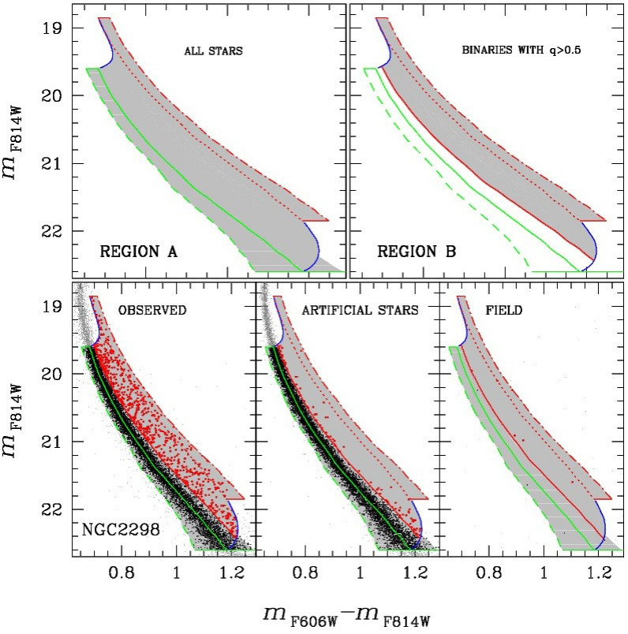

# age dating from the wd luminosity function

a simple stellar population produces white dwarfs continuously: every star massive enough to have evolved off the MS by now is sitting on the cooling sequence somewhere. because all WDs cool monotonically, the **luminosity function (LF)** of the WDCS contains a complete history of star formation in that population. the key feature is the **faint truncation**: the oldest WDs are also the dimmest, and the LF cuts off at a luminosity corresponding to the cooling time of the oldest WDs. that truncation luminosity is a direct age indicator.

## the method

the procedure (originating with Hansen et al. 2007 for NGC 6397) is:

1. obtain a deep CMD reaching well below the bottom of the WDCS in a nearby cluster. this requires HST or comparable resolution because WDs are very faint (faint absolute magnitudes around $M_{F606W} \sim 15$).
2. clean the CMD with proper motions to remove field-star contamination and identify the cluster WDCS.
3. construct the cluster-WD luminosity function in F814W or F606W.
4. compare with synthetic LFs from stellar evolution + WD cooling models (Mestel cooling plus crystallisation, plus realistic atmospheres handling [[WDCS turn to blue and CIA]]) at different ages.
5. the age that best matches the **position of the LF peak and the faint cutoff** is the WDCS age.

## NGC 6397 - the textbook case

NGC 6397 is a metal-poor halo globular cluster ([Fe/H] $\approx -2.1$) and sits close enough that HST/ACS can reach its faint WDs.  Hansen et al. (2007) found
$$t_{\rm WDCS} = 11.47 \pm 0.47\;\text{Gyr},$$
in striking agreement with the main-sequence turnoff age $t_{\rm MSTO} = 11.6 \pm 1.0$ Gyr. the agreement, derived from completely different stellar physics (degenerate cooling on one side, hydrogen burning and convective core overshooting on the other), is a strong validation of both methods.

## age sensitivity

the WDCS LF is increasingly age-sensitive at old ages: the cooling slows ($t_{\rm cool} \propto L^{-5/7}$, see [[White dwarf cooling theory]]), so the same age difference produces a larger luminosity gap as ages grow. quantitative estimates from simulations (Cassisi):
- at 12-13 Gyr, $\Delta(F606W) \sim 0.1$ mag / Gyr
- at 2-3 Gyr, $\Delta(F606W) \sim 0.4$ mag / Gyr.

at old ages, this is comparable to the sensitivity of the [[HR diagram]] main-sequence turnoff position itself.

## advantages

- nearly **metallicity-independent**. the position of the WDCS in the CMD shifts very little with [Fe/H], unlike the MS turnoff which is highly metallicity-dependent (see [[Spectroscopic determination of metallicity]] and [[Color-magnitude diagrams of clusters]]).
- **independent stellar physics** from the MSTO. degenerate matter, conductive opacities, ion crystallisation. nothing to do with H burning, convection, or overshooting. agreement between the two ages is therefore a real cross-check.

## limitations

- WDs are faint, so reaching the truncation requires nearby clusters. only a handful of GCs (47 Tuc, NGC 6397, M4) and a few open clusters (NGC 6791, NGC 188) have published WDCS ages.
- WD masses depend on the IFMR (see [[Initial-final mass relation IFMR]]). Errors there feed into the cooling time.
- pollution by Unresolved binary stars (WD+WD pairs in particular) produces double peaks in the LF, as in NGC 6791, and must be modelled (see [[WDCS vs MSTO ages comparison]]).

<!-- sources:wiki-arxiv -->
## Wikipedia and arXiv sources

*Placed pointer to Sirius B* ([Commons file page](https://commons.wikimedia.org/wiki/File:Sirius_A_and_B_Hubble_photo.editted.PNG), NASA, ESA, H. Bond (STScI), and M. Barstow (University of Leicester); modified by Bokus, Public domain, as used on the Wikipedia article [White dwarf](https://en.wikipedia.org/wiki/White_dwarf))

- **White dwarf**. "A white dwarf is a very dense type of star: in an Earth-sized volume, it packs a mass that is comparable to the Sun. A white dwarf radiates light from residual heat and eventual crystallization, not from nuclear fusion. Stars like the Sun, whose mass is not high enough to collapse into a neutron star or black hole, are expected to become white dwarf stars later in their evolution." ([Wikipedia](https://en.wikipedia.org/wiki/White_dwarf))
- **Evolutionary and pulsational properties of white dwarf stars**. "Abridged. White dwarf stars are the final evolutionary stage of the vast majority of stars, including our Sun. The study of white dwarfs has potential applications to different fields of astrophysics." ([arXiv:1007.2659](https://arxiv.org/abs/1007.2659))

> Definitions quoted from Wikipedia (CC BY-SA 4.0) and the arXiv abstract. Figures credited in their captions.
<!-- /sources:wiki-arxiv -->

## see also
- [[White dwarf cooling theory]]
- [[WDCS turn to blue and CIA]]
- [[WDCS vs MSTO ages comparison]]
- [[Color-magnitude diagrams of clusters]]
- [[Initial-final mass relation IFMR]]
- [[Stellar_Astrophysics_MOC]]

## Linked References

- [[Initial-final mass relation IFMR]]
- [[WDCS turn to blue and CIA]]
- [[WDCS vs MSTO ages comparison]]
- [[White dwarf cooling sequence on the CMD]]
- [[White dwarf cooling theory]]
- [[White dwarf mass-radius relation]]
- [[Stellar_Astrophysics_MOC]]

