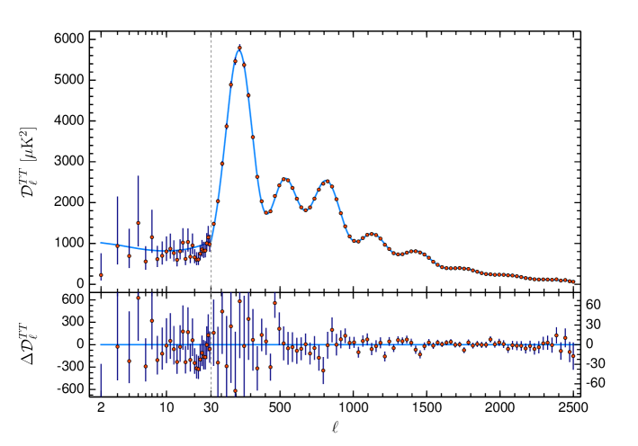
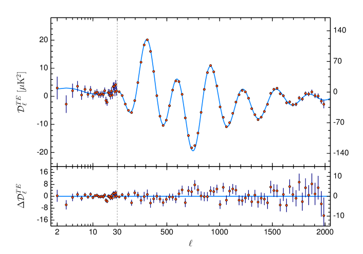

the **CMB angular power spectrum** $C_\ell$ is the variance of CMB temperature anisotropies at multipole $\ell$ (corresponding to angular scale $\theta \sim 180°/\ell$). its **peak structure** encodes most of cosmological physics.

## the definition

decompose the CMB temperature map in spherical harmonics:
$$T(\theta, \phi) - \bar T = \sum_{\ell, m} a_{\ell m}\,Y_\ell^m(\theta, \phi)$$

the **power spectrum**:
$$C_\ell \equiv \frac{1}{2\ell + 1}\sum_m \lvert a_{\ell m}\rvert^2$$

usually plotted as $D_\ell \equiv \ell(\ell+1)C_\ell/(2\pi)$ (which gives a roughly horizontal flat band at the Sachs-Wolfe plateau, easier to see structure on).

## the structure - acoustic peaks

main features:

| peak | $\ell$ | physics |
|---|---|---|
| first | $\approx 220$ | sound horizon at recombination subtends $\sim 1°$ today |
| second | $\approx 540$ | first compression after sound horizon traversal |
| third | $\approx 800$ | second compression |
| ... | ... | progressively damped by photon diffusion |
| Silk damping | $\ell \gtrsim 1000$ | exponential cutoff |

at lower $\ell$ (super-horizon), the spectrum is dominated by the **Sachs-Wolfe plateau**: photons climbing out of gravitational wells.

at high $\ell$, **secondary anisotropies** kick in: SZ effect, lensing.

## what each peak teaches

### first peak position $\ell_1 \approx 220$

set by the angular diameter distance to recombination + the sound horizon at recombination:
$$\ell_1 = \pi d_A(z = 1100)/r_s$$

with $r_s \approx 150$ Mpc (sound horizon, computable from $\Omega_b h^2$, $\Omega_c h^2$). measuring $\ell_1$ pins down the **geometry** of the universe: $\Omega_K$ to $0.5\%$ precision.

a flat universe gives $\ell_1 \approx 220$. open: smaller. closed: larger. Planck data give $\Omega_K \approx 0$.

### second / first peak ratio

ratio $C_{\ell_2}/C_{\ell_1}$ depends on the **baryon density** $\Omega_b h^2$:
- more baryons = heavier "fluid" = lower sound speed = compression peaks **enhanced** + rarefaction peaks **suppressed**.
- so a higher first/second ratio = higher $\Omega_b$.

Planck: $\Omega_b h^2 = 0.0224 \pm 0.0001$. consistent with BBN.

### third peak height

third peak's height depends on **dark matter density** $\Omega_c h^2$:
- more dark matter = larger gravity-driving forces = larger compression peaks.
- specifically: relative heights of peak 2, 3 fix $\Omega_m h^2 \approx 0.143$.

### damping tail

at $\ell > 1000$, **photon diffusion** (Silk damping) exponentially suppresses peaks. damping scale $\propto \Omega_b^{-1/2}$. tightly constrains $\Omega_b h^2$.

### Sachs-Wolfe plateau ($\ell < 100$)

dominated by the **late-time integrated Sachs-Wolfe (ISW) effect**: photons climbing out of evolving gravitational wells in the dark-energy era. provides direct probe of $\Omega_\Lambda$.

## the physical origin

before recombination: photons + baryons + electrons form a tightly-coupled fluid. perturbations oscillate as **sound waves**. at recombination, the photons free-stream away, **freezing in** the oscillation pattern.

modes that have **just completed** an oscillation at recombination $\to$ compression maximum $\to$ acoustic peak. modes at the **midpoint** of an oscillation $\to$ trough.

so the peak positions encode the sound horizon at recombination (a known scale), and the heights encode the relative pressure / gravity.

## worked example

the multipole of the first peak. with $r_s = 147$ Mpc and $d_M(1090) = 14.0$ Gpc, $\theta_s = 0.0105$ rad and $\ell_1 \approx \pi/\theta_s \approx 300$. the observed peak is at 220 because the acoustic phase is shifted by the potential.

## where it goes wrong

- cosmic variance limits the low multipoles. there are only $2\ell + 1$ modes at each $\ell$.
- $\ell(\ell + 1)C_\ell/2\pi$ is plotted, not $C_\ell$.

<!-- sources:wiki-arxiv -->
## Wikipedia and arXiv sources

*This map of the Cosmic Microwave Background radiation, imprinted on the sky when the universe was 370,000 years old, shows tiny temperature fluctuations that correspond to regions of slightly different densities* ([Commons file page](https://commons.wikimedia.org/wiki/File:Cosmic_Microwave_Background_%28CMB%29.jpeg), ESA and the Planck Collaboration, CC BY 4.0, as used on the Wikipedia article [Cosmic microwave background](https://en.wikipedia.org/wiki/Cosmic_microwave_background))

- **Cosmic microwave background**. "The cosmic microwave background (CMB, CMBR), or relic radiation, is microwave radiation that fills all space in the observable universe. With a standard optical telescope, the background space between stars and galaxies is almost completely dark. However, a sufficiently sensitive radio telescope detects a faint background glow that is almost uniform and is not associated with any star, galaxy, or other object." ([Wikipedia](https://en.wikipedia.org/wiki/Cosmic_microwave_background))
- **Cosmic Microwave Background Anisotropies**. "Cosmic microwave background (CMB) temperature anisotropies have and will continue to revolutionize our understanding of cosmology." ([arXiv:astro-ph/0110414](https://arxiv.org/abs/astro-ph/0110414))

> Definitions quoted from Wikipedia (CC BY-SA 4.0) and the arXiv abstract. Figures credited in their captions.
<!-- /sources:wiki-arxiv -->

## see also

- CMB, discovery and blackbody spectrum
- [[CMB anisotropies]]
- [[Polarization E and B modes]]
- [[Photon decoupling and CMB]]
- [[Saha equation and recombination]]
- [[Linear evolution of perturbations in expanding universe]]
- [[ΛCDM current parameters]]
- [[Inflation overview]]
- [[Matter power spectrum and BAO]]
- [[Observational_Cosmology_MOC]]

---

### Observational Cosmology Data Panels & Visual Evidence

*Planck 2018 CMB Temperature Angular Power Spectrum $D_\ell^{TT} = \ell(\ell+1)C_\ell/(2\pi)$ vs multipole $\ell \in [2, 2500]$, showing acoustic peaks at $\ell \approx 220, 540, 800$ and Silk damping tail.*

*Planck 2018 Temperature-E-mode Polarization cross-correlation spectrum $D_\ell^{TE}$, confirming acoustic oscillations in phase with velocity perturbations at decoupling.*

## Linked References

- [[Angular diameter distance]]
- [[CMB - discovery and blackbody spectrum]]
- [[CMB anisotropies]]
- [[Cosmological evolution of perturbations in the cosmic fluid]]
- [[Cosmological inflation]]
- [[Curvature-dynamics relation]]
- [[Lambda CDM current parameters]]
- [[LambdaCDM current parameters]]
- [[Lensing as a cosmological probe]]
- [[Polarization E and B modes]]
- [[SVT decomposition]]
- [[Surveys to remember]]
- [[ΛCDM current parameters]]
- [[Observational_Cosmology_MOC]]

