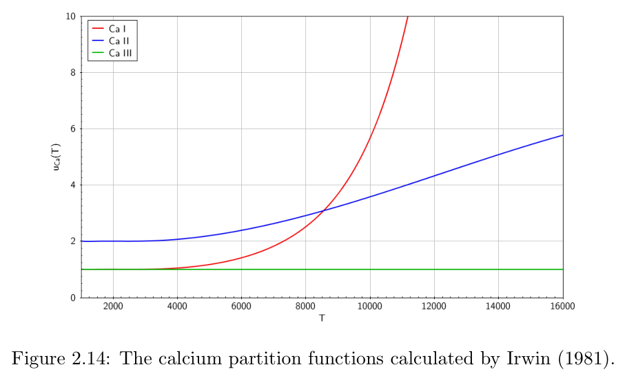
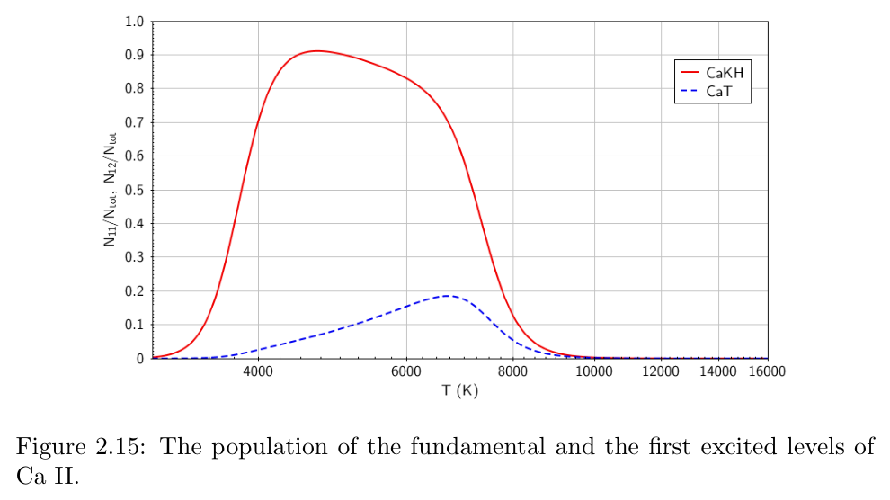
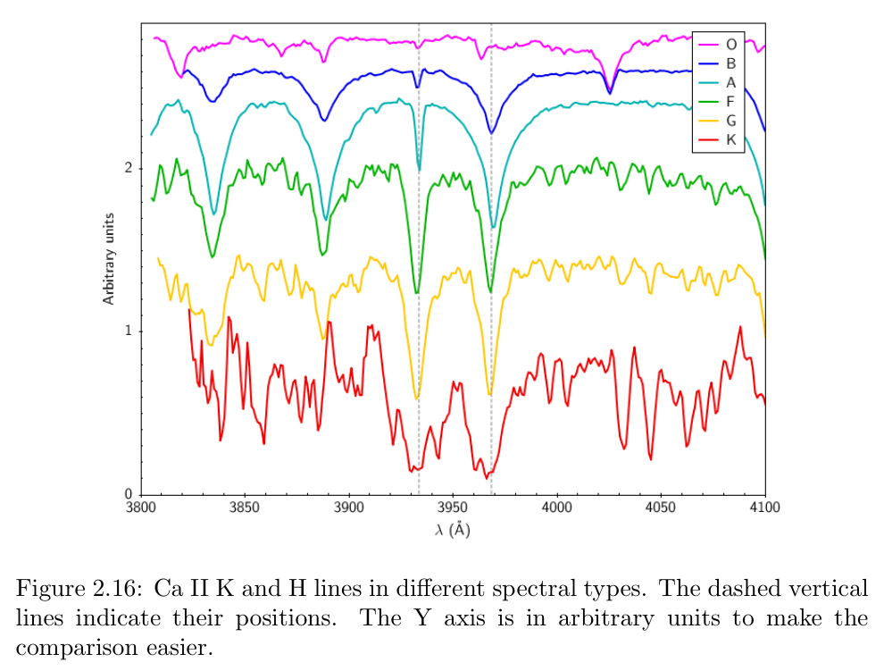
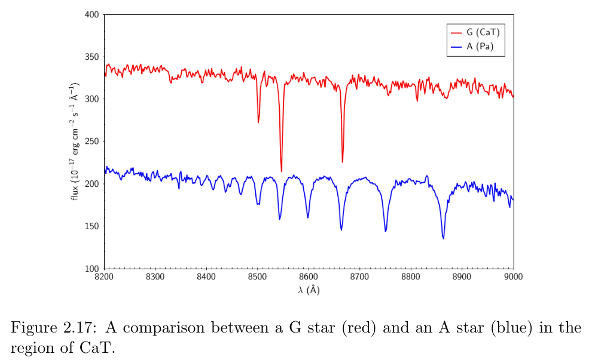

Ca has $\chi_{\rm CaI} = 6.11$ eV and $\chi_{\rm CaII} = 11.87$ eV, intermediate values. consequence: Ca II lines (especially the famous H + K at $3934, 3968$ Å) dominate stellar spectra in the largest temperature range of any species.

## Ca II H + K population

Ca II ground state is $4s^1\,^2S_{1/2}$, just like an alkali. the H + K resonance lines come from the ground, so the lower-level Boltzmann factor is $1$.

so the line strength is just $f_{\rm CaII}(T)$, the fraction of Ca in the singly-ionised stage.

at low $T$: most Ca is neutral $\to$ small $f_{\rm CaII}$, weak H + K.
at intermediate $T$: most Ca is $\rm Ca^+$, $f_{\rm CaII} \approx 1$, **maximum H + K strength**.
at high $T$: $\rm Ca^+$ ionises to $\rm Ca^{2+}$, $f_{\rm CaII}$ drops, H + K weakens.

the singly ionised regime is broad because $\chi_{\rm CaI}$ is small (easy to remove first electron) but $\chi_{\rm CaII}$ is much larger (hard to remove second). so a wide $T$ range keeps Ca in the $\rm Ca^+$ state.

## benchmark values

at typical $n_e$:
at Ciroi's $P_e = 1$ Pa (computed by me, with $u_0 = 1$, $u_1 = 2$, $u_2 = 1$ in place of Irwin's $u(T)$):
- $T = 3000$ K: mostly Ca I, $f_{\rm CaII} = 3.5\times10^{-3}$.
- $T = 4000$ K: $0.73$.
- $T = 5460$ K: $\approx 1$, the maximum. **H + K dominant**.
- $T = 7500$ K: $0.37$, Ca$^{2+}$ taking over.
- $T = 10\,000$ K: $2.9\times10^{-3}$.

higher $P_e$ in hot-star atmospheres (up to $\sim 100$ Pa) pushes the decline to higher $T$, which is why Ciroi finds Ca II "well detected up to A stars". (an older version of this list put $f_{\rm CaII} \approx 0.7$ at A0, which this model does not give.)

so Ca II H + K are strong from M through early A, peaking around G-K. the broadest temperature range of any species.

## figures

Ciroi's Figs. 2.14 to 2.17 below: Irwin's partition functions, the populations of the Ca II ground and $3\,^2D$ levels, H and K across spectral types, and the Ca triplet in a G against an A star.

## why Ca II is so prominent in galaxy spectra

galaxy integrated light is dominated by **G and K stars** (most numerous in the IMF, longest MS lifetime). these stars all have very strong Ca II H + K. so old galaxy spectra show massive H + K absorption, contributing to the **$4000$ Å break** ([[Calcium and CaII H+K]]).

so Ca II H + K are simultaneously:
- a **stellar temperature thermometer** in F-G-K dwarfs (line shape changes).
- a **luminosity discriminator** via line wings (pressure broadening differs between dwarfs and giants).
- a **galaxy redshift indicator** (the most-used absorption feature in $z \sim 0$ to $1$ surveys).
- a **velocity dispersion measurement tool** (line width = stellar kinematic dispersion in galaxies).

## the Ca II IR triplet

Ca II also has a strong NIR triplet at $8498, 8542, 8662$ Å from $3\,^2D \to 4\,^2P^o$. similar $T$ behaviour to H + K. preferred for galaxy velocity dispersions in the NIR clean continuum window.

<!-- ciroi-sync -->
## In Ciroi's notes

Ca II ($1s^22s^22p^63s^23p^64s^1$): ground $4\,^2S_{1/2}$, first excited $3\,^2D_{3/2,5/2}$ at 1.69 and 1.70 eV, then $4\,^2P_{1/2,3/2}$ at 3.12 and 3.15 eV. Levels 1 to 3 give H and K, levels 2 to 3 the red triplet CaT (Ciroi's notes, p. 30 to Ciroi's notes, p. 32). With $P_e = 1$ Pa, $N_1/N_0 \simeq 0.0666\,(u_1/u_0)T^{5/2}e^{-70935.128/T}$ ($\chi_0 = 6.113$ eV), $N_2/N_1 \simeq 0.0666\,(u_2/u_1)T^{5/2}e^{-137750.844/T}$ ($\chi_1 = 11.871$ eV), and for CaT $N_{12}/N_1 = (10/u_1)e^{-19726.765/T}$.

Two observational points from the notes:
- In F, G and K stars K and H are both strong. Towards hotter stars K fades while H seems to strengthen, because H (3968.5 Å) blends with H$\varepsilon$ (3970.1 Å), which grows as the Balmer lines grow.
- In A stars the Paschen lines sit on top of the Ca triplet and hide it (Fig. 2.17).
<!-- /ciroi-sync -->

<!-- spec-figures -->
## Figures

*Figure 2.14 of Ciroi's notes: The calcium partition functions calculated by Irwin (1981).* (Ciroi's notes, p. 33)

*Figure 2.15 of Ciroi's notes: The population of the fundamental and the first excited levels of Ca II.* (Ciroi's notes, p. 33)

*Figure 2.16 of Ciroi's notes: Ca II K and H lines in different spectral types. The dashed vertical lines indicate their positions. The Y axis is in arbitrary units to make the comparison easier.* (Ciroi's notes, p. 34)

*Figure 2.17 of Ciroi's notes: A comparison between a G star (red) and an A star (blue) in the region of CaT.* (Ciroi's notes, p. 34)
<!-- /spec-figures -->

<!-- sources:wiki-arxiv -->
## Wikipedia and arXiv sources

- **Saha ionization equation**. "In physics, the Saha ionization equation is an expression that relates the ionization state of a gas in thermal equilibrium to the temperature and pressure. The equation is a result of combining ideas of quantum mechanics and statistical mechanics and is used to explain the spectral classification of stars. The expression was developed by physicist Meghnad Saha in 1920." ([Wikipedia](https://en.wikipedia.org/wiki/Saha_ionization_equation))

> Definitions quoted from Wikipedia (CC BY-SA 4.0). Figures credited in their captions.
<!-- /sources:wiki-arxiv -->

## see also

- [[Calcium and CaII H+K]]
- [[Boltzmann equation in spectroscopy]]
- [[Saha ionisation equation]]
- [[Population of excited levels]]
- [[Why the Sequence OBAFGKM]]
- [[Stellar spectra and spectral classification]]
- [[Color-magnitude diagrams of clusters]]
- [[Single stellar population SSP]]
## Linked References

- [[Calcium and CaII H+K]]
- [[Population of excited levels]]
- [[Why the Sequence OBAFGKM]]
- [[Astronomical_Spectroscopy_MOC]]

