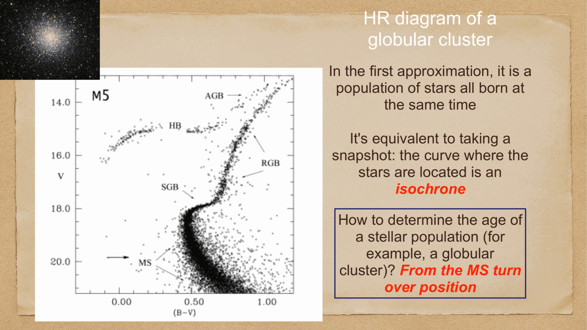
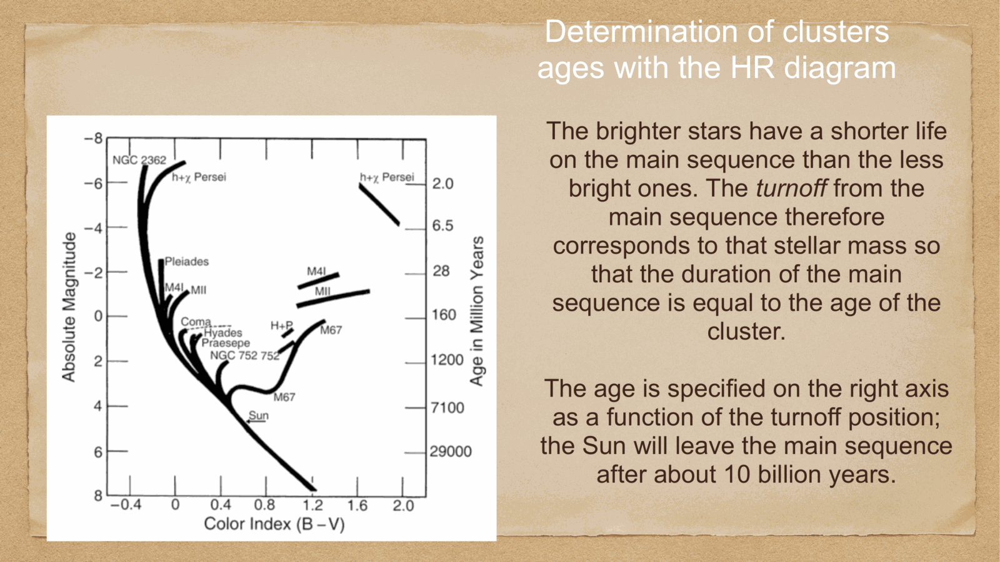
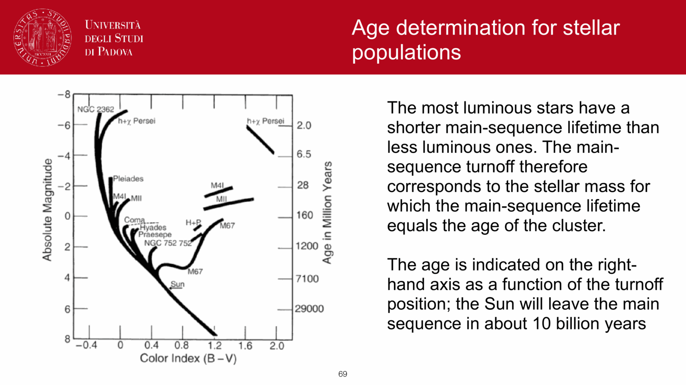
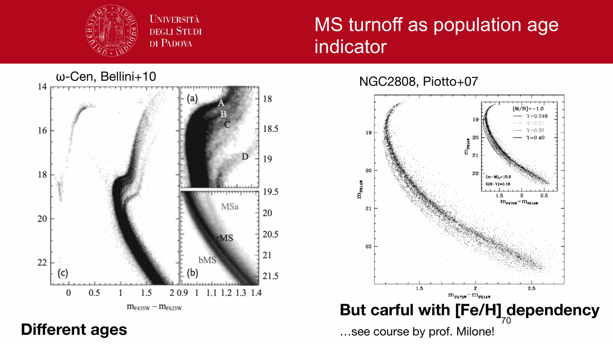
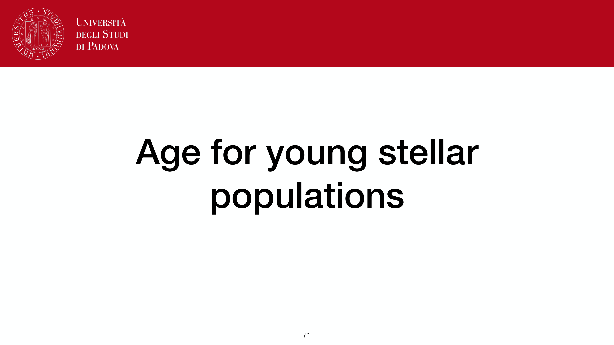
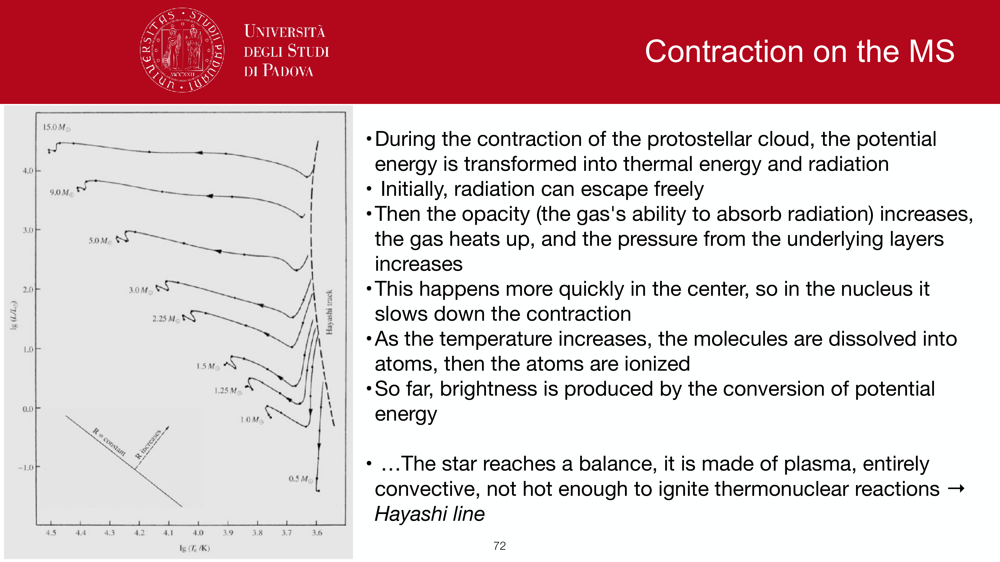
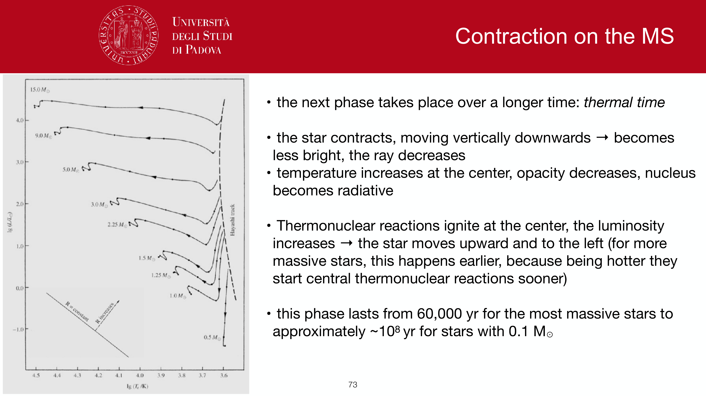
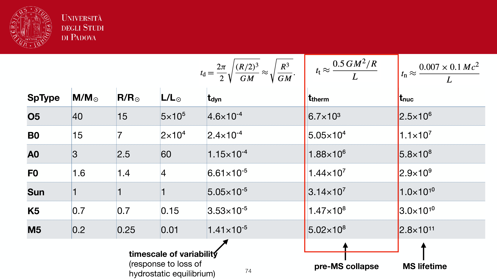
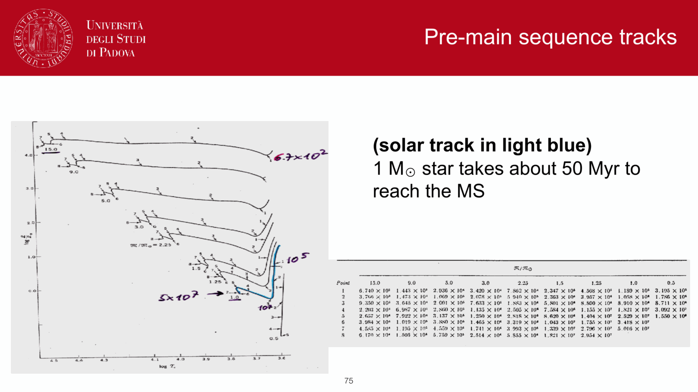
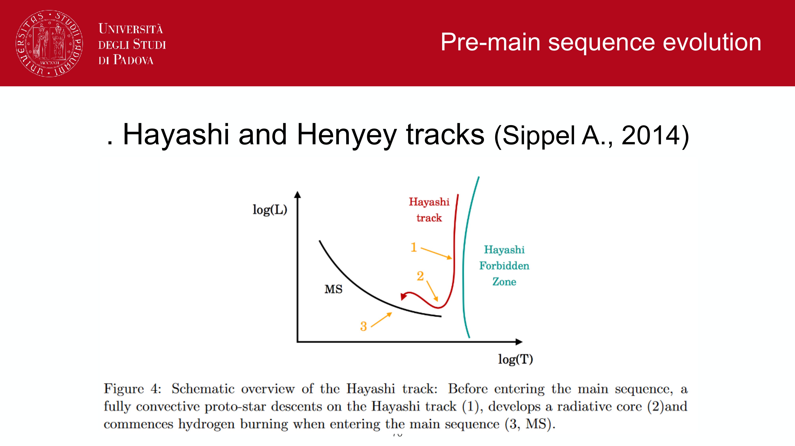

star clusters (both **open clusters** like the Pleiades and **globular clusters** like M13) are ideal natural astrophysical laboratories because all member stars share three properties:
1. **same distance** $d$ from Earth (distance modulus $\mu = m - M$ is identical for all cluster members).
2. **same age** $t$ (all stars formed essentially simultaneously in a single starburst).
3. **same initial chemical composition** (same metallicity $[\text{Fe}/\text{H}]$).

consequence: plotting a cluster's color-magnitude diagram (CMD) provides a direct snapshot of stellar evolution for stars of different masses at a single fixed age: an **isochrone**.

---

## the Main Sequence Turnoff (MSTO)

as a cluster ages, stars peel off the main sequence from top to bottom, because more massive stars have much shorter lifetimes ($t_{\text{MS}} \propto M^{-2.5}$).

the highest, hottest, most luminous point still remaining on the main sequence is the **Main Sequence Turnoff (MSTO)**.
- stars with $M > M_{\text{TO}}$ have already exhausted their core hydrogen and evolved into red giants, supergiants, or compact remnants.
- stars with $M < M_{\text{TO}}$ are still burning hydrogen on the main sequence.

### determining cluster age
measuring the luminosity $L_{\text{TO}}$ or mass $M_{\text{TO}}$ of stars at the turnoff gives the cluster age directly:
$$\boxed{\, t_{\text{cluster}} \approx 10^{10} \left(\frac{M_{\text{TO}}}{M_\odot}\right)^{-2.5} \text{ yr} \approx 10^{10} \left(\frac{L_{\text{TO}}}{L_\odot}\right)^{-2.5/3.5} \text{ yr} \,}$$

### benchmark ages
- **young open clusters (e.g. Pleiades, h & $\chi$ Persei)**: turnoff at spectral type B or A $\implies$ ages $t \sim 10^7 - 10^8$ years.
- **intermediate open clusters (e.g. Hyades, M67)**: turnoff near F stars $\implies$ ages $t \sim 6 \times 10^8 - 4 \times 10^9$ years.
- **ancient Galactic globular clusters (e.g. M92, 47 Tuc)**: turnoff near G dwarfs ($M_{\text{TO}} \approx 0.8 M_\odot$) $\implies$ ages **$t \approx 12 - 13.5$ billion years**! 

globular clusters represent the oldest stellar populations in the Milky Way, setting a strict lower limit on the age of the Universe ($t_{\text{Univ}} > 13$ Gyr), in complete concordance with Planck CMB cosmology ($t_0 = 13.8$ Gyr).

---

## the turnoff mass and age relation, derived

assumptions: a star leaves the main sequence when it has burned a fixed fraction of its hydrogen, and on the main sequence $L \propto M^{3.5}$.

the fuel is proportional to $M$ and the burning rate is $L$, so the main-sequence lifetime is

$$t_{\rm MS} \simeq 10\ \text{Gyr}\,\left(\frac{M}{M_\odot}\right)\left(\frac{L}{L_\odot}\right)^{-1} = 10\ \text{Gyr}\,\left(\frac{M}{M_\odot}\right)^{-2.5}$$

the $10$ Gyr comes from the Sun: about 10% of its mass burns, with an efficiency of $0.007$, at $L_\odot$.

in a cluster of age $t$ the stars now leaving the main sequence are those with $t_{\rm MS} = t$. inverting:

$$\boxed{\, \frac{M_{\rm TO}}{M_\odot} = \left(\frac{t}{10\ \text{Gyr}}\right)^{-0.4}, \qquad \frac{L_{\rm TO}}{L_\odot} = \left(\frac{t}{10\ \text{Gyr}}\right)^{-1.4} \,}$$

so the turnoff is a **clock**. it gets fainter and redder as the cluster ages.

## worked examples

- **Pleiades**, $t \approx 125$ Myr: $M_{\rm TO} = (0.0125)^{-0.4} \approx 5.8\,M_\odot$, a B star.
- **M67**, $t \approx 4$ Gyr: $M_{\rm TO} = (0.4)^{-0.4} \approx 1.4\,M_\odot$, an F star.
- **a globular cluster**, $t \approx 12.5$ Gyr: $M_{\rm TO} = (1.25)^{-0.4} \approx 0.9\,M_\odot$. detailed models for metal-poor stars give $0.8\,M_\odot$.

## how good the age is

from $L_{\rm TO} \propto t^{-1.4}$, a fractional error in the turnoff luminosity gives $\delta t/t = \delta L/(1.4\,L)$. an error of $0.1$ mag in the distance modulus is about 10% in luminosity, so about **7 to 10% in age**. for a globular cluster that is one billion years, from the distance alone.

two methods avoid the distance:

- the **vertical method** uses the magnitude difference between the turnoff and the horizontal branch, $\Delta V_{\rm TO}^{\rm HB}$. the horizontal branch barely moves with age while the turnoff fades, so the difference grows with age.
- the **horizontal method** uses the colour difference between the turnoff and the base of the red giant branch, which shrinks with age.

both are independent of distance and reddening, but they need the metallicity.

## where it goes wrong

- reading the turnoff without fitting an isochrone of the right **metallicity**. metal-poor stars are hotter and brighter at the same mass, so a wrong $[\mathrm{Fe}/\mathrm{H}]$ shifts the age.
- taking **blue stragglers** for the turnoff. they sit above it and would give an age that is too young.
- ignoring **unresolved binaries**, which broaden the main sequence up to 0.75 mag above the single-star line.
- in clusters of 1 to 2 Gyr the turnoff is **extended**, mostly because of stellar rotation, and a single age does not describe it.

<!-- sources:wiki-arxiv -->
## Wikipedia and arXiv sources

*HR diagrams for two open clusters, showing the main sequence turn-off at different ages* ([Commons file page](https://commons.wikimedia.org/wiki/File:Open_cluster_HR_diagram_ages.gif), Created by User:Worldtraveller, CC BY-SA 3.0, as used on the Wikipedia article [Main sequence turnoff](https://en.wikipedia.org/wiki/Main_sequence_turnoff))

- **Main sequence turnoff**. "The turnoff point for a star refers to the point on the Hertzsprung–Russell diagram where it leaves the main sequence after its main fuel is exhausted – the main sequence turnoff. By plotting the turnoff points of individual stars in a star cluster one can estimate the cluster's age." ([Wikipedia](https://en.wikipedia.org/wiki/Main_sequence_turnoff))

> Definitions quoted from Wikipedia (CC BY-SA 4.0). Figures credited in their captions.
<!-- /sources:wiki-arxiv -->

## see also

- [[Fundamentals_Astrophysics_Cosmology_MOC]]
- [[HR diagram]]
- [[Stellar scaling relations]]
- [[Solar evolution and final stages]]
- [[Stellar populations I II III]]

---

## observational astrophysics course slides (Prof. Paolo Cassata)

*Main Sequence Turn-Off (MSTO) point: stars at the turn-off are exhausting core hydrogen.*

*Turn-off mass M_TO determines cluster age: age proportional to M_TO^(-2.5).*

*Isochrone fitting: theoretical curves of constant age overlaid on observational CMD.*

*Vertical method: Delta V_TO^HB (magnitude difference between turnoff and horizontal branch).*

*Horizontal method: delta(B - V) (color difference between turnoff and base of red giant branch).*

*Age of the oldest globular clusters (~12.8 +/- 0.5 Gyr) providing cosmic lower age bound.*

*Blue stragglers: stars above the turn-off formed by binary mass transfer or stellar collisions.*

*Multiple stellar populations in globular clusters (light element abundance anomalies).*

## Linked References

- [[Age estimation in unresolved populations]]
- [[Age-metallicity degeneracy]]
- [[Color-magnitude diagrams of clusters]]
- [[HR diagram]]
- [[Main sequence, giants, supergiants, white dwarfs]]
- [[Metallicity and chemical evolution]]
- [[Single stellar population SSP]]
- [[Solar evolution and final stages]]
- [[Spectroscopic parallax and main-sequence fitting]]
- [[Stellar populations I II III]]
- [[Fundamentals_Astrophysics_Cosmology_MOC]]
- [[Observational_Astrophysics_MOC]]

