"matter" in cosmology means non-relativistic, pressureless stuff. the four baryon methods (see [[Cosmic_inventory_baryons]]) depend on photon-matter interaction. there are *other* methods that bypass photons entirely and exploit gravity:

> *typically one exploits the gravitational effects that matter determines, e.g. the gravitational field produced by a given system from which one infers the mass of the system.*

these methods consistently give a total matter density several times the baryon density. the difference is **dark matter**: non-relativistic, effectively pressureless, gravitationally interacting, but invisible to photons.

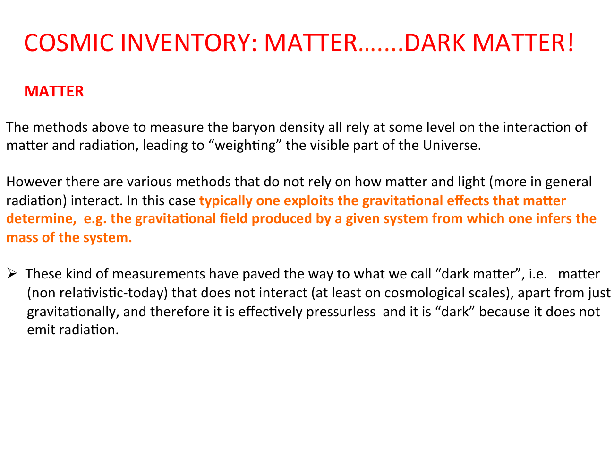

---

## the answer

from Planck 2018:
$$\boxed{\,\Omega_m = 0.315 \pm 0.007, \quad \Omega_{dm} h^2 = 0.120 \pm 0.001\,}$$

so the matter density is about **five times the baryon density**. *most of the matter in the universe is not baryons.* dark matter is some new particle species (or species).

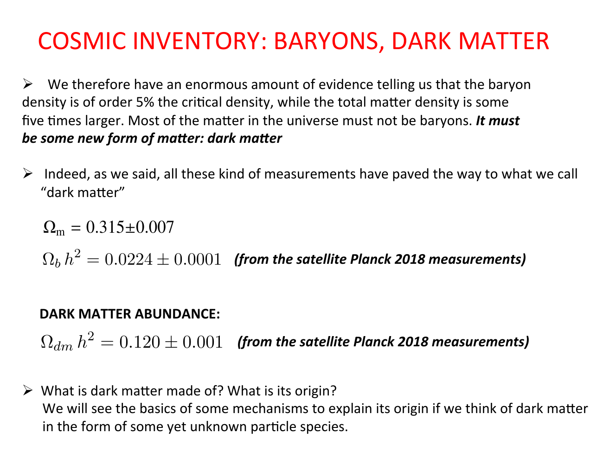

---

## evidence on galactic scales - rotation curves

textbook argument. for a circular orbit at radius $r$ inside a spherical mass distribution $M(r)$:
$$V^2(r) = \frac{GM(r)}{r}$$

if all the mass is luminous and concentrated in a stellar disk, then beyond the disk edge $r_*$ the enclosed mass is constant and the velocity drops:
$$V(r) \propto \frac{1}{r^{1/2}} \qquad \text{(Keplerian fall-off)}$$

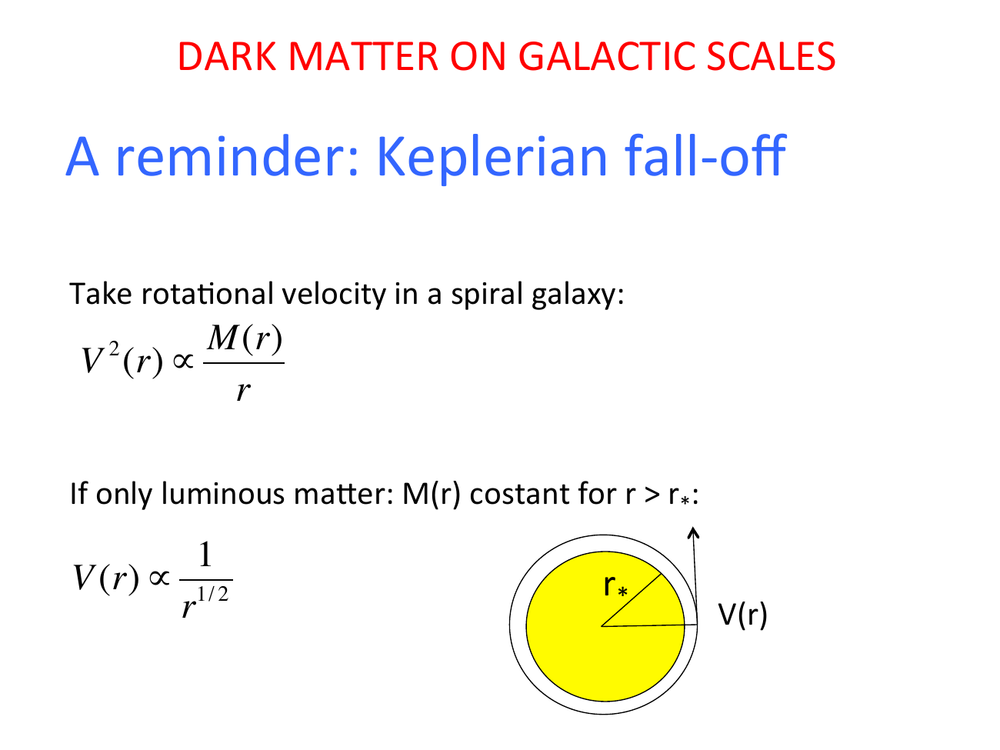

what we *observe* is completely different. neutral hydrogen (21-cm) observations probe rotation way past the optical disk, and the curves stay **flat**. flat $V(r)$ means $M(r) \propto r$, so there is mass distributed at large radii that does not emit light.

### measuring rotation curves

a galaxy is parametrized by its center, systemic velocity $V_{sys}$, circular velocity $V(R)$, inclination $i$, azimuth $\theta$:
$$V_{obs}(\xi, \eta) = V_{sys} + V(R)\cos\theta\sin i$$

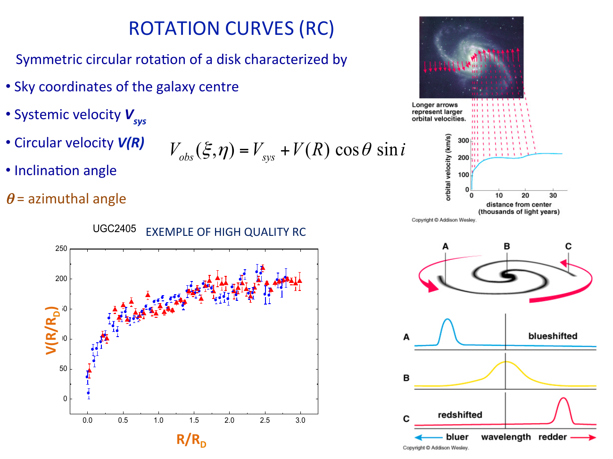

velocities are measured from Doppler shifts of emission lines (one side blueshifted, one redshifted).

### historical surveys

Rubin & Ford (1970), Roberts & Whitehurst (1975), the entire Rubin sample of 21 Sc galaxies (1980) all show: **no rotation curve follows the stellar disk velocity profile**.

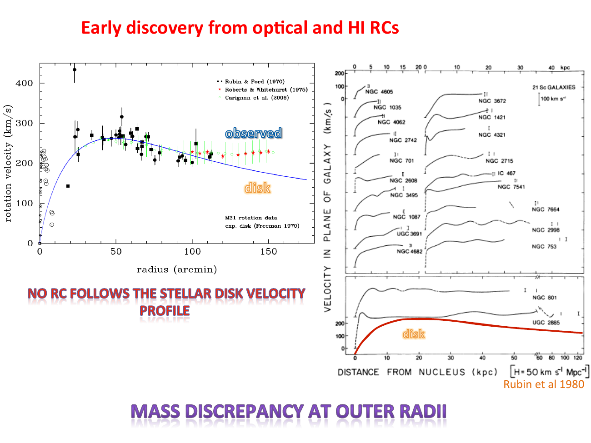

### decomposing the rotation curve

modern analysis fits the observed $V(r)$ as the sum of three components: stellar disk + gas + dark matter halo.

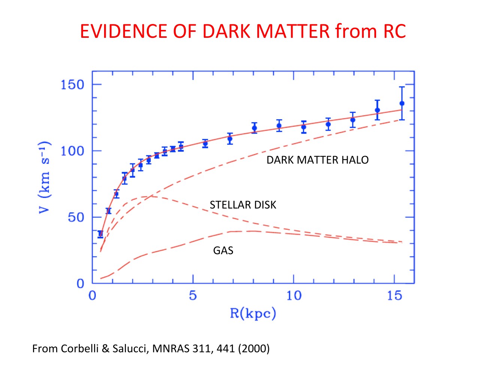

the stellar disk peaks and falls off, the gas rises slowly, the dark matter halo dominates at large radius. without a halo the high-$r$ flat curve cannot be explained. (Corbelli & Salucci 2000 for M33.)

---

## evidence on cosmological scales

galactic rotation curves only give a *galaxy-scale* measurement. the more compelling evidence comes from cosmological scales:

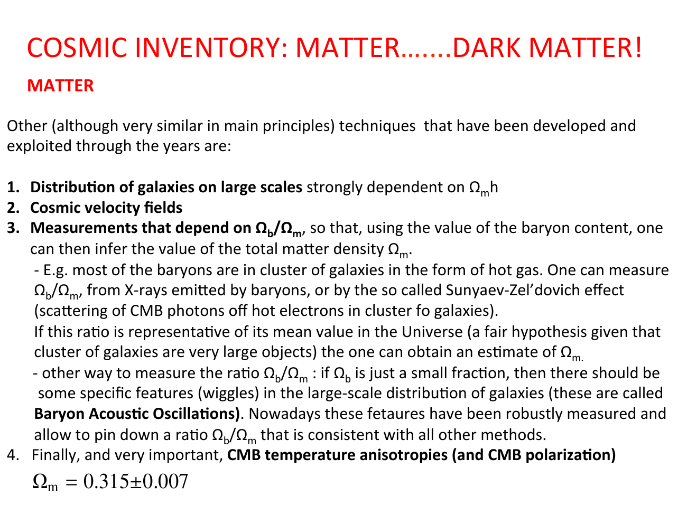

1. **distribution of galaxies on large scales** - strongly dependent on $\Omega_m h$
2. **cosmic velocity fields** - peculiar motions trace the underlying gravitational potential
3. **measurements that depend on $\Omega_b/\Omega_m$**, like:
   - X-ray and Sunyaev-Zel'dovich measurements of cluster gas
   - **baryon acoustic oscillations** in the matter power spectrum (see [[Matter power spectrum and BAO]])
4. **CMB temperature anisotropies and polarization** - the peak heights fix $\Omega_m h^2$

### CMB anisotropies fix the total matter

the relative heights of the second, third, fourth peaks fix $\Omega_m h^2$:

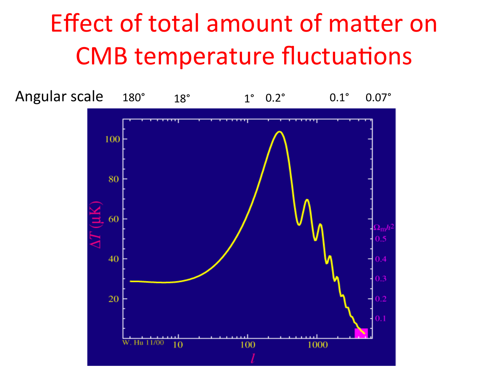

### mass-to-light ratio across scales

a direct check. $M/L_B$ vs scale: luminous matter tracks $L$, total mass tracks $M$. if $M/L$ stayed constant with scale, all matter would be luminous. it does not.

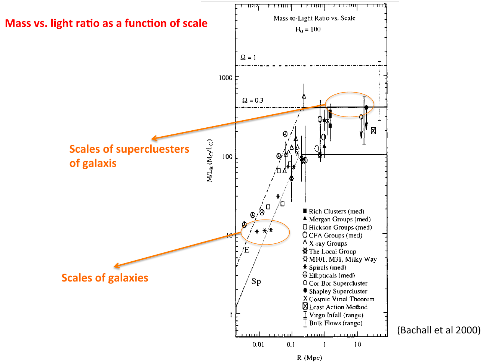

at galactic scales (spirals, ellipticals): $M/L \sim 10$ in solar units. at cluster scales (rich clusters, superclusters): $M/L \sim 200\text{-}300$, consistent with $\Omega_m \approx 0.3$. the rise tells you the dark matter fraction increases on larger scales.

### the BAO smoking gun

a universe of pure baryons would have huge oscillations in $P_m(k)$. our universe has small wiggles on top of a smooth dark-matter power-law. the data agree with the dark-matter-dominated prediction.

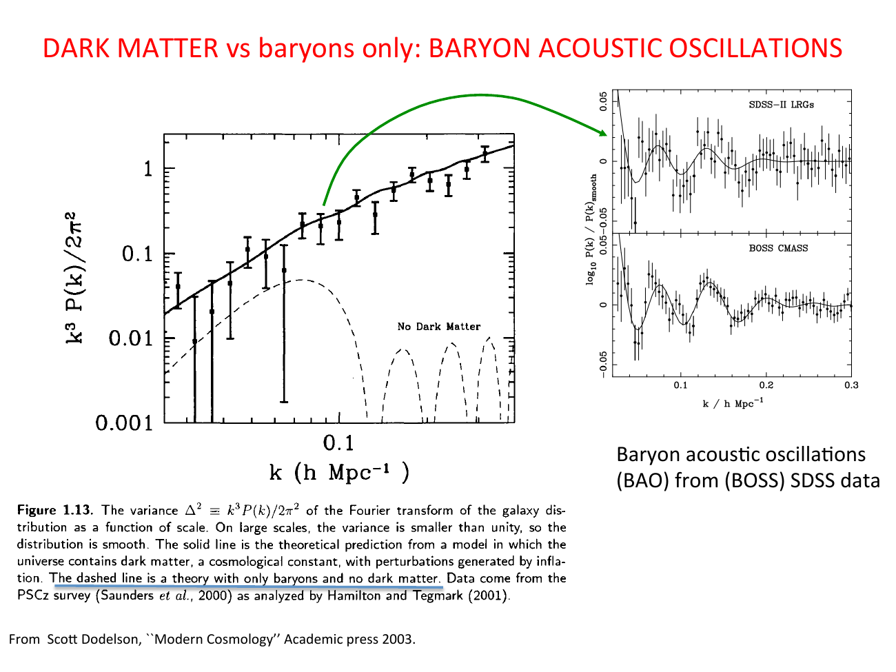

---

## the matter power spectrum

zoom out on $P_m(k)$:

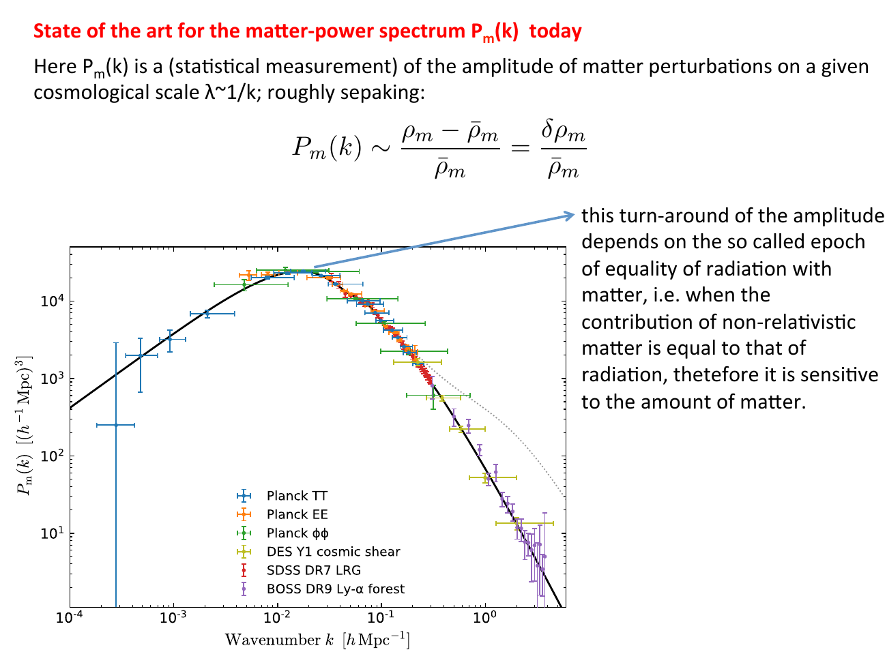

the **turnover** at $k \sim 0.02\,h\,\text{Mpc}^{-1}$ corresponds to the **horizon size at matter-radiation equality**, directly sensitive to $\Omega_m h^2$. modes that entered the horizon during radiation domination did not grow (Meszaros effect). modes that entered later did. so the position of the turnover fixes the matter density.

→ see [[Matter power spectrum and BAO]] for the full physics.

---

## what is dark matter made of?

unknown. candidates include:
- **WIMPs** (weakly interacting massive particles) at the electroweak scale, $m_{\rm DM} \sim 100$ GeV. attractive because thermal freeze-out of a weak-cross-section particle naturally gives $\Omega_{dm} h^2 \sim 0.1$ - the **WIMP miracle**, see Dark matter relics - WIMP miracle
- **axions** at very low mass ($\mu$eV), produced by misalignment in the early universe
- **sterile neutrinos** at keV scale
- **primordial black holes**

distinguishing **hot vs cold dark matter** by structure formation: see [[Hot vs cold dark matter]]. observations strongly favor cold dark matter (CDM), the C in ΛCDM.

---

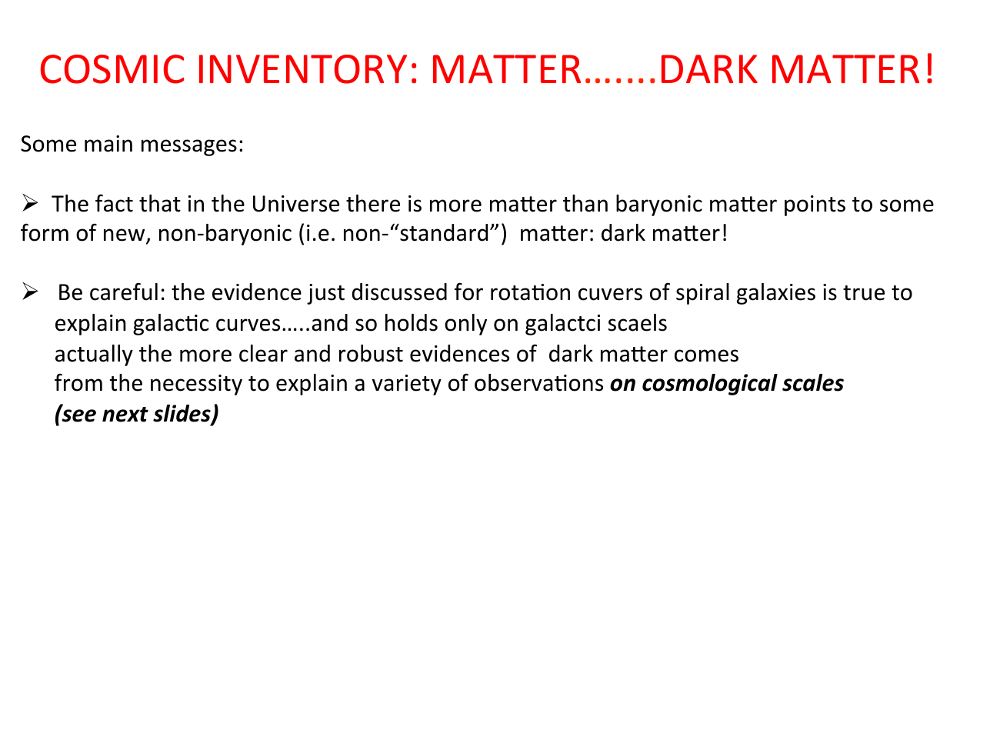

---

## worked example

the cluster baryon fraction gives $\Omega_m$ directly. if clusters are fair samples of the universe, with $f_b = M_{\rm gas}/M_{\rm tot} \approx 0.155$:

$$\Omega_m = \frac{\Omega_b}{f_b} = \frac{0.049}{0.155} = 0.32$$

## where it goes wrong

- dark matter is inferred only through gravity. every method measures total mass and subtracts what is seen.
- "cold" means non-relativistic at decoupling, not low temperature today.
- rotation curves need dark matter on the outskirts of galaxies. the CMB needs it everywhere.

<!-- sources:wiki-arxiv -->
## Wikipedia and arXiv sources

- **Dark matter**. "In astronomy and cosmology, dark matter is an invisible and hypothetical form of matter that does not interact with electromagnetic radiation, including light. Dark matter is implied by gravitational effects that cannot be explained by general relativity unless more matter is present than can be observed." ([Wikipedia](https://en.wikipedia.org/wiki/Dark_matter))
- **Particle Dark Matter: Evidence, Candidates and Constraints**. "In this review article, we discuss the current status of particle dark matter, including experimental evidence and theoretical motivations. We discuss a wide array of candidates for particle dark matter, but focus on neutralinos in models of supersymmetry and Kaluza-Klein dark matter in models of universal extra dimensions." ([arXiv:hep-ph/0404175](https://arxiv.org/abs/hep-ph/0404175))

> Definitions quoted from Wikipedia (CC BY-SA 4.0) and the arXiv abstract. Figures credited in their captions.
<!-- /sources:wiki-arxiv -->

## see also

- [[Fundamentals_Astrophysics_Cosmology_MOC]]
- [[Cosmic_inventory_overview]]
- [[Cosmic_inventory_baryons]]
- [[Matter power spectrum and BAO]]
- Dark matter relics - WIMP miracle
- [[Hot vs cold dark matter]]

## Linked References

- [[Cosmic_inventory_baryons]]
- [[Cosmic_inventory_overview]]
- [[Dark matter on galactic scales]]
- [[Dark matter relics - WIMP miracle]]
- [[Gravitational lensing - intro]]
- [[Hot vs cold dark matter]]
- [[Lambda CDM current parameters]]
- [[Lensing as a cosmological probe]]
- [[MOND]]
- [[N-body simulations]]
- [[Peculiar velocities of galaxies and structures]]
- [[Press-Schechter halo mass function]]
- [[Strong vs weak lensing]]
- [[Fundamentals_Astrophysics_Cosmology_MOC]]

