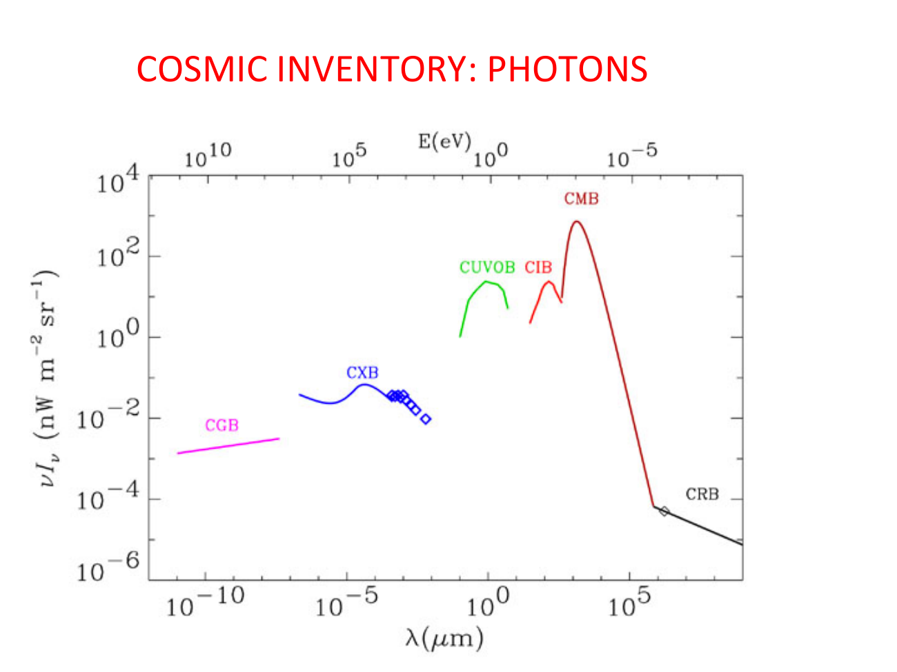
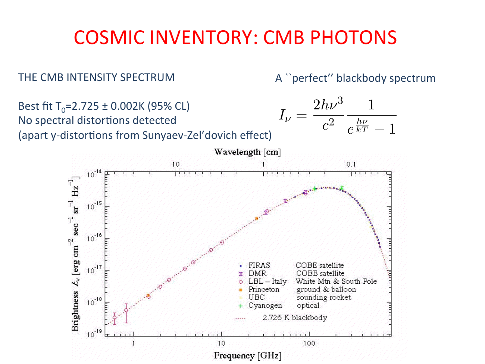
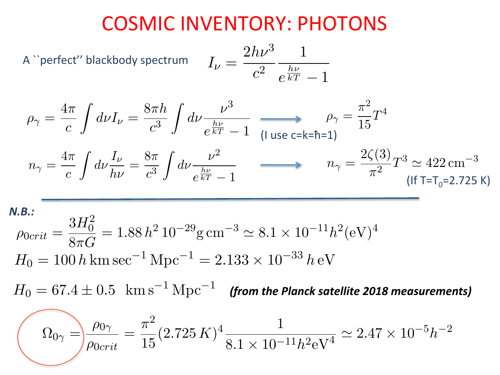
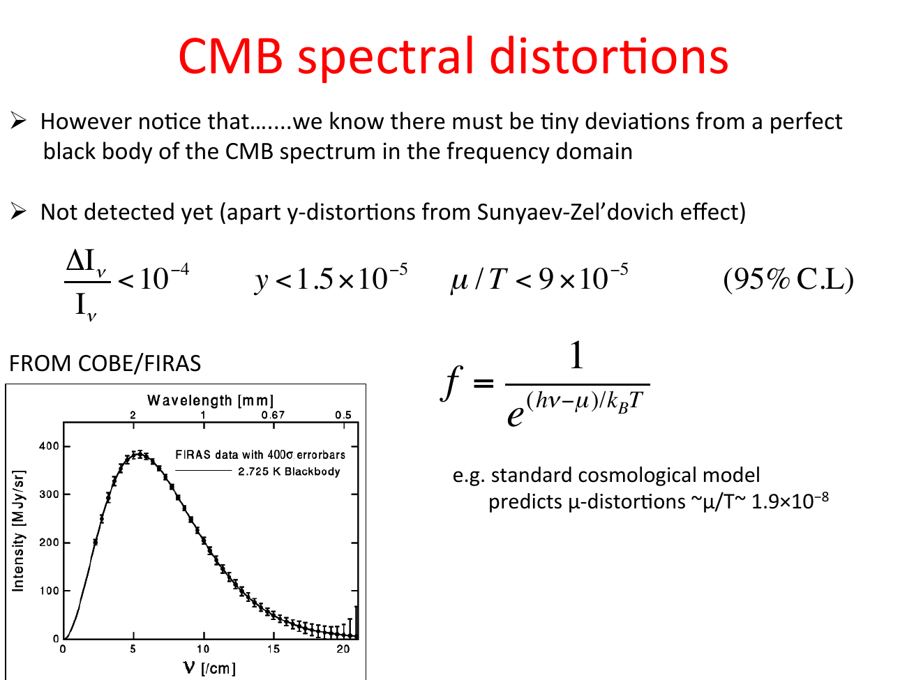
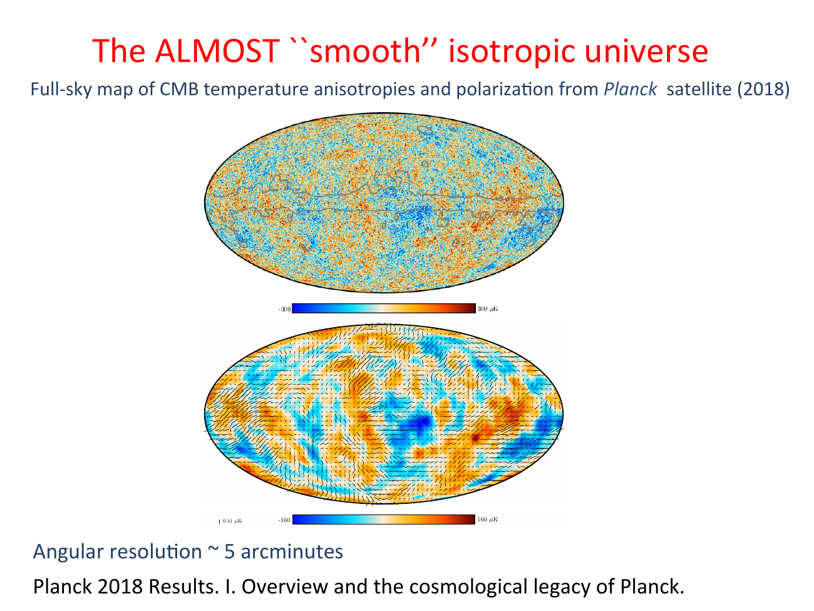
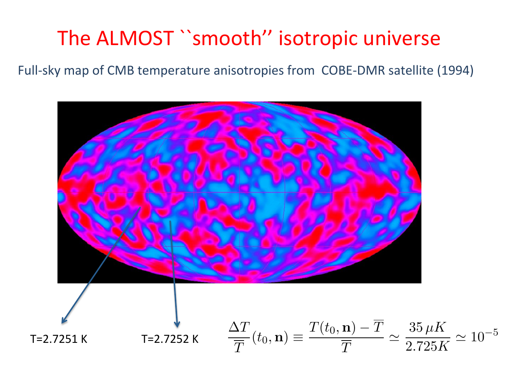

photons in the universe come in many bands, each carrying its own cosmic background:

- **CGB**: cosmic gamma-ray background
- **CXB**: cosmic X-ray background (see [[Lab_High-Energy_MOC]])
- **CUVOB**: cosmic UV/optical background (stars and AGN)
- **CIB**: cosmic infrared background (dust-reprocessed star formation)
- **CMB**: cosmic microwave background, **dominates by number** ($\sim 99\%$ of all photons)
- **CRB**: cosmic radio background

so for a photon census, "the photons of the universe" means essentially "the CMB."

---

## the CMB blackbody spectrum

the CMB is the most perfect blackbody we have ever measured. the Planck spectrum:
$$I_\nu = \frac{2h\nu^3}{c^2} \frac{1}{e^{h\nu/k_B T} - 1}$$

best-fit temperature from FIRAS on COBE:
$$T_0 = 2.725 \pm 0.002~\text{K} \quad (95\%~\text{CL})$$

no spectral distortions detected, except $y$-distortions from the Sunyaev-Zel'dovich effect through clusters.

datasets that confirmed the Planck shape over multiple decades of frequency: FIRAS (COBE), DMR (COBE), LBL ground+balloon, Princeton ground+balloon, UBC sounding rocket, cyanogen optical lines. all on the same 2.726 K curve.

---

## photon density and $\Omega_{0\gamma}$

setting $c = k_B = \hbar = 1$ and integrating the Planck function:

energy density:
$$\rho_\gamma = \frac{4\pi}{c}\int d\nu\, I_\nu = \frac{8\pi h}{c^3}\int d\nu\, \frac{\nu^3}{e^{h\nu/k_B T} - 1} \;\to\; \rho_\gamma = \frac{\pi^2}{15} T^4$$

number density:
$$n_\gamma = \frac{4\pi}{c}\int d\nu\, \frac{I_\nu}{h\nu} = \frac{8\pi}{c^3}\int d\nu\, \frac{\nu^2}{e^{h\nu/k_B T} - 1} \;\to\; n_\gamma = \frac{2\zeta(3)}{\pi^2} T^3 \simeq 422~\text{cm}^{-3}$$

(at $T = T_0 = 2.725$ K)

with the critical density $\rho_{0,\rm crit} = 3H_0^2/(8\pi G) \simeq 8.1\times10^{-11}\,h^2~\text{eV}^4$ and $H_0 = 67.4 \pm 0.5$ km/s/Mpc:

$$\boxed{\,\Omega_{0\gamma} = \frac{\rho_{0\gamma}}{\rho_{0,\rm crit}} = \frac{\pi^2}{15}(2.725\,\text{K})^4 \frac{1}{8.1\times10^{-11}\,h^2\,\text{eV}^4} \simeq 2.47 \times 10^{-5}\,h^{-2}\,}$$

so today the photon background is essentially negligible in the energy budget. but at $z \gtrsim 3300$ (matter-radiation equality, $a_{eq}$) it dominated everything, since $\rho_\gamma \propto a^{-4}$ while $\rho_m \propto a^{-3}$.

 
---

## CMB spectral distortions

read more: CMB Spectral Distortions - What They Are and Where They Come From 

even though the CMB looks like a perfect blackbody, the standard model predicts tiny departures from blackbody, of order $\mu/T \sim 1.9 \times 10^{-8}$. so far we only have upper bounds:

$$\frac{\Delta I_\nu}{I_\nu} < 10^{-4}, \quad y < 1.5\times 10^{-5}, \quad \mu/T < 9 \times 10^{-5} \quad (95\%~\text{CL})$$

a $\mu$-distortion would mean a chemical potential in the photon distribution
$$f = \frac{1}{e^{(h\nu - \mu)/k_BT} - 1}$$
and a $y$-distortion would be Compton scattering by hot electrons (SZ-like).

---

## CMB anisotropies

zoom in on the same spectrum spatially, and it is *not* perfectly smooth. Planck (2018) measured the temperature and polarization full-sky maps at $\sim 5$ arcmin resolution:

at the level of micro-Kelvins, $\Delta T/\bar T \sim 10^{-5}$. the COBE-DMR map from 1994 was the first detection:

$$\frac{\Delta T}{\bar T}(t_0,\hat n) \equiv \frac{T(t_0,\hat n) - \bar T}{\bar T} \simeq \frac{35\,\mu K}{2.725\,\text{K}} \simeq 10^{-5}$$

these tiny anisotropies are the seeds of every galaxy and cluster I will ever observe.

---

## worked example

$n_\gamma = 410$ photons per cm$^3$ against $n_b = 2.5 \times 10^{-7}$ baryons per cm$^3$, so $\eta = 6.1 \times 10^{-10}$, one baryon per 1.6 billion photons.

## where it goes wrong

- the CMB has many more photons than all stars ever made, but less energy than the stars over the age of the universe only by a small factor.
- radiation was dominant in energy before $z \approx 3400$, but photons have dominated in number always.

<!-- sources:wiki-arxiv -->
## Wikipedia and arXiv sources

*This map of the Cosmic Microwave Background radiation, imprinted on the sky when the universe was 370,000 years old, shows tiny temperature fluctuations that correspond to regions of slightly different densities* ([Commons file page](https://commons.wikimedia.org/wiki/File:Cosmic_Microwave_Background_%28CMB%29.jpeg), ESA and the Planck Collaboration, CC BY 4.0, as used on the Wikipedia article [Cosmic microwave background](https://en.wikipedia.org/wiki/Cosmic_microwave_background))

- **Cosmic microwave background**. "The cosmic microwave background (CMB, CMBR), or relic radiation, is microwave radiation that fills all space in the observable universe. With a standard optical telescope, the background space between stars and galaxies is almost completely dark. However, a sufficiently sensitive radio telescope detects a faint background glow that is almost uniform and is not associated with any star, galaxy, or other object." ([Wikipedia](https://en.wikipedia.org/wiki/Cosmic_microwave_background))
- **Cosmic Microwave Background Anisotropies**. "Cosmic microwave background (CMB) temperature anisotropies have and will continue to revolutionize our understanding of cosmology." ([arXiv:astro-ph/0110414](https://arxiv.org/abs/astro-ph/0110414))

> Definitions quoted from Wikipedia (CC BY-SA 4.0) and the arXiv abstract. Figures credited in their captions.
<!-- /sources:wiki-arxiv -->

## see also

- [[Cosmic_inventory_photons_derivation]]
- CMB Spectral Distortions - What They Are and Where They Come From
- [[Fundamentals_Astrophysics_Cosmology_MOC]]
- [[Cosmic_inventory_overview]]
- [[Brief thermal history]]
- [[Photon decoupling and CMB]]

## Linked References

- [[BBN_baryon_to_photon_ratio]]
- [[BBN_concordance_with_CMB]]
- [[BBN_overview]]
- [[Blackbody radiation and Stefan-Boltzmann]]
- [[Brief thermal history]]
- [[CMB - discovery and blackbody spectrum]]
- [[CMB Spectral Distortions - What They Are and Where They Come From]]
- [[Cosmic_inventory_baryons]]
- [[Cosmic_inventory_overview]]
- [[Cosmic_inventory_photons_derivation]]
- [[Cosmological principle]]
- [[Photon decoupling and CMB]]
- [[Saha equation and recombination]]
- [[Fundamentals_Astrophysics_Cosmology_MOC]]

