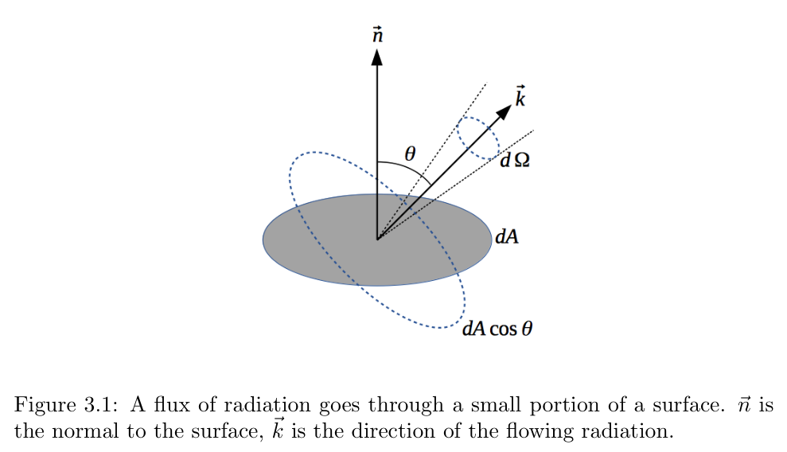
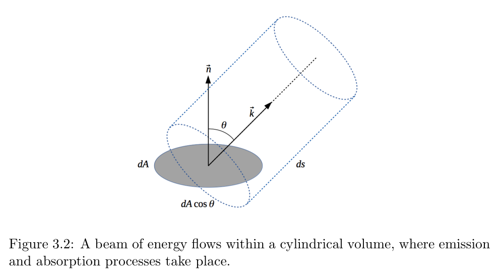

the **equation of radiative transfer** (RTE) is the master equation describing how light intensity changes as it propagates through a medium that emits and absorbs at the photon's frequency. fundamental for both stellar atmospheres and nebulae.

## the equation

along a ray of path length $s$:
$$\boxed{\, \frac{dI_\nu}{ds} = -\kappa_\nu I_\nu + j_\nu \,}$$

where:
- $I_\nu$ = specific intensity at frequency $\nu$ (erg s$^{-1}$ cm$^{-2}$ Hz$^{-1}$ sr$^{-1}$).
- $\kappa_\nu$ = absorption coefficient (cm$^{-1}$), the inverse mean free path for photons of frequency $\nu$.
- $j_\nu$ = emission coefficient (erg s$^{-1}$ cm$^{-3}$ Hz$^{-1}$ sr$^{-1}$), photons added per unit path.

physical reading: along the path, the intensity loses photons by absorption ($-\kappa I$) and gains photons by emission ($+j$). when both balance, $dI/ds = 0$.

## scattering vs absorption

formally $\kappa_\nu$ represents both pure absorption (photon destroyed, energy thermalised) and scattering (photon redirected). at a given location and frequency, the **albedo** $\omega = \sigma_{\rm scat}/(\sigma_{\rm scat} + \sigma_{\rm abs})$ measures the scattering fraction. for photoionised gas in equilibrium, scattering is small at most $\nu$ (except resonance lines). for stellar continua, electron scattering matters in hot stars.

## reformulation - optical depth

define the **optical depth** along the line of sight:
$$\tau_\nu(s) = \int_0^s \kappa_\nu(s')\,ds'$$

then the RTE becomes
$$\frac{dI_\nu}{d\tau_\nu} = -I_\nu + S_\nu$$
with the **source function** $S_\nu \equiv j_\nu/\kappa_\nu$.

source function = local emissivity per unit absorption. at LTE it equals $B_\nu(T)$.

## the formal solution

measure $\tau_\nu$ from the observer's side of the cloud ($\tau_\nu = 0$) towards the source ($\tau_\nu = \tau^*_\nu$), so $d\tau_\nu = \kappa_\nu\,dr = -\kappa_\nu\,ds$ and the equation reads $dI_\nu/d\tau_\nu = I_\nu - S_\nu$. multiplying by $e^{-\tau_\nu}$ and integrating gives (Ciroi eq. 3.3)
$$I_\nu(0) = \int_0^{\tau^*_\nu} S_\nu(\tau_\nu)\,e^{-\tau_\nu}\,d\tau_\nu + I_{\nu 0}\,e^{-\tau^*_\nu}$$
with $I_{\nu0}$ the intensity of the beam entering on the source side. the main result:
- **first term**: light from $\tau$ that survives absorption back to the observer.
- **second term**: emission from each layer along the ray, weighted by transmission to the observer.

## the two physical regimes

### optically thin ($\tau \ll 1$)
absorption is negligible. emergent intensity is just the integrated emission:
$$I_\nu(0) \approx \int_0^\infty j_\nu\,ds$$
e.g. nebular emission from a thin HII region: each atom radiates and the photon escapes.

### optically thick ($\tau \gg 1$)
absorption dominates. emergent intensity is the source function at $\tau = 1$:
$$I_\nu(0) \approx S_\nu(\tau = 1) = B_\nu(T(\tau = 1))\quad\text{(at LTE)}$$
this is the **Eddington-Barbier approximation** (see [[Eddington-Barbier approximation]]). emergent radiation samples one layer's thermal Planck spectrum: the **photosphere**, where light is "born."

## why both matter

a stellar atmosphere is optically thick in the continuum (the photosphere is well-defined) but optically thin in the absorption-line cores. the RTE then describes:
- **continuum**: $I = B(T)$ at the optical depth where $\tau_{\rm cont} = 1$.
- **inside the line**: line opacity adds to continuum opacity, so $\tau = 1$ shifts to a higher (cooler) layer. intensity is lower there. you see a dip = an absorption line.

so absorption lines are not "blocked light" but **light from a cooler higher layer** of the atmosphere.

## moments and approximations

multiplying RTE by $1, \mu, \mu^2$ and integrating over angle gives the moment equations relating $J = (1/4\pi)\int I\,d\Omega$ (mean intensity), $H$ (Eddington flux), $K$ (radiation pressure). the **Eddington approximation** $K = J/3$ closes the system, giving radiative-transfer solutions in plane-parallel atmospheres.

<!-- ciroi-sync -->
## In Ciroi's notes

- Definitions with units (Ciroi's notes, p. 35, Ciroi's notes, p. 36): $I_\nu = dE_\nu/(dA\cos\theta\,d\nu\,d\Omega\,dt)$ [erg cm$^{-2}$ s$^{-1}$ Hz$^{-1}$ sr$^{-1}$], emission coefficient $\varepsilon_\nu$ [erg cm$^{-3}$ s$^{-1}$ Hz$^{-1}$ sr$^{-1}$], absorption coefficient $k_\nu$ [cm$^{-1}$], the fraction of $I_\nu$ removed per unit length. Ciroi writes $\varepsilon_\nu$ and $k_\nu$ where this note uses $j_\nu$ and $\kappa_\nu$.
- Constant source function (Ciroi's notes, p. 38): $I_\nu(0) = S_\nu(1 - e^{-\tau^*_\nu}) + I_{\nu0}e^{-\tau^*_\nu}$. Optically thick, $I_\nu(0) = S_\nu$, the cloud is seen only through its source function. Optically thin, $I_\nu(0) = \tau^*_\nu(S_\nu - I_{\nu0}) + I_{\nu0}$, and away from the source ($I_{\nu0} = 0$) $I_\nu(0) = \tau^*_\nu S_\nu = \varepsilon_\nu r^*$, everything emitted escapes.
- In TE, $k_\nu I_\nu = \varepsilon_\nu$ and $S_\nu = I_\nu = B_\nu(T) = \dfrac{2h\nu^3}{c^2}\dfrac{1}{e^{h\nu/k_BT}-1}$.
- Plane-parallel atmosphere (Ciroi's notes, p. 39): with $ds = -dr/\cos\vartheta$, $\cos\vartheta\,dI_\nu/d\tau_\nu = I_\nu - S_\nu$, whose solution is the limb-darkening equation $I_\nu(0,\vartheta) = \int_0^\infty S_\nu(\tau_\nu)e^{-\tau_\nu\sec\vartheta}d(\tau_\nu\sec\vartheta)$, see [[Limb darkening]] and [[Eddington-Barbier approximation]].
<!-- /ciroi-sync -->

<!-- spec-figures -->
## Figures

*Figure 3.1 of Ciroi's notes: A flux of radiation goes through a small portion of a surface. $\vec n$ is the normal to the surface, $\vec k$ is the direction of the flowing radiation.* (Ciroi's notes, p. 35)

*Figure 3.2 of Ciroi's notes: A beam of energy flows within a cylindrical volume, where emission and absorption processes take place.* (Ciroi's notes, p. 36)
<!-- /spec-figures -->

<!-- sources:wiki-arxiv -->
## Wikipedia and arXiv sources

- **Radiative transfer**. "Radiative transfer (also called radiation transport) is the physical phenomenon of energy transfer in the form of electromagnetic radiation. The propagation of radiation through a medium is affected by absorption, emission, and scattering processes. The equation of radiative transfer describes these interactions mathematically." ([Wikipedia](https://en.wikipedia.org/wiki/Radiative_transfer))

> Definitions quoted from Wikipedia (CC BY-SA 4.0). Figures credited in their captions.
<!-- /sources:wiki-arxiv -->

## see also

- [[Optical depth]]
- [[Source function]]
- [[Local thermodynamic equilibrium LTE]]
- [[Eddington-Barbier approximation]]
- [[Stellar atmosphere structure]]
- [[Continuum opacity sources]]
- [[Specific intensity flux luminosity]]
- [[Limb darkening]]
- [[Radiative transport]] - additional notes
- [[Boltzmann equation in cosmology]] - analogous in cosmological / photon-fluid regime
## Linked References

- [[Absorption coefficient and oscillator strength]]
- [[Continuum opacity sources]]
- [[Eddington-Barbier approximation]]
- [[Limb darkening]]
- [[Local thermodynamic equilibrium LTE]]
- [[Optical depth]]
- [[Source function]]
- [[Stellar atmosphere structure]]
- [[Thermal continuum from stellar photosphere]]
- [[Astronomical_Spectroscopy_MOC]]

