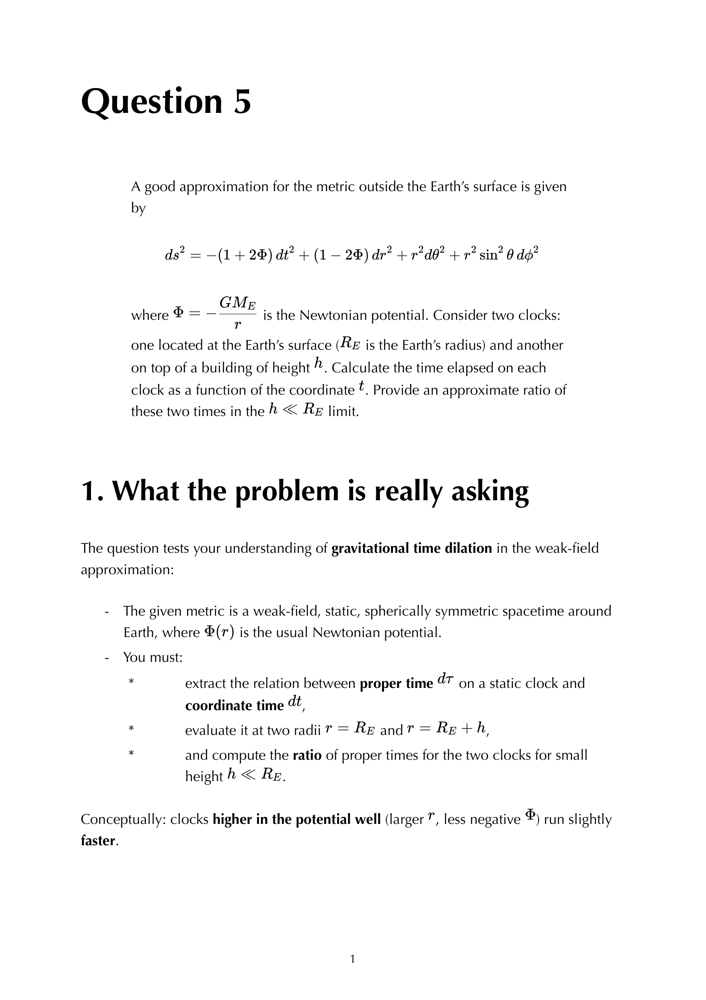
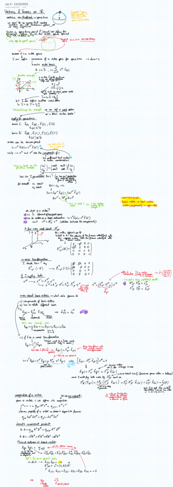


# Equivalence principle

---

### General Relativity Mathematical & Oral Defense Panel

*Question 5 Oral Exam Model Solution: Weak-field metric outside Earth $ds^2 = -(1+2\Phi)dt^2 + (1-2\Phi)dr^2 + r^2 d\Omega^2$, gravitational time dilation, clock tick rates, and the Pound-Rebka experimental verification.*

*Lecture 04 Blackboard Derivation: Einstein Equivalence Principle (EEP), local inertial frames, and the elevator thought experiment.*
<!-- sources:wiki-arxiv -->
## Wikipedia and arXiv sources

*Lead figure of the Wikipedia article Equivalence principle* ([Commons file page](https://commons.wikimedia.org/wiki/File:Elevator_gravity.svg), derivative work: Pbroks13 (talk) Elevator_gravity2.png: Markus Poessel (Mapos), CC BY-SA 3.0, as used on the Wikipedia article [Equivalence principle](https://en.wikipedia.org/wiki/Equivalence_principle))

- **Equivalence principle**. "The equivalence principle is the hypothesis that the observed equivalence of gravitational and inertial mass is a consequence of nature. The weak form, known for centuries, relates to masses of any composition in free fall taking the same trajectories and landing at identical times." ([Wikipedia](https://en.wikipedia.org/wiki/Equivalence_principle))
- **Lecture Notes on General Relativity**. "These notes represent approximately one semester's worth of lectures on introductory general relativity for beginning graduate students in physics. Topics include manifolds, Riemannian geometry, Einstein's equations, and three applications: gravitational radiation, black holes, and cosmology." ([arXiv:gr-qc/9712019](https://arxiv.org/abs/gr-qc/9712019))

> Definitions quoted from Wikipedia (CC BY-SA 4.0) and the arXiv abstract. Figures credited in their captions.
<!-- /sources:wiki-arxiv -->



  <h4 class="backlinks-title">Linked References (2)</h4>
  <ul class="backlinks-list">
    <li class="backlink-item-wrap"><a href="../../02_Literature/Book/Baumann%20GR/Ch%201%20-%20Gravity%20is%20Geometry.html" class="backlink-item">Ch 1 - Gravity is Geometry</a></li>
    <li class="backlink-item-wrap"><a href="../../04_Atlas/General_Relativity_MOC.html" class="backlink-item">General_Relativity_MOC</a></li>
  </ul>

