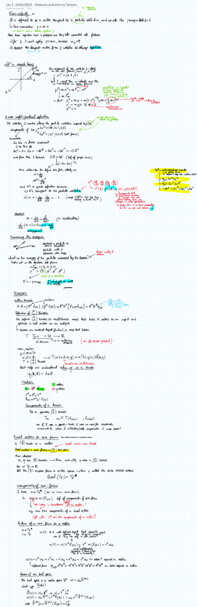

# Four-velocity and four-momentum

---

### General Relativity Mathematical & Oral Defense Panel

*Lecture 05 Blackboard Derivation: Four-velocity $u^\mu = dx^\mu/d\tau$, normalization $u^\mu u_\mu = -c^2$, four-acceleration $a^\mu = D u^\mu / d\tau$, and orthogonality $u^\mu a_\mu = 0$.*

<!-- sources:wiki-arxiv -->
## Wikipedia and arXiv sources

- **Four-velocity**. "In physics, in particular in special relativity and general relativity, a four-velocity is a four-vector in four-dimensional spacetime that represents the relativistic counterpart of velocity, which is a three-dimensional vector in space. Physical events correspond to mathematical points in time and space, the set of all of them together forming a mathematical model of physical four-dimensional spacetime." ([Wikipedia](https://en.wikipedia.org/wiki/Four-velocity))
- **Lecture Notes on General Relativity**. "These notes represent approximately one semester's worth of lectures on introductory general relativity for beginning graduate students in physics. Topics include manifolds, Riemannian geometry, Einstein's equations, and three applications: gravitational radiation, black holes, and cosmology." ([arXiv:gr-qc/9712019](https://arxiv.org/abs/gr-qc/9712019))

> Definitions quoted from Wikipedia (CC BY-SA 4.0) and the arXiv abstract. Figures credited in their captions.
<!-- /sources:wiki-arxiv -->

## Linked References

- [[General_Relativity_MOC]]

