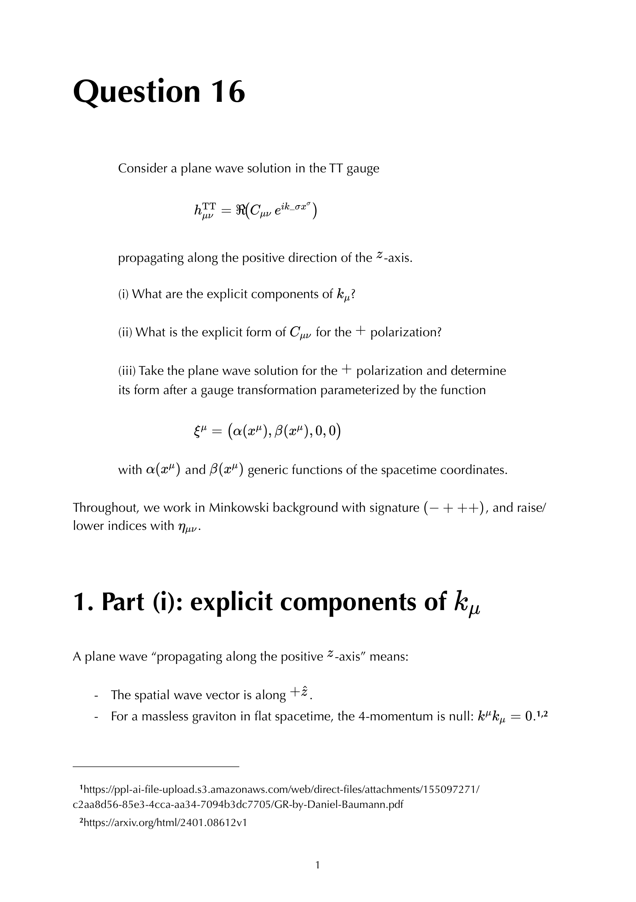
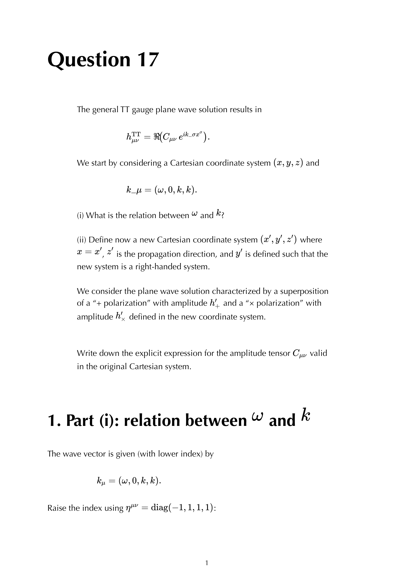
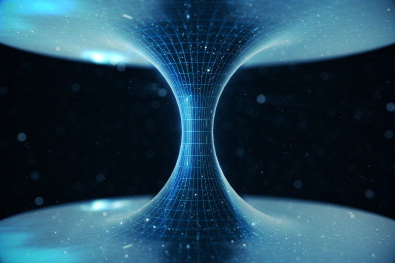

# Gravitational waves in General Relativity

---

### General Relativity Mathematical & Oral Defense Panel

*Question 16 Oral Exam Model Solution: Plane gravitational wave propagation in Transverse-Traceless (TT) gauge, physical degrees of freedom ($h_+, h_\times$), and wave equation $\Box h_{ij}^{\rm TT} = 0$.*

*Question 17 Oral Exam Model Solution: Quadrupolar tidal effect of a gravitational wave on a ring of freely falling test particles, geodesic deviation equation, and differential strain measurement in laser interferometers.*

*Cambridge Lecture Diagram: Gravitational wave quadrupolar distortion of test mass rings for plus (+) and cross (x) polarization states.*

<!-- sources:wiki-arxiv -->
## Wikipedia and arXiv sources

- **Gravitational wave**. "Gravitational waves are waves of spacetime curvature produced by the relative motion of gravitating masses and which propagate away at the speed of light. They were first predicted by Albert Einstein as a consequence of his general theory of relativity, appearing as "ripples in spacetime curvature"." ([Wikipedia](https://en.wikipedia.org/wiki/Gravitational_wave))
- **The basics of gravitational wave theory**. "Einstein's special theory of relativity revolutionized physics by teaching us that space and time are not separate entities, but join as ``spacetime''." ([arXiv:gr-qc/0501041](https://arxiv.org/abs/gr-qc/0501041))

> Definitions quoted from Wikipedia (CC BY-SA 4.0) and the arXiv abstract. Figures credited in their captions.
<!-- /sources:wiki-arxiv -->

## Linked References

- [[General_Relativity_MOC]]

