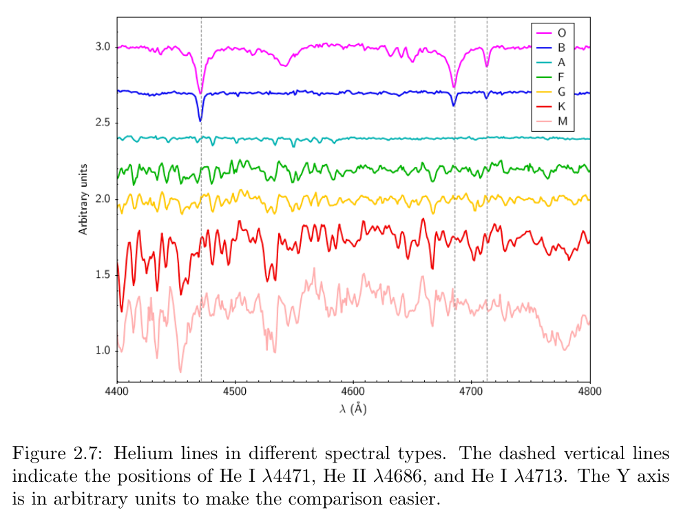

helium has two electrons. their spins can be antiparallel (singlet, $S = 0$, **parahelium**) or parallel (triplet, $S = 1$, **orthohelium**). these are essentially **two decoupled Grötrian diagrams** because intersystem transitions are spin-forbidden.

## the ground state

$1s^2$, $L = 0$, $S = 0$, $J = 0$ $\to$ $1\,^1S_0^e$. statistical weight $g = 1$. the only possible ground state (Pauli forces antiparallel spins for two equivalent $1s$ electrons).

orthohelium has no $1s^2$ analogue: with $S = 1$ both spins parallel, you need two distinct orbitals. lowest orthohelium state is $1s^1 2s^1$, term $2\,^3S_1^e$, **metastable** (forbidden to ground at E1 since same parity, but at $19.82$ eV above ground).

## excited states

| configuration | terms |
|---|---|
| $1s^1 2s^1$ | $2\,^1S_0^e$ (parahelium) and $2\,^3S_1^e$ (orthohelium) |
| $1s^1 2p^1$ | $2\,^1P_1^o$ and $2\,^3P_{0,1,2}^o$ |
| $1s^1 3s^1$ | $3\,^1S_0^e$ and $3\,^3S_1^e$ |
| $1s^1 3p^1$ | $3\,^1P_1^o$ and $3\,^3P_{0,1,2}^o$ |
| $1s^1 3d^1$ | $3\,^1D_2^e$ and $3\,^3D_{1,2,3}^e$ |

## the famous lines

| line | transition | $\lambda$ (Å) | system |
|---|---|---|---|
| He I $\lambda 5876$ (D3) | $3\,^3D \to 2\,^3P^o$ | 5875.6 | triplet |
| He I $\lambda 6678$ | $3\,^1D \to 2\,^1P^o$ | 6678.2 | singlet |
| He I $\lambda 4471$ | $4\,^3D \to 2\,^3P^o$ | 4471.5 | triplet |
| He I $\lambda 4922$ | $4\,^1D \to 2\,^1P^o$ | 4921.9 | singlet |
| He I $\lambda 4026$ | $5\,^3D \to 2\,^3P^o$ | 4026.2 | triplet |
| He I $\lambda 5048$ | $4\,^1S \to 2\,^1P^o$ | 5047.7 | singlet |

He I lines are diagnostic of stellar temperature in B and O stars and of ionisation state in HII regions and AGN.

## He II (singly ionised)

He$^+$ has one electron, hydrogenic with $Z = 2$. all energy levels are $4\times$ those of H (since $E \propto Z^2/n^2$). Pickering series ($n_{\rm lower} = 4$, $n_{\rm upper} = 5, 6, 7, ...$) lies in the optical because the higher $Z^2$ moves the Brackett series of "He II" into visible.

key transitions:
- **He II $\lambda 1640$**: $3 \to 2$, UV. signature of very hot ionising sources.
- **He II $\lambda 4686$**: $4 \to 3$, optical. seen in O stars, WR stars, AGN broad-line regions, planetary nebulae with hot central stars. requires ionising photons of $h\nu > 54.4$ eV.

## why this matters

helium is the **second-most abundant element**, $\sim 24\%$ by mass in stars. its line strengths trace temperature:
- **He I lines** appear in B stars, peak at B2 ($T \sim 22\,000$ K).
- **He II lines** appear in O stars, peak at O5 ($T \sim 40\,000$ K).
- both absent in cooler stars (A and later) because no excitation at low $T$.
- in the hottest O stars He I fades because helium is mostly He$^+$ and He$^{2+}$, while He II stays strong. Wolf-Rayet stars show very strong, broad He II emission (He II $\lambda 4686$ is a defining WR line).

so the He I / He II ratio is a temperature thermometer for early-type stars. plus, He I and He II emission diagnose AGN (Seyfert) and hot evolved stars (PN central stars, sdO).

<!-- ciroi-sync -->
## In Ciroi's notes

The first excited level above the ground is $2\,^3S_1$ at 19.82 eV, the second $2\,^1S_0$ at 20.62 eV (Ciroi's notes, p. 15). Ciroi's table of He I lines in the visible and near IR (Ciroi's notes, p. 16):

| Lower | Upper | $E_n$ (eV) | $E_m$ (eV) | $\lambda$ (Å) | Line |
|---|---|---|---|---|---|
| $2\,^1S_0$ | $4\,^1P_1$ | 20.62 | 23.74 | 3964.73 | He I λ3965 |
| $2\,^1P_1$ | $4\,^1D_2$ | 21.22 | 23.74 | 4921.93 | He I λ4922 |
| $2\,^1S_0$ | $3\,^1P_1$ | 20.62 | 23.09 | 5015.68 | He I λ5016 |
| $2\,^1P_1$ | $3\,^1D_2$ | 21.22 | 23.07 | 6678.15 | He I λ6678 |
| $2\,^3S_1$ | $4\,^3P_{2,1,0}$ | 19.82 | 23.70 | 3187.75 | He I λ3187 |
| $2\,^3S_1$ | $3\,^3P_{2,1,0}$ | 19.82 | 23.00 | 3888.65 | He I λ3889 |
| $2\,^3P_{2,1,0}$ | $5\,^3D_{3,2,1}$ | 20.96 | 24.04 | 4026.19 | He I λ4026 |
| $2\,^3P_{2,1,0}$ | $4\,^3D_{3,2,1}$ | 20.96 | 23.74 | 4471.48 | He I λ4471 |
| $2\,^3P_{2,1,0}$ | $4\,^3S_1$ | 20.96 | 23.59 | 4713.14 | He I λ4713 |
| $2\,^3P_{2,1,0}$ | $3\,^3D_{3,2,1}$ | 20.96 | 23.07 | 5875.62 | He I λ5876 |
| $2\,^3P_{2,1,0}$ | $3\,^3S_1$ | 20.96 | 22.72 | 7065.19 | He I λ7065 |
| $2\,^3S_1$ | $2\,^3P_{2,1,0}$ | 19.82 | 20.96 | 10830.3 | He I λ10830 |

He II λ4686 is the Pa$\alpha$-like $4 \to 3$ transition of hydrogenic He$^+$.
<!-- /ciroi-sync -->

<!-- spec-figures -->
## Figures

*Figure 2.7 of Ciroi's notes: Helium lines in different spectral types. The dashed vertical lines indicate the positions of He I λ4471, He II λ4686, and He I λ4713. The Y axis is in arbitrary units to make the comparison easier.* (Ciroi's notes, p. 27)
<!-- /spec-figures -->

<!-- sources:wiki-arxiv -->
## Wikipedia and arXiv sources

*Helium atom (not to scale)* ([Commons file page](https://commons.wikimedia.org/wiki/File:Helium_atom_%28not_to_scale%29.svg), Original: Svdmolen and Jeanot Vector: King of Hearts, CC BY-SA 3.0, as used on the Wikipedia article [Helium atom](https://en.wikipedia.org/wiki/Helium_atom))

- **Helium atom**. "A helium atom is an atom of the chemical element helium. Helium is composed of two electrons bound by the electromagnetic force to a nucleus containing two protons along with two neutrons, depending on the isotope, held together by the strong force. Unlike for the hydrogen atom, a closed-form solution to the Schrödinger equation for the helium atom has not been found." ([Wikipedia](https://en.wikipedia.org/wiki/Helium_atom))

> Definitions quoted from Wikipedia (CC BY-SA 4.0). Figures credited in their captions.
<!-- /sources:wiki-arxiv -->

## see also

- [[Quantum numbers and atomic states]]
- [[Atomic term symbols]]
- [[Russell-Saunders LS coupling]]
- [[Selection rules]]
- [[Hydrogen spectral series]]
- Energy level diagrams Grötrian
- [[Helium population vs T]]
- [[Why the Sequence OBAFGKM]]
- [[Stellar spectra and spectral classification]]
## Linked References

- [[AGN spectroscopy]]
- [[Emission line stars]]
- [[Energy level diagrams Grotrian]]
- [[Helium population vs T]]
- [[Hydrogen spectral series]]
- [[Pauli principle and electron configurations]]
- [[Planetary nebula spectroscopy]]
- [[Quantum numbers and atomic states]]
- [[Russell-Saunders LS coupling]]
- [[Rydberg-Ritz formula]]
- [[Supernova spectroscopy]]
- [[Symbiotic star spectroscopy]]
- [[Why the Sequence OBAFGKM]]
- [[Astronomical_Spectroscopy_MOC]]

