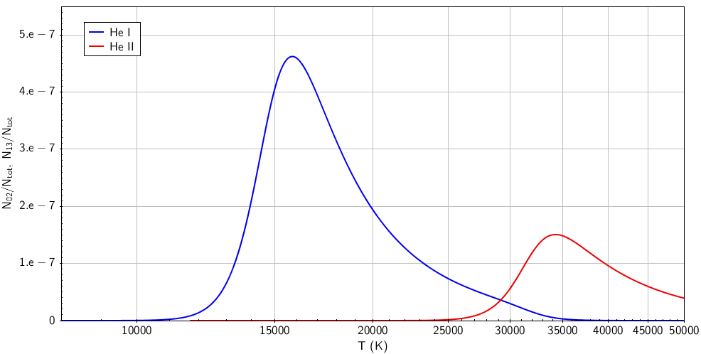
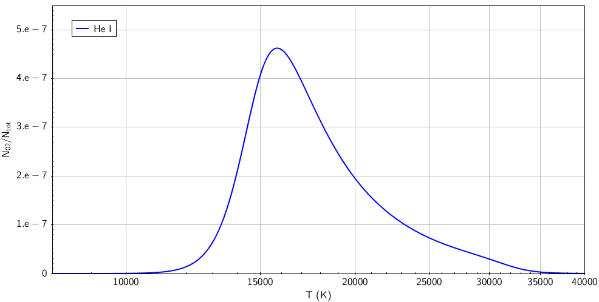
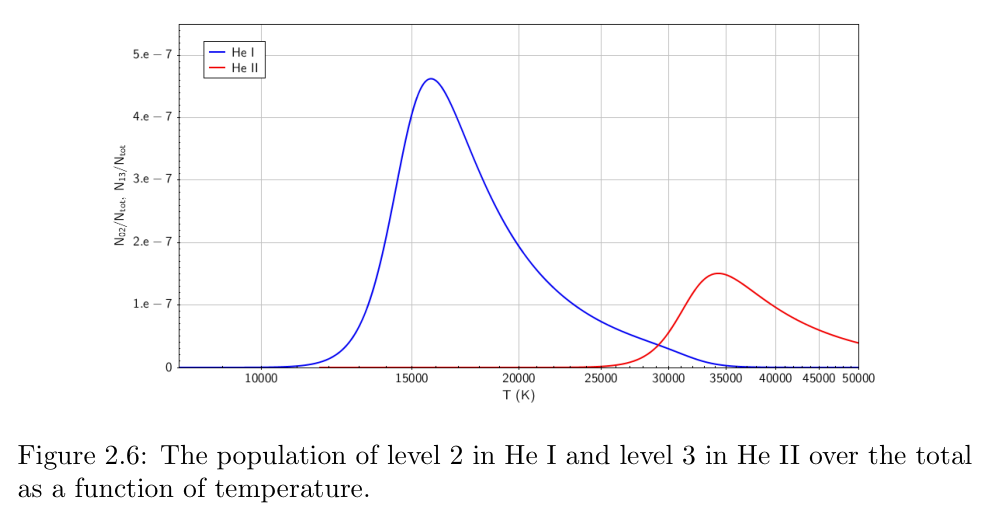
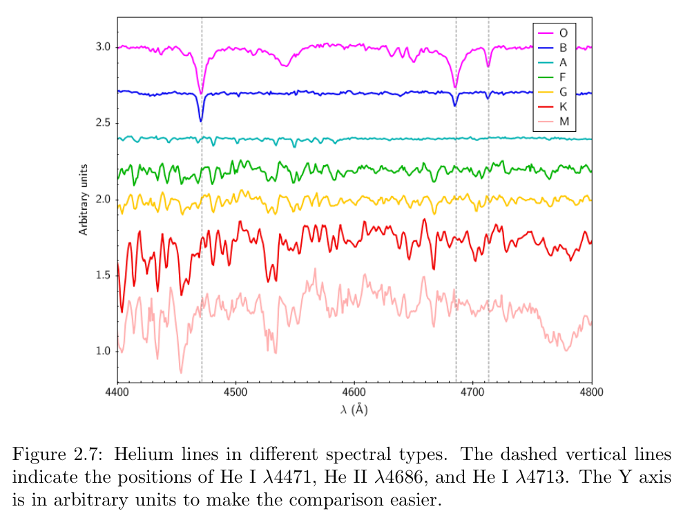

helium is harder to excite than hydrogen ($\chi_{HeI} = 24.6$ eV, $\chi_{HeII} = 54.4$ eV), so its line strengths peak at much higher temperatures. the He I and He II lines are the central diagnostics for OB stars.

## the setup

He has two ionisation potentials:
- $\chi_{\rm HeI} = 24.6$ eV (to make He$^+$).
- $\chi_{\rm HeII} = 54.4$ eV (to make He$^{2+}$).

Saha balance gives fractions $f_{\rm HeI}, f_{\rm HeII}, f_{\rm HeIII}$ of He in each stage at temperature $T$ and density $n_e$.

within each stage, Boltzmann gives level populations.

## He I line strength

He I lines come from excited levels of neutral He, e.g. $\lambda 4471$ from $4\,^3D \to 2\,^3P^o$. the lower level $2\,^3P$ is at $\sim 21$ eV above ground.

so in the line-forming layer, $f_{2\,^3P}(T) = f_{\rm HeI} \cdot e^{-21/k_BT} \cdot g_2/Z_{\rm HeI}$.

at low $T$: $e^{-21/k_BT}$ is tiny.
at high $T$ ($> 30\,000$ K): $f_{\rm HeI}$ drops as Saha ionises to He$^+$.

peak: Ciroi's simple model gives $T \simeq 15\,800$ K (B5). observed He I $\lambda 4471$ is strongest nearer B2 V ($\sim 22\,000$ K), because real atmospheres have higher $P_e$ and a range of $T$.

## He II line strength

He II lines (singly ionised, hydrogenic) come from levels of He$^+$, e.g. $\lambda 4686$ from $4 \to 3$.
- requires $\chi = 54$ eV photons to make He$^+$ in the first place.
- the higher levels of He$^+$ are at much higher energies (since $E \propto Z^2$, factor of $4$).

so He II lines peak at $T \simeq 34\,000$ K in Ciroi's model (O stars), up to $\sim 40\,000$ K in real O-star atmospheres.

## comparison with H I

| species | first appears | peak | disappears |
|---|---|---|---|
| H Balmer | F0 | A0 ($\sim 10\,000$ K) | mid-B (ionised) |
| He I | mid-B (~B5) | B2 ($\sim 22\,000$ K) | early O |
| He II | O8 | O5 ($\sim 40\,000$ K) | continues into Wolf-Rayet |

each species "passes the baton" to the next as $T$ increases, exactly because of the matching Saha + Boltzmann balance.

## thermometers in OB stars

since H is essentially fully ionised in OB stars (no Balmer to use), He I / He II line ratios become the temperature thermometers:
- B-star $T$: He I $\lambda 4471$ line strength.
- O-star $T$: He II $\lambda 4686$ / He I $\lambda 4471$.

a direct ratio bypasses the absolute Saha and gives $T$ from line ratios alone, much more robust.

## my plots

 

He I and He II together, peaks about a factor 2 apart in $T$, and He I alone.

both peaks have the characteristic Saha + Boltzmann shape: cold rise, hot fall.

## why para vs ortho doesn't matter for the curves

both singlet (para-) and triplet (ortho-) He I lines come from levels at similar $\sim 20$ eV excitation. their bell curves vs $T$ are essentially the same shape. orthohelium has a slightly more populated $2\,^3S$ level due to its triplet metastability, so He I $\lambda 5876$ (D3) is often slightly stronger than the singlet equivalent.

<!-- ciroi-sync -->
## In Ciroi's notes

Ciroi uses the He I lines λ4026, λ4471, λ4713 and λ5876, all with lower level $2\,^3P_{2,1,0}$ at 20.964 eV, $g = 9$, $u_0 = 1$: $N_{02}/N_0 = 9e^{-243266.848/T}$. Ionisation with $P_e = 20$ Pa, $\chi_0 = 24.587$ eV, $\chi_1 = 54.416$ eV gives $N_1/N_0 \simeq 6.66\times10^{-3}T^{5/2}e^{-285307/T}$ and $N_2/N_1 \simeq 1.665\times10^{-3}T^{5/2}e^{-631442/T}$, the last one negligible below about 25\,000 K. For He II λ4686 the lower level $n = 3$ sits 48.372 eV above the He$^+$ ground ($g = 18$, $u_1 = 2$), so $N_{13}/N_1 = 9e^{-561307.7/T}$ (Ciroi's notes, p. 25, Ciroi's notes, p. 26). Result: He I maximum at $T \simeq 15\,800$ K (B5), He II at $T \simeq 34\,000$ K (O), confirmed by the spectra in Fig. 2.7 (Ciroi's notes, p. 27). My recomputation gives 15\,790 K and 34\,270 K.
<!-- /ciroi-sync -->

<!-- spec-figures -->
## Figures

*Figure 2.6 of Ciroi's notes: The population of level 2 in He I and level 3 in He II over the total as a function of temperature.* (Ciroi's notes, p. 27)

*Figure 2.7 of Ciroi's notes: Helium lines in different spectral types. The dashed vertical lines indicate the positions of He I λ4471, He II λ4686, and He I λ4713. The Y axis is in arbitrary units to make the comparison easier.* (Ciroi's notes, p. 27)
<!-- /spec-figures -->

<!-- sources:wiki-arxiv -->
## Wikipedia and arXiv sources

- **Saha ionization equation**. "In physics, the Saha ionization equation is an expression that relates the ionization state of a gas in thermal equilibrium to the temperature and pressure. The equation is a result of combining ideas of quantum mechanics and statistical mechanics and is used to explain the spectral classification of stars. The expression was developed by physicist Meghnad Saha in 1920." ([Wikipedia](https://en.wikipedia.org/wiki/Saha_ionization_equation))

> Definitions quoted from Wikipedia (CC BY-SA 4.0). Figures credited in their captions.
<!-- /sources:wiki-arxiv -->

## see also

- [[Boltzmann equation in spectroscopy]]
- [[Saha ionisation equation]]
- [[Helium energy levels]]
- [[Hydrogen population vs T]]
- [[Population of excited levels]]
- [[Why the Sequence OBAFGKM]]
- [[Stellar spectra and spectral classification]]
## Linked References

- [[Boltzmann equation in spectroscopy]]
- [[Helium energy levels]]
- [[History of stellar classification]]
- [[Hydrogen population vs T]]
- [[Population of excited levels]]
- [[Saha ionisation equation]]
- [[Why the Sequence OBAFGKM]]
- [[Astronomical_Spectroscopy_MOC]]

