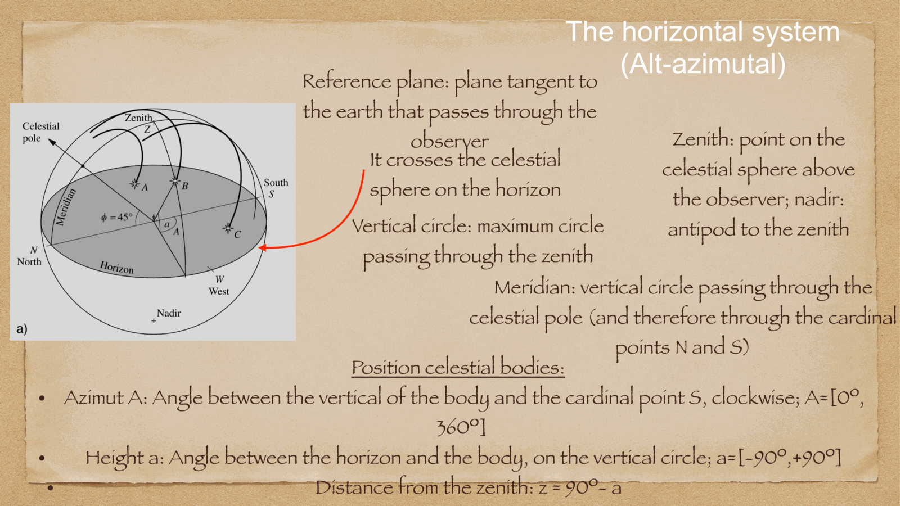
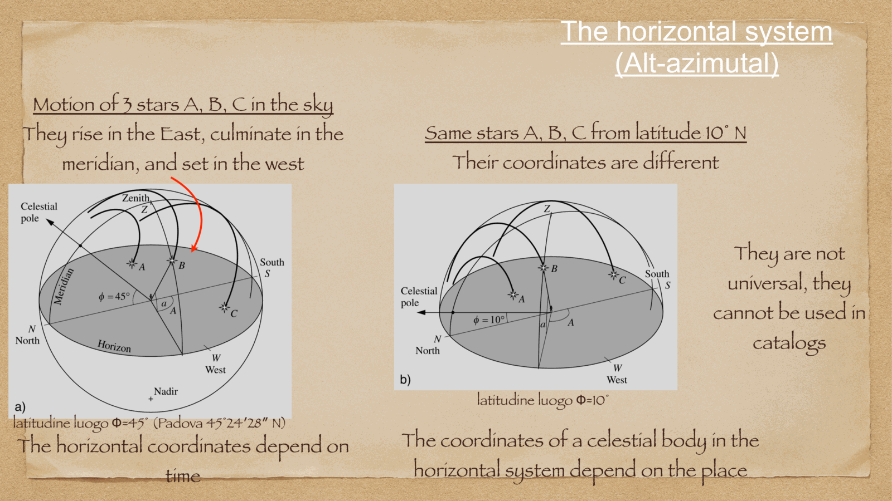
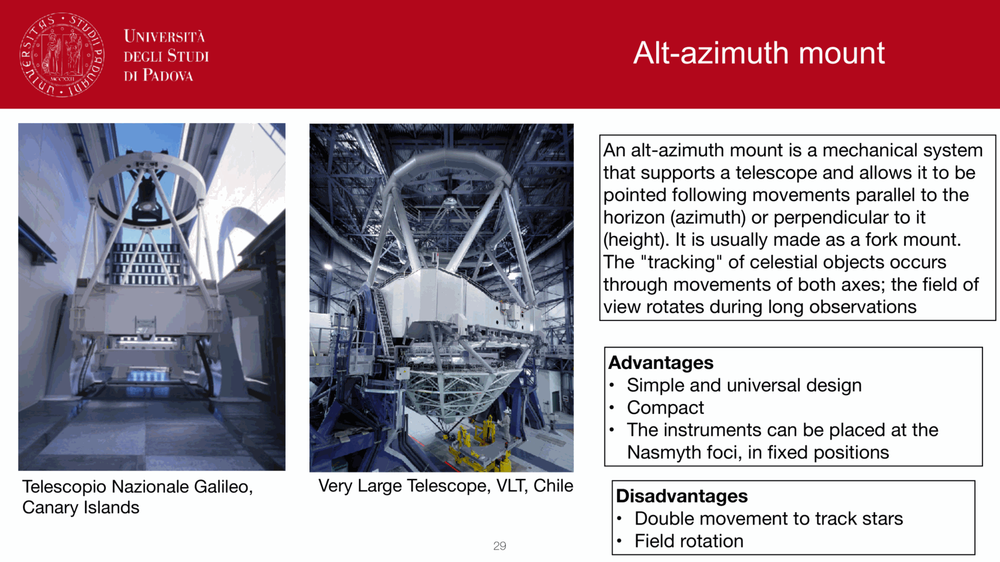
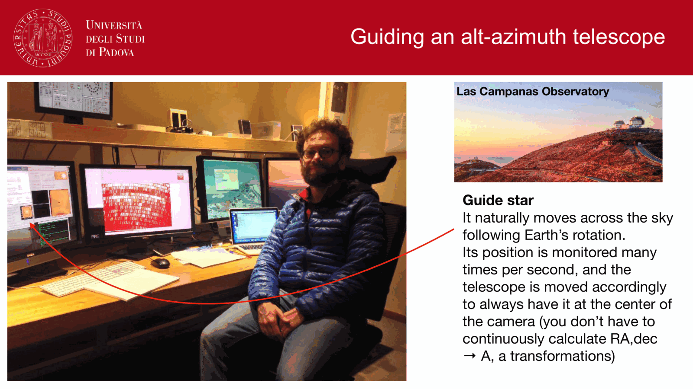
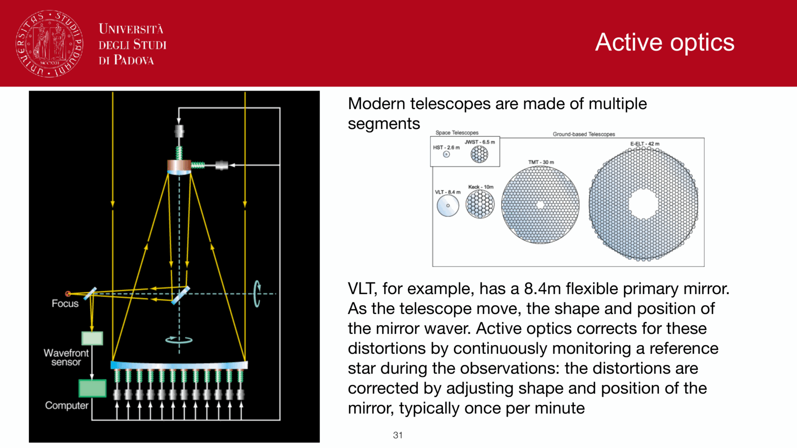
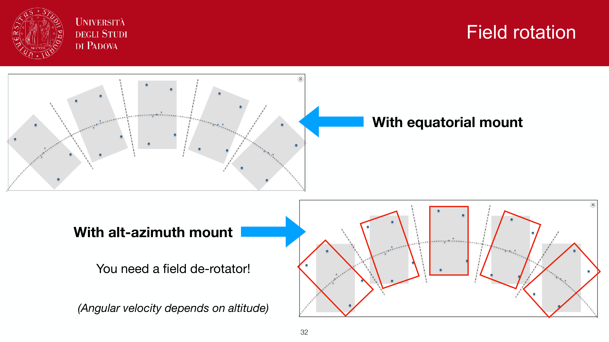

the most natural coordinate system for someone standing on the Earth: take the local horizontal plane as the reference plane.

---

## the geometry

- **zenith** $Z$: the point on the celestial sphere directly overhead
- **nadir**: the point on the celestial sphere directly underfoot, antipode of the zenith
- **horizon**: where the local horizontal plane meets the celestial sphere, a great circle
- **vertical circle**: any great circle through the zenith and nadir
- **meridian**: the vertical circle that also passes through the celestial pole. it crosses the horizon at the cardinal points N and S

reference plane: the plane tangent to the Earth that passes through the observer (the local horizontal plane).

---

## the two coordinates

**azimuth** $A$: the angle along the horizon, measured **clockwise from the south cardinal point** to the foot of the body's vertical circle. (some textbooks measure from N instead, so convention matters!)
- $A \in [0°, 360°]$

**altitude** (height) $a$: the angle between the horizon and the body, measured along the body's vertical circle.
- $a \in [-90°, +90°]$
- $a > 0$: above horizon (visible)
- $a < 0$: below horizon (not visible)

**zenith distance** $z = 90° - a$: complementary to altitude. often used in atmospheric extinction calculations.

---

## the catch - alt-azimuth is *not* universal

this system is tied to the local horizon and the local vertical, both of which depend on:
- **observer location** (different latitude → different zenith → different horizon)
- **time** (Earth rotates → stars move across the sky during the night)

so I cannot tabulate stars in alt-azimuth coordinates. it is only useful for *immediate* observations.

three stars A, B, C rising in the east, culminating in the meridian, and setting in the west have completely different $(A, a)$ values depending on the observer's latitude:

at $\phi = 45°$ N (Padova) the picture is one thing. at $\phi = 10°$ N it's another. and within a single night, the same star moves continuously through different $(A, a)$ values.

---

## what alt-azimuth is good for

- **pointing a telescope** with an alt-azimuth mount (the cheapest, simplest mount geometry)
- **rise/set conditions**: $a = 0$ defines the horizon, see Culmination and rise/set
- **atmospheric refraction and extinction**: the air path length depends on zenith distance $z$
- **catching a transient or a satellite** that is moving in the sky

for **catalog work** I switch to the equatorial system (see [[Equatorial system]]), which is observer-independent.

---

## worked example

from Padova, $\phi = 45.4^\circ$:

- the altitude of the celestial pole equals the latitude, so Polaris stands at $a \approx 45.4^\circ$.
- the Sun at upper culmination has $a = 90^\circ - \phi + \delta_\odot$. at the summer solstice $a = 44.6^\circ + 23.4^\circ = 68.0^\circ$, at the winter solstice $a = 21.2^\circ$.

## where it goes wrong

- the zero point of azimuth. some books count from north, some from south. I state mine before any number.
- these coordinates depend on the place and on the time, so they never go into a catalog.
- the airmass uses the zenith distance $z = 90^\circ - a$, not the altitude.
- refraction raises every object, so the observed altitude is larger than the geometric one.

<!-- sources:wiki-arxiv -->
## Wikipedia and arXiv sources

*A schematic diagram of the terms "Azimuth" and "Altitude" as they relate to the viewing of celestial objects* ([Commons file page](https://commons.wikimedia.org/wiki/File:Azimuth-Altitude_schematic.svg), TWCarlson, CC BY-SA 3.0, as used on the Wikipedia article [Horizontal coordinate system](https://en.wikipedia.org/wiki/Horizontal_coordinate_system))

- **Horizontal coordinate system**. "The horizontal coordinate system is a celestial coordinate system that uses the observer's local horizon as the fundamental plane to define two angles of a spherical coordinate system: altitude and azimuth. Therefore, the horizontal coordinate system is sometimes called the az/el system, the alt/az system, or the alt-azimuth system, among others." ([Wikipedia](https://en.wikipedia.org/wiki/Horizontal_coordinate_system))

> Definitions quoted from Wikipedia (CC BY-SA 4.0). Figures credited in their captions.
<!-- /sources:wiki-arxiv -->

## see also

- [[Fundamentals_Astrophysics_Cosmology_MOC]]
- [[Spherical_astronomy_complete]]
- [[Equatorial system]]
- [[Alt-azimuth ↔ equatorial transformations]]
- Culmination and rise/set

---

## observational astrophysics course slides (Prof. Paolo Cassata)

*Horizontal coordinate system: zenith, nadir, horizon.*

*Altitude a and zenith distance z = 90 deg - a.*

*Azimuth A measurement conventions (North vs South origin).*

*Alt-azimuth telescope mounts and field rotation.*

## Linked References

- [[Alt-azimuth equatorial transformations]]
- [[Alt-azimuth ↔ equatorial transformations]]
- [[Atmospheric refraction]]
- [[Spherical_astronomy_complete]]
- [[Fundamentals_Astrophysics_Cosmology_MOC]]
- [[Observational_Astrophysics_MOC]]

