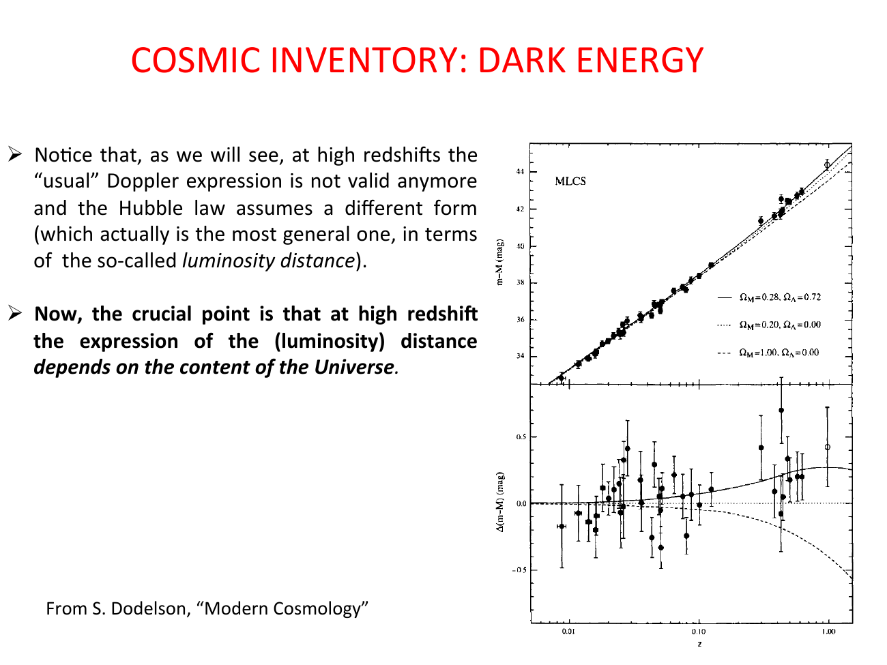
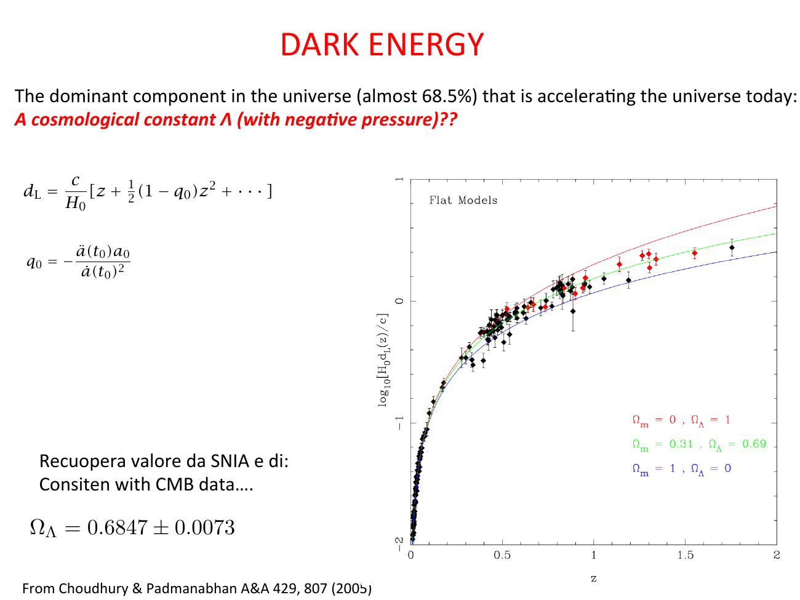

the Hubble law $v = H_0 d$ is only valid for $z \ll 1$. at higher redshifts the linear form fails and we need the full **luminosity-distance form**:
$$d_L(z) = (1 + z)\int_0^z \frac{c\, dz'}{H(z')}$$

(in a flat universe.) this is the form actually used to fit SN Ia Hubble diagrams and discover dark energy in 1998.

---

## the small-z expansion

expanding $d_L(z)$ in powers of $z$:
$$\boxed{\,d_L(z) = \frac{c}{H_0}\left[z + \tfrac12(1 - q_0) z^2 + \cdots\right]\,}$$

with the deceleration parameter
$$q_0 = -\frac{\ddot a(t_0) a_0}{\dot a(t_0)^2}$$

so:
- the **first-order** term $\propto z$ measures $H_0$ alone, the Hubble constant
- the **second-order** term $\propto z^2$ measures $q_0$, the acceleration

a positive $q_0$ means deceleration (an EdS or matter-only universe). a negative $q_0$ means acceleration, requiring something with negative pressure (Λ).

---

## the SN Ia Hubble diagram

at $z \sim 0.5$ to $1$, the second-order term is large enough to break the degeneracy between $H_0$ and $q_0$. when SN Ia were measured at these redshifts in 1998, they came out *fainter* than any matter-only model, sitting on a curve consistent with $\Omega_M = 0.28, \Omega_\Lambda = 0.72$, the discovery of dark energy.

---

## the full $d_L$ for ΛCDM

with $\Omega_K \approx 0$, $\Omega_\gamma$ negligible:
$$d_L(z) = \frac{c(1+z)}{H_0}\int_0^z \frac{dz'}{\sqrt{\Omega_m(1+z')^3 + \Omega_\Lambda}}$$

for nonzero curvature you also need a $\sin/\sinh$ factor on the comoving distance (see 03_Zettel/Theory/Cosmological distances).

related distances (all equal at low z, all different at high z):
- comoving: $d_C(z) = \int_0^z c\,dz'/H(z')$
- angular diameter: $d_A(z) = d_C(z)/(1+z)$
- luminosity: $d_L(z) = d_C(z)(1+z) = d_A(z)(1+z)^2$

→ see 03_Zettel/Theory/Cosmological distances for the full set.

---

## why this distinction matters

at low $z$ I can interchange "velocity" and "distance" almost casually because everything is linear. at high $z$ I cannot. the cosmological *redshift* is no longer a kinematic Doppler effect. it is a **geometrical** consequence of $a(t)$ stretching photons.

so when an undergraduate first encounters $z = 0.5$ they often want to compute "how fast that galaxy is moving" using $v = cz/(1+z)$ or some variant. the right answer is: there is no single velocity. the universe is not just stars moving in a static space. it is space itself stretching. what we *measure* is $z$, not $v$.

---

## where it goes wrong

- recession speeds above $c$ are allowed. they are not motion through space.
- the light we see from $z > 1.6$ was emitted when the source was receding faster than light.

<!-- sources:wiki-arxiv -->
## Wikipedia and arXiv sources

*raisin bread model of the universe* ([Commons file page](https://commons.wikimedia.org/wiki/File:Raisinbread.gif), w:en:User:ScienceApologist, Public domain, as used on the Wikipedia article [Hubble's law](https://en.wikipedia.org/wiki/Hubble%27s_law))

- **Hubble's law**. "Hubble's law, officially the Hubble–Lemaître law, is the observation in physical cosmology that galaxies are moving away from Earth at speeds proportional to their distance. Thus, the farther a galaxy is from the Earth, the faster it moves away. A galaxy's recessional velocity is typically determined by measuring its redshift, a shift in the frequency of light emitted by the galaxy." ([Wikipedia](https://en.wikipedia.org/wiki/Hubble%27s_law))
- **The Hubble Constant**. "Considerable progress has been made in determining the Hubble constant over the past two decades." ([arXiv:1004.1856](https://arxiv.org/abs/1004.1856))

> Definitions quoted from Wikipedia (CC BY-SA 4.0) and the arXiv abstract. Figures credited in their captions.
<!-- /sources:wiki-arxiv -->

## see also

- [[Fundamentals_Astrophysics_Cosmology_MOC]]
- [[Hubble law derivation low-z]]
- [[Hubble constant and deceleration parameter]]
- 03_Zettel/Theory/Cosmological distances
- [[Cosmic_inventory_dark_energy]]
- Friedmann equations with Λ

## Linked References

- [[Cosmic_inventory_dark_energy]]
- [[Cosmological distances]]
- [[Hubble constant and deceleration parameter]]
- [[Hubble flow distances]]
- [[Hubble law derivation low-z]]
- [[Hubble law]]
- [[Fundamentals_Astrophysics_Cosmology_MOC]]

