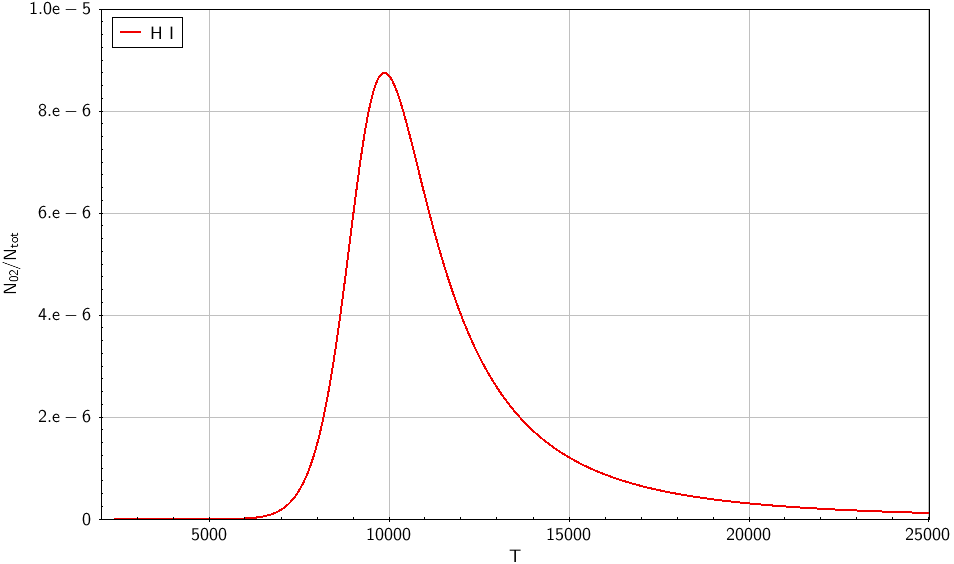
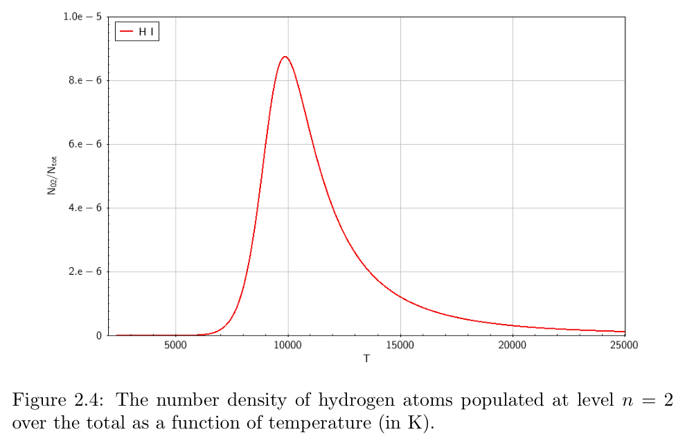
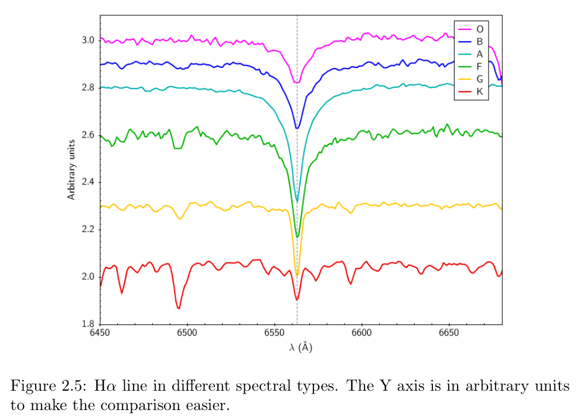

how the population of H atoms in a given level changes with temperature, illustrating Saha + Boltzmann competition. the canonical example.

## the setup

H total abundance $n_H$. ionisation balance (Saha):
$$\frac{n_p n_e}{n_{HI}} = \Phi(T)\,e^{-13.6/k_BT}$$
sets $f_{HI}(T) = n_{HI}/n_H$.

within neutral H, level populations (Boltzmann):
$$\frac{n_n}{n_{HI}} = \frac{g_n}{Z_{HI}}\,e^{-E_n/k_BT}$$
with $E_n = -13.6/n^2$ eV (Rydberg). $g_n = 2n^2$.

so the fraction of all H in the $n = 2$ level is:
$$f_{n=2}(T) = f_{HI}(T) \cdot \frac{g_2 e^{-E_2/k_BT}}{Z_{HI}}$$

## the bell curve

at low $T$: $f_{HI} \approx 1$ but $e^{-10.2/k_BT}$ is tiny. very few in $n = 2$.
at high $T$: $e^{-10.2/k_BT} \to 1$ but $f_{HI} \to 0$ (all ionised).
peak: balance between the two, at $T \sim 10^4$ K.

quantitatively, at the typical line-forming photospheric density $n_e \sim 10^{14}$ cm$^{-3}$:
- $T = 5800$ K (Sun): $f_{n=2} = 5.5 \times 10^{-9}$.
- $T = 7500$ K (F0): $5.6 \times 10^{-7}$.
- $T = 9870$ K: $8.7 \times 10^{-6}$, the maximum.
- $T = 15\,000$ K (B5): $1.2 \times 10^{-6}$, declining due to ionisation.
- $T = 25\,000$ K (B0): $1.2 \times 10^{-7}$.

(computed by me from Ciroi's equations at $P_e = 20$ Pa, $n_e \sim 10^{14}$ cm$^{-3}$; an older version of this list was 10 to 100 times too low on the hot side.)

so Balmer line strength rises from G to A0, peaks, then falls toward earlier types.

## why A0 and not earlier or later

at $T = 7000$ K the Boltzmann factor $e^{-10.2/k_BT}$ is tiny: not enough atoms are in $n = 2$. at $T = 25\,000$ K Saha has ionised most of the hydrogen.

the maximum of the product $f_{HI} \cdot e^{-E_2/k_BT}$ in solar-photosphere conditions is at $T \approx 9500$ K, with the precise value depending on $n_e$. for higher gravity (smaller stars), the peak shifts to slightly lower $T$ because more pressure means less ionisation at any given $T$. the Balmer lines peak at $\sim$ A2 V instead of A0.

## the Balmer "jump"

at $\lambda < 3646$ Å, photons can ionise hydrogen from $n = 2$ via the bound-free continuum. the **Balmer jump** in stellar continua reflects exactly this: the higher $f_{n=2}$, the deeper the discontinuity. peaks at A0, faint in cooler and hotter stars. an excellent independent thermometer.

## my plot

$f_{n=2}(T)$ peaks near $10^4$ K. the fall on the hot side is slower than the rise on the cold side, as in Ciroi's Fig. 2.4, because ionisation removes neutral H gradually while the Boltzmann factor switches on steeply.

## the main result

H I lines become **strongest at $T \sim 10\,000$ K** (A-type stars) for a hard physical reason: the temperature where Boltzmann excitation just balances Saha ionisation. this is the central insight of Cecilia Payne 1925 and explains the position of A in the OBAFGKM sequence.

<!-- ciroi-sync -->
## In Ciroi's notes

Ciroi's numbers (Ciroi's notes, p. 24, Ciroi's notes, p. 25): $N_{02}/N_0 = 4e^{-118360.6/T}$ and $N_1/N_0 \simeq 1.665\times10^{-3}T^{5/2}e^{-157814.126/T}$ at $P_e = 20$ Pa. Level $n = 2$ starts to fill above about 7000 K, the fraction peaks at $T \simeq 9900$ K, drops fast up to about 15\,000 K and slowly after that. So Balmer lines are present in almost every spectral type but strongest in A0 (Fig. 2.5).
<!-- /ciroi-sync -->

<!-- spec-figures -->
## Figures

*Figure 2.4 of Ciroi's notes: The number density of hydrogen atoms populated at level n = 2 over the total as a function of temperature (in K).* (Ciroi's notes, p. 25)

*Figure 2.5 of Ciroi's notes: Hα line in different spectral types. The Y axis is in arbitrary units to make the comparison easier.* (Ciroi's notes, p. 26)
<!-- /spec-figures -->

<!-- sources:wiki-arxiv -->
## Wikipedia and arXiv sources

- **Saha ionization equation**. "In physics, the Saha ionization equation is an expression that relates the ionization state of a gas in thermal equilibrium to the temperature and pressure. The equation is a result of combining ideas of quantum mechanics and statistical mechanics and is used to explain the spectral classification of stars. The expression was developed by physicist Meghnad Saha in 1920." ([Wikipedia](https://en.wikipedia.org/wiki/Saha_ionization_equation))

> Definitions quoted from Wikipedia (CC BY-SA 4.0). Figures credited in their captions.
<!-- /sources:wiki-arxiv -->

## see also

- [[Boltzmann equation in spectroscopy]]
- [[Saha ionisation equation]]
- [[Hydrogen spectral series]]
- [[Helium population vs T]]
- [[Population of excited levels]]
- [[Why the Sequence OBAFGKM]]
- [[Stellar spectra and spectral classification]]
- Energy level diagrams Grötrian
## Linked References

- [[Boltzmann equation in spectroscopy]]
- [[Helium population vs T]]
- [[History of stellar classification]]
- [[Hydrogen spectral series]]
- [[Population of excited levels]]
- [[Saha ionisation equation]]
- [[Why the Sequence OBAFGKM]]
- [[Astronomical_Spectroscopy_MOC]]

