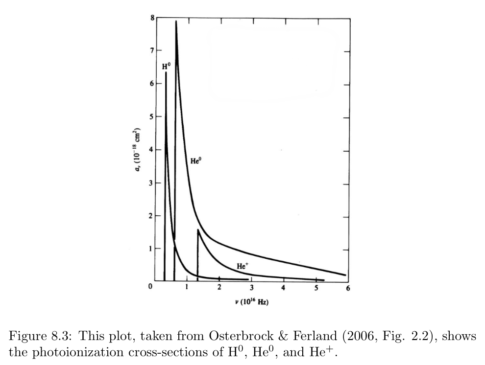
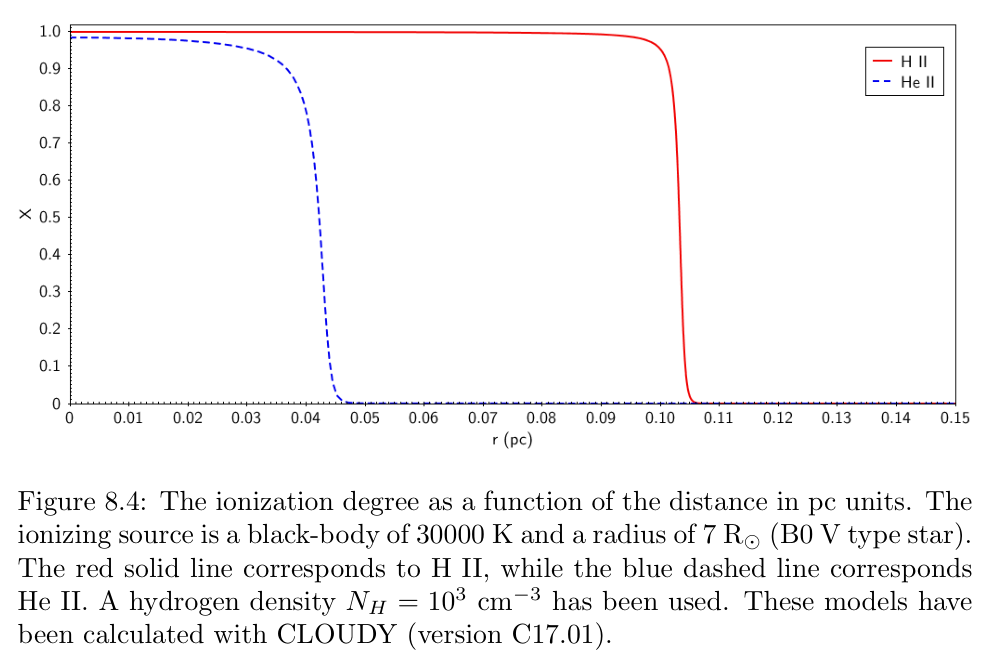
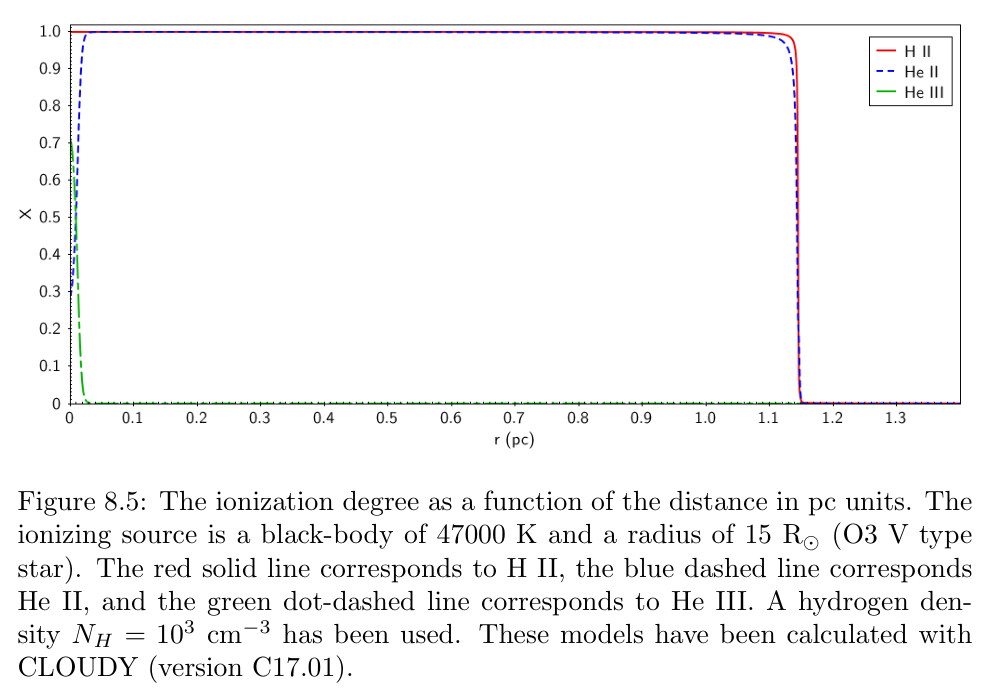
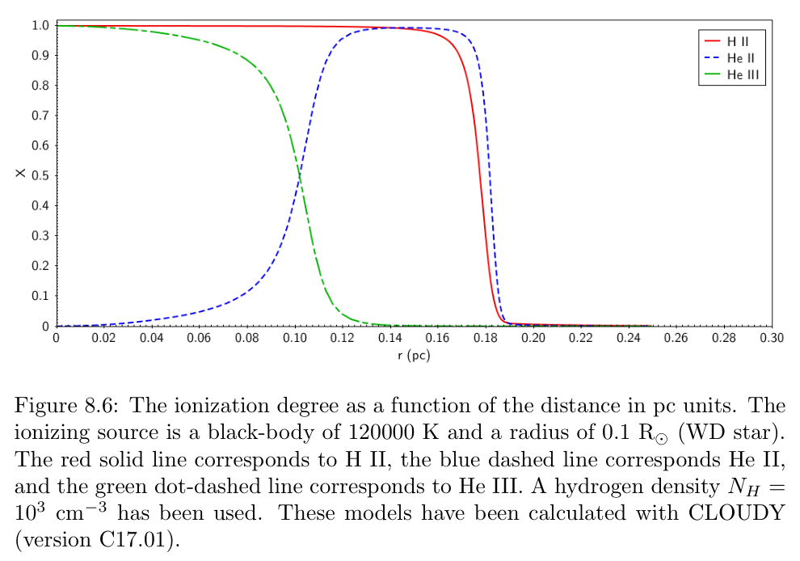

in a photoionised gas around a single source, **species at higher ionisation potential cluster closer to the source**, and **lower-ionisation species at the periphery**. the gas is layered like an onion. observable as different emission-line "shells" in resolved nebulae.

## the physical reason

at distance $r$ from the source, the **ionisation parameter** $U(r) \propto 1/r^2$ decreases outward.
- **inner region** (high $U$): high-ionisation species [OIII], [Ne III], He II dominant.
- **outer region** (low $U$): low-ionisation species [OII], [SII], [NII], H I.

each species has a peak ionisation efficiency at a specific $U$:

| species | required $h\nu$ for ionisation | peak $\log U$ |
|---|---|---|
| H II | 13.6 eV | $\sim -2$ |
| He II | 24.6 eV | $\sim -2$ |
| He III | 54.4 eV | $\sim -1$ |
| O II | 13.6 eV (similar to H) | $\sim -2$ |
| O III | 35 eV | $\sim -2$ |
| O IV | 54.9 eV | $\sim -1$ |
| Ne III | 41 eV | $\sim -2$ |
| Ne V | 97 eV | $\sim 0$ |
| S II | 10.4 eV | $\sim -2.5$ |
| N II | 14.5 eV | $\sim -2$ |

so the spatial layering reflects the radial $U$ gradient.

## observable consequences

### emission-line maps

in spatially resolved HII regions (M42 Orion, M16 Eagle, M20 Trifid):
- **inner core**: [OIII] $\lambda 5007$, He II $\lambda 4686$ emission strongest.
- **middle**: H$\alpha, [OII], [NII]$.
- **outer**: [SII], [OI] $\lambda 6300$.

resolved with HST or ground-based narrow-band imaging. each filter highlights a different layer.

### integrated line ratios

unresolved nebulae produce integrated spectra reflecting the volume-weighted mix:
- starburst galaxies (low $U$, low $T_e$): low [OIII]/[OII], high [SII]/H$\alpha$.
- AGN narrow-line regions (high $U$, hard ionising spectrum): high [OIII]/H$\beta$, He II $\lambda 4686$ visible.

these differences underlie the BPT diagram for galaxy classification ([[BPT diagram]]).

## ionisation correction factors (ICFs)

to measure abundances, you need to add up **all** ionisation stages of an element. but you observe only a few. the **ionisation correction factor**:
$$\mathrm{ICF}(X) = \frac{n(X)_{\rm tot}}{n(X)_{\rm observed\,stages}}$$

uses the ionisation potentials of observed and unobserved species to estimate the missing fraction. typical ICFs are $\sim 1$ to $\sim 3$. for sulphur, where only S II and S III are usually accessible, ICF can be $\sim 1.2$.

## the matter-bounded vs ionisation-bounded distinction

- **ionisation-bounded**: the gas is more than enough to absorb all ionising photons (typical HII region). the boundary is sharp.
- **matter-bounded**: gas is too thin to absorb all photons. some photons leak out. low-density-clumpy gas, AGN narrow-line regions sometimes. consequence: extra Lyman continuum reaches the IGM.

matter-bounded vs ionisation-bounded affects the integrated line ratios. matter-bounded shows excess [OII] and [SII] relative to [OIII] for the same $U$.

<!-- spec-figures -->
## Figures

*Figure 8.3 of Ciroi's notes: This plot, taken from Osterbrock & Ferland (2006, Fig. 2.2), shows the photoionization cross-sections of H$^0$, He$^0$ and He$^+$.* (Ciroi's notes, p. 106)

*Figure 8.4 of Ciroi's notes: The ionization degree as a function of the distance in pc units. The ionizing source is a black-body of 30000 K and a radius of 7 $R_\odot$ (B0 V type star). The red solid line corresponds to H II, while the blue dashed line corresponds He II. A hydrogen density $N_H = 10^3$ cm$^{-3}$ has been used. These models have been calculated with CLOUDY (version C17.01).* (Ciroi's notes, p. 106)

*Figure 8.5 of Ciroi's notes: The ionization degree as a function of the distance in pc units. The ionizing source is a black-body of 47000 K and a radius of 15 $R_\odot$ (O3 V type star). The red solid line corresponds to H II, the blue dashed line corresponds He II, and the green dot-dashed line corresponds to He III. A hydrogen density $N_H = 10^3$ cm$^{-3}$ has been used. These models have been calculated with CLOUDY (version C17.01).* (Ciroi's notes, p. 107)

*Figure 8.6 of Ciroi's notes: The ionization degree as a function of the distance in pc units. The ionizing source is a black-body of 120000 K and a radius of 0.1 $R_\odot$ (WD star). The red solid line corresponds to H II, the blue dashed line corresponds He II, and the green dot-dashed line corresponds to He III. A hydrogen density $N_H = 10^3$ cm$^{-3}$ has been used. These models have been calculated with CLOUDY (version C17.01).* (Ciroi's notes, p. 108)
<!-- /spec-figures -->

<!-- sources:wiki-arxiv -->
## Wikipedia and arXiv sources

*Lead figure of the Wikipedia article Strömgren sphere* ([Commons file page](https://commons.wikimedia.org/wiki/File:Rosette_nebula_Lanoue.png), John Lanoue, Public domain, as used on the Wikipedia article [Strömgren sphere](https://en.wikipedia.org/wiki/Str%C3%B6mgren_sphere))

- **Strömgren sphere**. "The Strömgren sphere is an idealized model of ionized hydrogen shells around young OB stars or quasars. Though ideally symmetrical, common examples demonstrate asymmetry as a result of environmental factors like gas inhomogeneity, bow shocks, anisotropic stellar emission, or relativistic effects. The Strömgren sphere is named after Bengt Strömgren, who first described it in 1937." ([Wikipedia](https://en.wikipedia.org/wiki/Str%C3%B6mgren_sphere))

> Definitions quoted from Wikipedia (CC BY-SA 4.0). Figures credited in their captions.
<!-- /sources:wiki-arxiv -->

## see also

- [[Ionisation parameter U]]
- Strömgren sphere
- [[Photoionisation balance]]
- [[Forbidden line diagnostics]]
- [[BPT diagram]]
- [[H II region spectroscopy]]
- [[AGN spectroscopy]]
- [[Planetary nebula spectroscopy]]

## Linked References

- [[Ionisation parameter U]]
- [[Ionisation parameter and ionisation state]]
- [[Molecular clouds]]
- [[Photoionisation balance]]
- [[Stromgren sphere]]
- [[Astronomical_Spectroscopy_MOC]]

