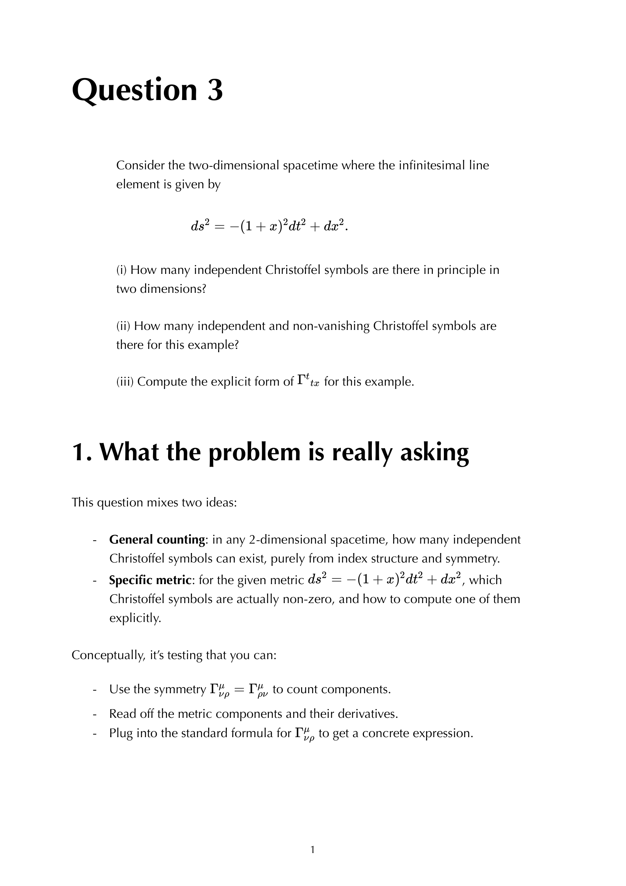


# Killing vectors and symmetries

---

### General Relativity Mathematical & Oral Defense Panel

*Question 3 Oral Exam Model Solution: Symmetries and Killing vectors in 2D spacetime $ds^2 = -(1+x^2)dt^2 + dx^2$, Killing equation $\nabla_\mu \xi_\nu + \nabla_\nu \xi_\mu = 0$, and conserved quantities along geodesics.*
<!-- sources:wiki-arxiv -->
## Wikipedia and arXiv sources

- **Killing vector field**. "In mathematics and theoretical physics, a Killing vector field or Killing field (named after Wilhelm Killing) is a vector field on a Riemannian manifold or pseudo-Riemannian manifold that preserves the metric. Flows generated by Killing vector fields are continuous isometries of the manifold." ([Wikipedia](https://en.wikipedia.org/wiki/Killing_vector_field))
- **Lecture Notes on General Relativity**. "These notes represent approximately one semester's worth of lectures on introductory general relativity for beginning graduate students in physics. Topics include manifolds, Riemannian geometry, Einstein's equations, and three applications: gravitational radiation, black holes, and cosmology." ([arXiv:gr-qc/9712019](https://arxiv.org/abs/gr-qc/9712019))

> Definitions quoted from Wikipedia (CC BY-SA 4.0) and the arXiv abstract. Figures credited in their captions.
<!-- /sources:wiki-arxiv -->



  <h4 class="backlinks-title">Linked References (1)</h4>
  <ul class="backlinks-list">
    <li class="backlink-item-wrap"><a href="../../04_Atlas/General_Relativity_MOC.html" class="backlink-item">General_Relativity_MOC</a></li>
  </ul>

