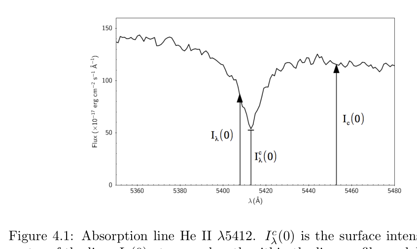

the **line profile function** $\phi(\nu)$ is the normalised function that distributes the integrated line cross section over frequency. its shape is set by the broadening mechanisms acting on the line.

## normalisation

by convention:
$$\int_{-\infty}^{+\infty} \phi(\nu)\,d\nu = 1$$

units: Hz$^{-1}$. so $\phi(\nu)$ has dimension of inverse frequency width.

## the families

three main shapes generated by different physics:

### Gaussian (Doppler)
random thermal velocities of the absorbing atoms, plus microturbulence. the Maxwellian velocity distribution gives a Gaussian frequency profile:
$$\phi_{\rm G}(\nu) = \frac{1}{\Delta\nu_D \sqrt\pi}\,\exp\!\left[-\left(\frac{\nu - \nu_0}{\Delta\nu_D}\right)^2\right]$$
with the **Doppler width** $\Delta\nu_D = (\nu_0/c)\sqrt{2k_BT/m + v_{\rm turb}^2}$.

FWHM of the Gaussian: $2\sqrt{\ln 2}\,\Delta\nu_D \approx 1.665\,\Delta\nu_D$.

### Lorentzian (natural + collisional)
finite lifetime of the upper level (natural broadening) or perturbations from neighbouring particles (collisional / pressure broadening). gives:
$$\phi_{\rm L}(\nu) = \frac{1}{\pi}\,\frac{\Gamma/2}{(\nu - \nu_0)^2 + (\Gamma/2)^2}$$
with **damping constant** $\Gamma = \gamma_{\rm nat} + \gamma_{\rm coll}$.

FWHM: exactly $\Gamma$. Lorentzian has very wide wings ($\propto 1/(\nu-\nu_0)^2$ at large $\Delta\nu$).

### Voigt (the convolution)
when both Gaussian and Lorentzian mechanisms operate (the usual case in real atmospheres), the combined profile is the **Voigt profile**, the convolution of Gaussian + Lorentzian:
$$\phi_{\rm Voigt}(\nu) = \int \phi_{\rm G}(\nu')\,\phi_{\rm L}(\nu - \nu')\,d\nu'$$

at line center, the Gaussian dominates (narrow core). in the wings, the Lorentzian dominates ($1/(\nu-\nu_0)^2$ tails). see [[Voigt profile]].

## consequences for the spectrum

- **line core**: Gaussian-shaped, depth set by central optical depth.
- **line wings**: Lorentzian-shaped, deep wings appear when natural + collisional broadening is significant.
- **interface**: the transition between core and wing is the **damping parameter** $a = \Gamma / (4\pi \Delta\nu_D)$.

at low column density, only the line core matters and the line is essentially Gaussian. at high column density, the line saturates in the core but continues to grow in the Lorentzian wings: this is the **damping wing regime** of the curve of growth.

## the Voigt parameters

Voigt profile is parameterised by two: $u = (\nu - \nu_0)/\Delta\nu_D$ and $a = \Gamma/(4\pi\Delta\nu_D)$. tabulated as $H(a, u)$, the Voigt function. modern computation: scipy's `wofz` (the Faddeeva function).

<!-- spec-figures -->
## Figures

*Figure 4.1 of Ciroi's notes: Absorption line He II λ5412.* (Ciroi's notes, p. 41)
<!-- /spec-figures -->

<!-- sources:wiki-arxiv -->
## Wikipedia and arXiv sources

*Vibronic spectrum of permanganate ion* ([Commons file page](https://commons.wikimedia.org/wiki/File:Permanganate_spectrum.png), Petergans, CC BY-SA 3.0, as used on the Wikipedia article [Spectral line shape](https://en.wikipedia.org/wiki/Spectral_line_shape))

- **Spectral line shape**. "Spectral line shape or spectral line profile describes the form of an electromagnetic spectrum in the vicinity of a spectral line – a region of stronger or weaker intensity in the spectrum. Ideal line shapes include Lorentzian, Gaussian and Voigt functions, whose parameters are the line position, maximum height and half-width." ([Wikipedia](https://en.wikipedia.org/wiki/Spectral_line_shape))

> Definitions quoted from Wikipedia (CC BY-SA 4.0). Figures credited in their captions.
<!-- /sources:wiki-arxiv -->

## see also

- [[Absorption coefficient and oscillator strength]]
- [[Equivalent width]]
- [[Curve of growth]]
- [[Voigt profile]]
- [[Natural broadening Lorentzian]]
- [[Thermal Doppler broadening]]
- [[Collisional pressure broadening]]
- [[Microturbulence]]
- [[Damping wings]]
- [[Rotational broadening]]

## Linked References

- [[Absorption coefficient and oscillator strength]]
- [[Collisional pressure broadening]]
- [[Curve of growth]]
- [[Equivalent width]]
- [[Macroturbulence]]
- [[Microturbulence]]
- [[Natural broadening Lorentzian]]
- [[Rotational broadening]]
- [[Thermal Doppler broadening]]
- [[Voigt profile]]
- [[Astronomical_Spectroscopy_MOC]]

