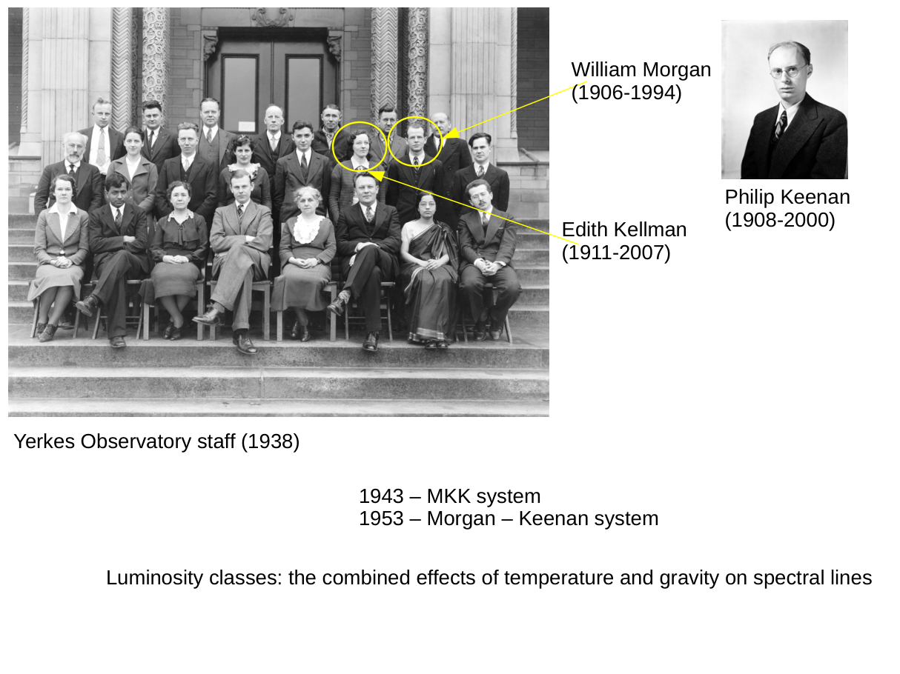

the MK system extends the OBAFGKM temperature sequence with **luminosity classes** (I-V) based on stellar surface gravity, which manifests in the **shape and width** of spectral lines.

## the five classes

| class | description | typical $\log g$ | examples |
|---|---|---|---|
| I | supergiants | $\sim 0$ to $1.5$ | Rigel (B8 Ia), Betelgeuse (M2 Ia) |
| II | bright giants | $\sim 1.5$ to $2.5$ | Polaris (F8 II), $\beta$ Aql (G8 II) |
| III | giants (red giant branch) | $\sim 2.5$ to $3.5$ | Aldebaran (K5 III), Arcturus (K1.5 III) |
| IV | subgiants | $\sim 3.5$ to $4.0$ | Procyon (F5 IV) |
| V | dwarfs (main sequence) | $\sim 4.0$ to $4.5$ | Sun (G2 V), 61 Cyg A (K5 V) |

(Roman numerals for the class. additional: VI for "subdwarfs," VII for white dwarfs, etc.)

so a full MK type looks like **G2 V** (the Sun), **K0 III** (Arcturus), **B8 Ia** (Rigel), etc.

## physical basis - surface gravity

at fixed $T_{\rm eff}$, the **size** of the star differs hugely between dwarfs and supergiants. since $\log g = \log(GM/R^2)$:
- dwarf ($M = M_\odot, R = R_\odot$): $\log g = 4.44$.
- giant ($M = M_\odot, R = 100\,R_\odot$): $\log g = 0.4$.
- supergiant ($M = 20\,M_\odot, R = 1000\,R_\odot$): $\log g = 0.0$.

so giants have **much lower gravity** than dwarfs. the photosphere has lower pressure for given $T$, which changes line profiles.

## the diagnostics

at fixed $T_{\rm eff}$ (i.e. fixed letter class), luminosity-class differences appear in:

### Balmer line wings (especially in O, B, A stars)

higher gravity = denser atmosphere = stronger Stark broadening of H lines. dwarf B5 V has very wide Balmer wings. supergiant B5 Iab has narrow Balmer cores. the wing width is a **gravity discriminator**.

### resonance line wings (in cool stars)

Ca II H + K, Mg I b, Na I D wings: stronger in dwarfs, narrower in giants. driven by van der Waals and resonance broadening, both density-sensitive.

### specific line ratios

certain line ratios are very gravity-sensitive:
- Sr II $\lambda 4077$ / Fe I $\lambda 4071$: stronger Sr II in giants.
- O I triplet $\lambda 7774$: weaker in giants.
- Ca I $\lambda 4226$ / Sr II $\lambda 4077$.

these are tabulated in the MK atlas.

### CN, CH, MgH bands (in cool stars)

molecular bands are stronger in giants because lower gravity allows more pressure-stable molecules. M giants have very strong TiO bands compared to M dwarfs.

## the HR diagram interpretation

luminosity class corresponds to the position on the HR diagram:
- **Class V (MS)**: thin diagonal band at modest $L$.
- **Class III (giants)**: red giant branch + clump at $L \sim 100\,L_\odot$.
- **Class I (supergiants)**: top of the diagram, $L \sim 10^4$ to $10^6\,L_\odot$.

knowing both letter class (T) and luminosity class places the star on the HR diagram.

## the Hertzsprung gap and other features

- **Hertzsprung gap**: between MS and red giants for late-A through early-G stars. few stars there because evolution is fast.
- **horizontal branch**: He-burning stars at $L \sim 50\,L_\odot$, mostly Pop II.
- **AGB**: very luminous late-type, $L \sim 10^3\,L_\odot$, rich Mira-type variables.

## consequence for galactic surveys

luminosity classes matter because:
- **same letter class but different luminosity** = very different intrinsic brightness.
- **misclassifying** a giant as a dwarf changes inferred distance by factor $\sim 10$.
- **photometric distance estimates** rely on knowing both class and luminosity.

modern stellar surveys (Gaia + spectroscopy) recover both reliably.

<!-- spec-figures -->
## Figures

*Yerkes, Morgan, Keenan and Kellman (MK system), Ciroi's slides* (Ciroi's slides, slide 28)
<!-- /spec-figures -->

<!-- sources:wiki-arxiv -->
## Wikipedia and arXiv sources

*Lead figure of the Wikipedia article Stellar classification* ([Commons file page](https://commons.wikimedia.org/wiki/File:HR-diag-no-text-2.svg), User:Spacepotato, CC BY-SA 3.0, as used on the Wikipedia article [Stellar classification](https://en.wikipedia.org/wiki/Stellar_classification))

- **Stellar classification**. "In astronomy, stellar classification is the classification of stars based on their spectral characteristics. Electromagnetic radiation from the star is analyzed by splitting it with a prism or diffraction grating into a spectrum exhibiting the rainbow of colors interspersed with spectral lines." ([Wikipedia](https://en.wikipedia.org/wiki/Stellar_classification))

> Definitions quoted from Wikipedia (CC BY-SA 4.0). Figures credited in their captions.
<!-- /sources:wiki-arxiv -->

## see also

- [[Stellar spectra and spectral classification]]
- [[Why the Sequence OBAFGKM]]
- [[History of stellar classification]]
- [[Collisional pressure broadening]]
- [[Stark broadening]]
- [[Voigt profile]]
- [[Damping wings]]
- [[HR diagram]]
- [[Stellar populations I II III]]
- [[Spectroscopic parallax and main-sequence fitting]]
- [[Sodium population vs T]]

## Linked References

- [[Collisional pressure broadening]]
- [[Damping wings]]
- [[History of stellar classification]]
- [[Saha ionisation equation]]
- [[Sodium and alkalis]]
- [[Sodium population vs T]]
- [[Stark broadening]]
- [[Why the Sequence OBAFGKM]]
- [[Astronomical_Spectroscopy_MOC]]

