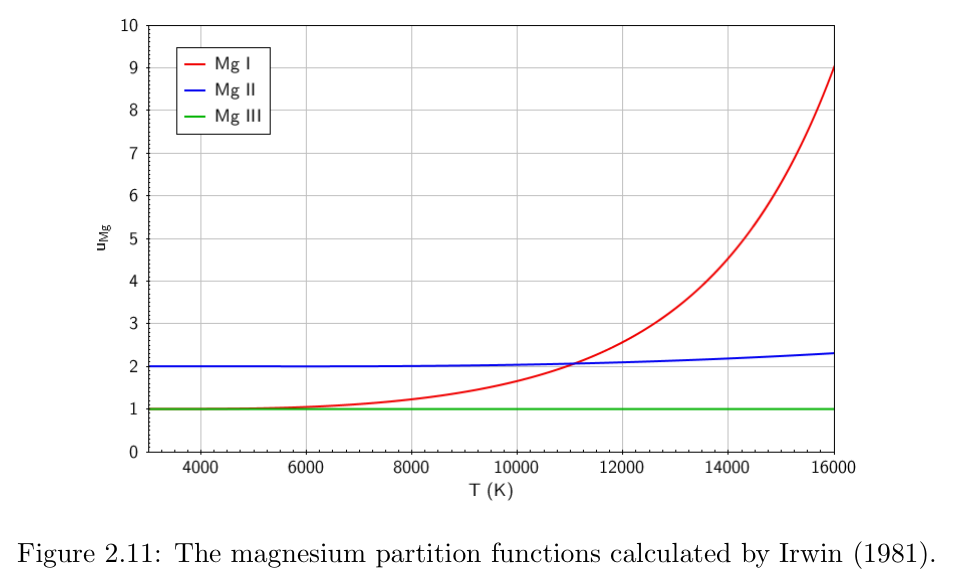
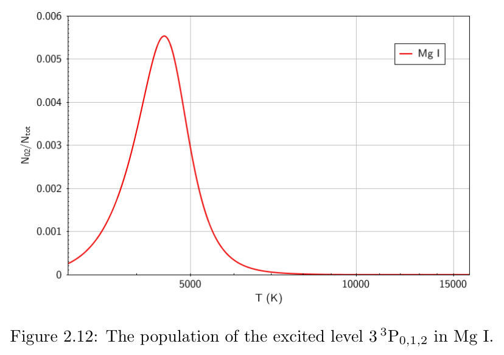
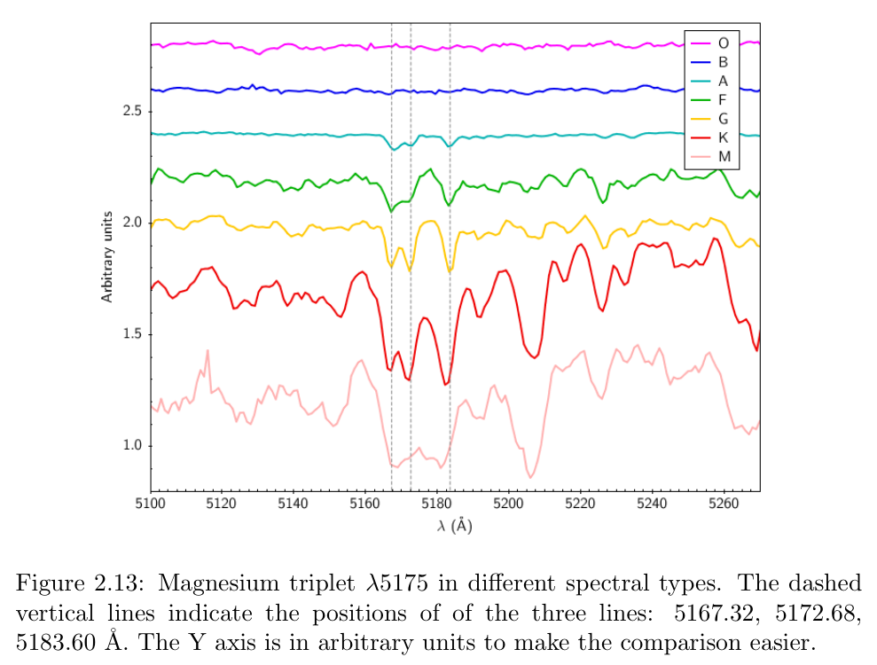

Mg has $\chi_{\rm MgI} = 7.65$ eV (modest) and $\chi_{\rm MgII} = 15$ eV. Mg I lines (notably the b-triplet at $\sim 5170$ Å) appear in cool to intermediate stars. Mg II h+k at UV $2800$ Å in hotter ones.

## Mg I b-triplet

lower level of b-triplet is $3\,^3S_1$ at $2.7$ eV above ground (it's an excited triplet). so the line strength scales as
$$f(T) = f_{\rm MgI}(T) \cdot e^{-2.7/k_BT}\,g/Z$$

Boltzmann factor needs $T$ high enough to populate $3\,^3S$, but Saha needs $T$ low enough to keep Mg neutral.

peak: $T \sim 5000$ K (G stars, including Sun). Mg I b is strongest in solar-type stars.

at lower $T$ ($M$ stars): the $3\,^3S$ level is too far above ground to be appreciably populated (Boltzmann suppresses), so Mg I b weakens despite full neutrality.

at higher $T$ ($A$ stars): Saha ionises away the neutral Mg, lines weaken.

## Mg II h+k

Mg II ground is $3s^1$, just like H or alkalis. h+k transitions $3p \to 3s$:
- **k**: $\lambda 2796$ Å.
- **h**: $\lambda 2803$ Å.

these are **resonance lines** of Mg II (from the ground), so accessible to any photon at those wavelengths. very strong in:
- A and F stars in the UV.
- ISM along QSO sight lines (Mg II absorbers at $z \sim 0.5$ to $2$).
- AGN broad-line regions.
- chromospheres of cool stars (emission cores).

peak strength as Mg II in stellar populations: $T \sim 8000$ to $10\,000$ K (A0), where Saha favours singly ionised.

## the user's plot

`~/Documents/2/spectroscopy/Plots-20260501/MgI_pop_T.png` shows Mg I as a bell curve peaked at $\sim 5000$ K.

`MgI_stelle.png` shows Mg I b in actual stellar spectra of various types, demonstrating the peak at G.

<!-- spec-figures -->
## Figures

*Figure 2.11 of Ciroi's notes: The magnesium partition functions calculated by Irwin (1981).* (Ciroi's notes, p. 30)

*Figure 2.12 of Ciroi's notes: The population of the excited level $3\,^3P_{0,1,2}$ in Mg I.* (Ciroi's notes, p. 31)

*Figure 2.13 of Ciroi's notes: Magnesium triplet $\lambda 5175$ in different spectral types. The dashed vertical lines indicate the positions of the three lines: $5167.32$, $5172.68$, $5183.60$ Å. The Y axis is in arbitrary units to make the comparison easier.* (Ciroi's notes, p. 31)
<!-- /spec-figures -->

<!-- sources:wiki-arxiv -->
## Wikipedia and arXiv sources

- **Saha ionization equation**. "In physics, the Saha ionization equation is an expression that relates the ionization state of a gas in thermal equilibrium to the temperature and pressure. The equation is a result of combining ideas of quantum mechanics and statistical mechanics and is used to explain the spectral classification of stars. The expression was developed by physicist Meghnad Saha in 1920." ([Wikipedia](https://en.wikipedia.org/wiki/Saha_ionization_equation))

> Definitions quoted from Wikipedia (CC BY-SA 4.0). Figures credited in their captions.
<!-- /sources:wiki-arxiv -->

## see also

- [[Magnesium and alkali earths]]
- [[Boltzmann equation in spectroscopy]]
- [[Saha ionisation equation]]
- [[Population of excited levels]]
- [[Why the Sequence OBAFGKM]]
- [[Stellar spectra and spectral classification]]

## Linked References

- [[Magnesium and alkali earths]]
- [[Population of excited levels]]
- [[Why the Sequence OBAFGKM]]
- [[Astronomical_Spectroscopy_MOC]]

