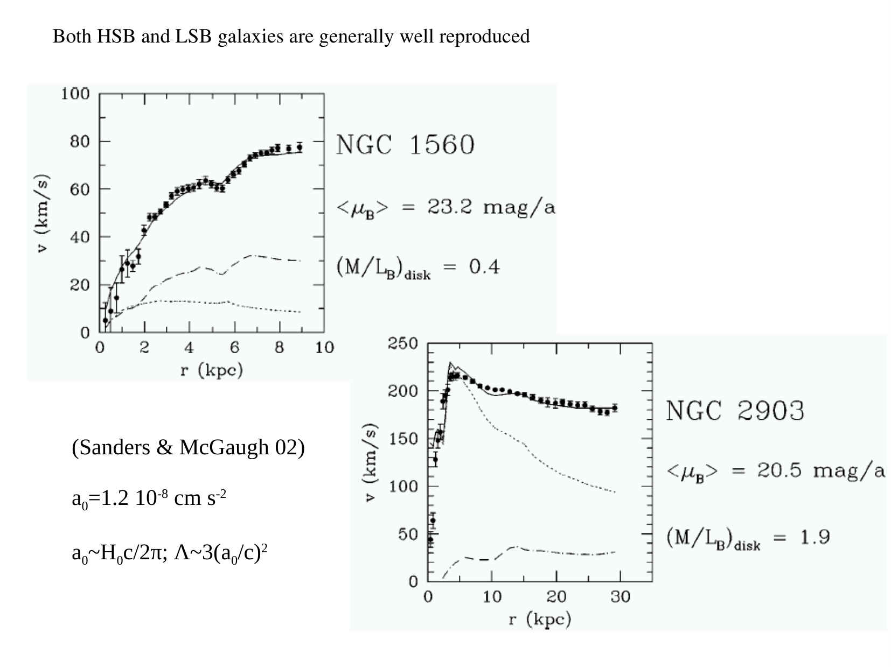
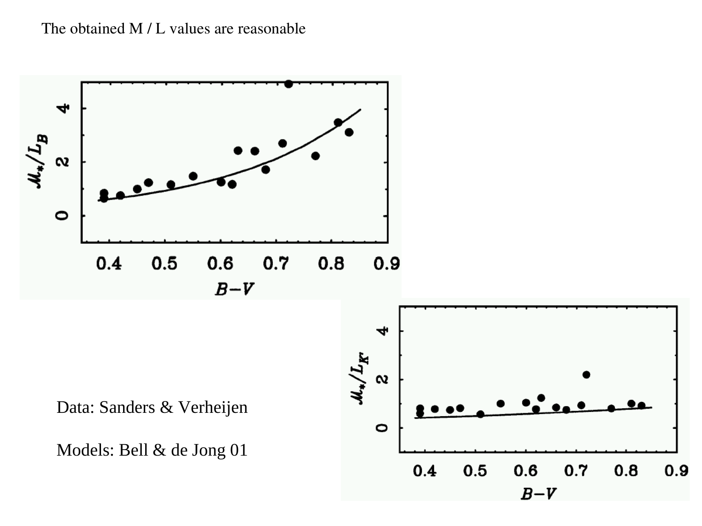
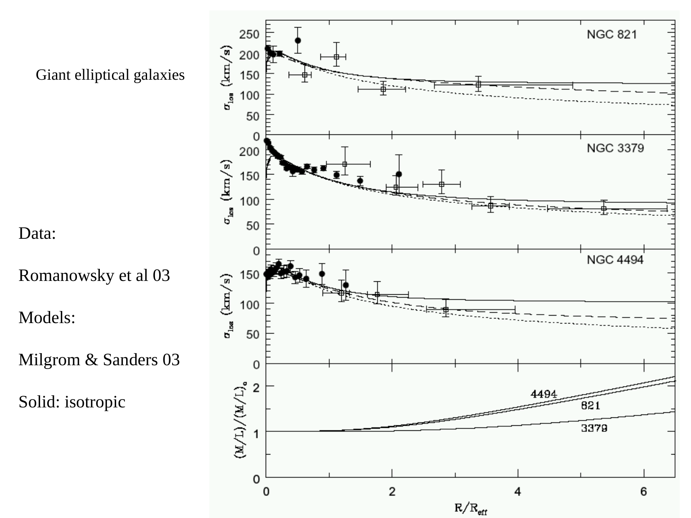
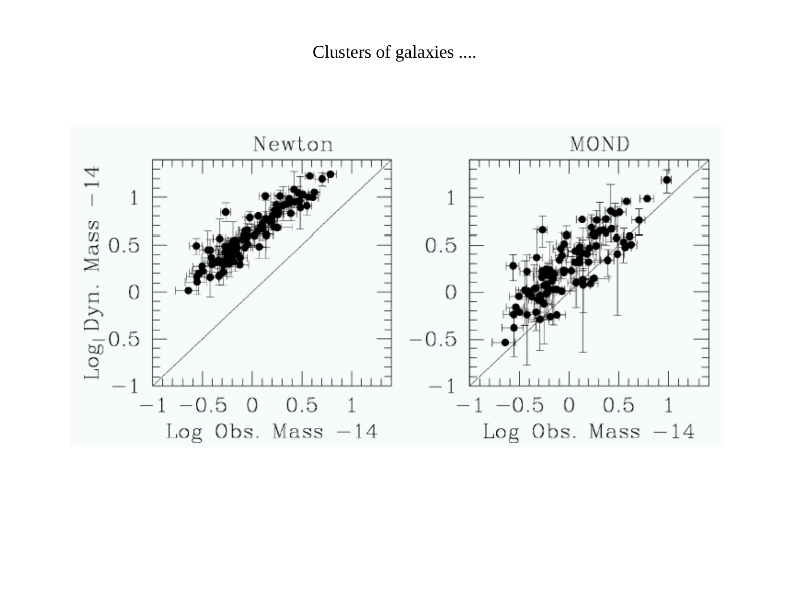
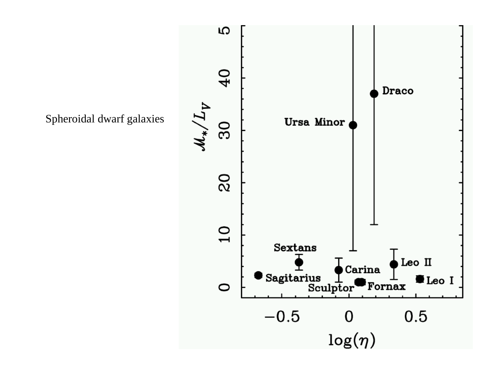
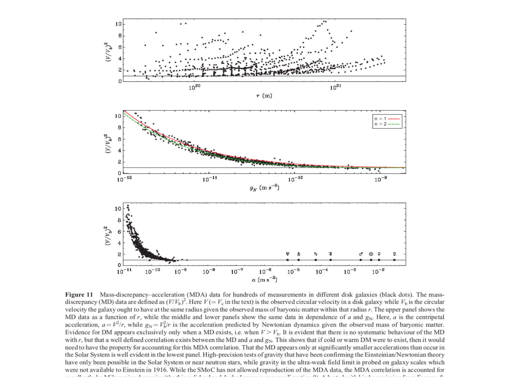
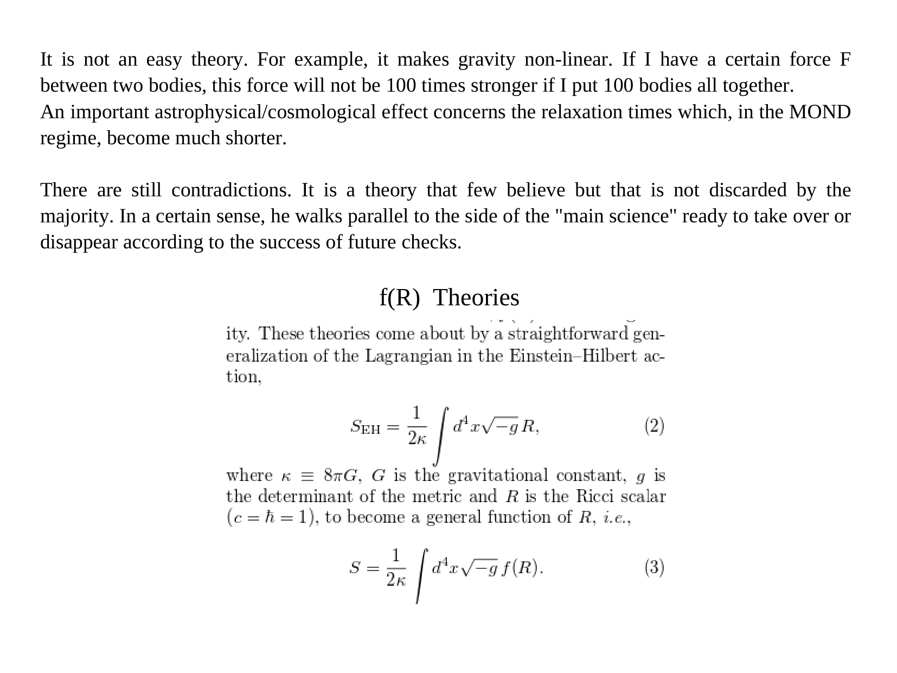
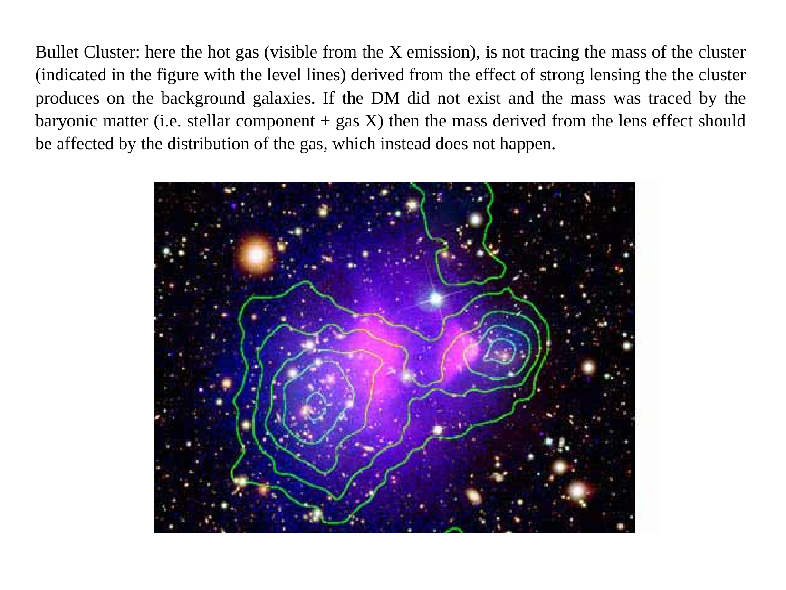
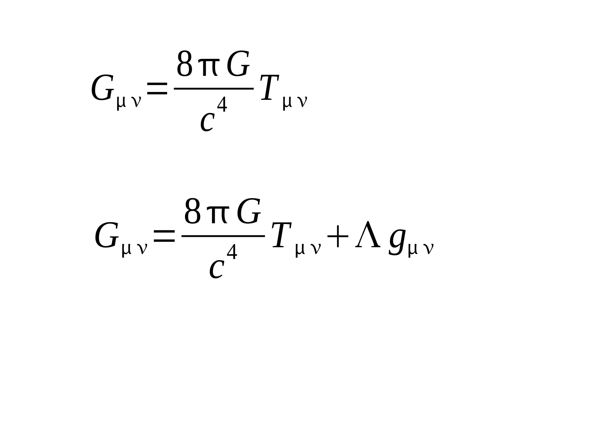
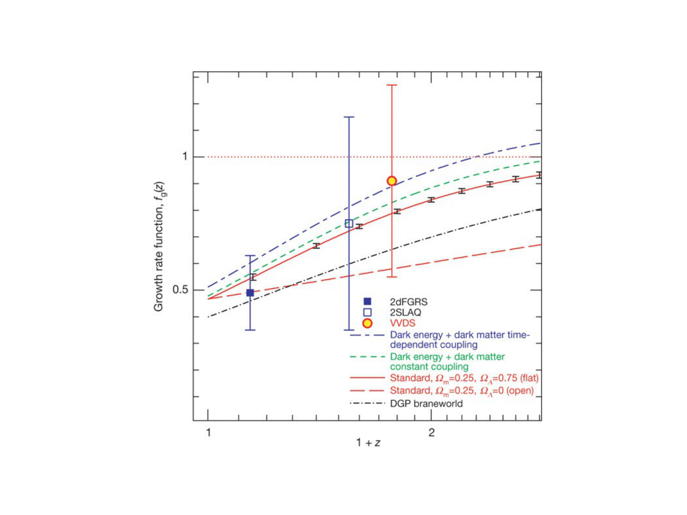

# modified gravity alternatives

up: [[Astrophysics_of_Galaxies_MOC]] · [[Dark matter rotation curves]]

## mond (modified newtonian dynamics)

Proposed by Mordehai Milgrom in 1983 as an alternative to dark matter. MOND posits that Newton's second law breaks down below a characteristic acceleration scale:

$$a_0 \approx 1.2 \times 10^{-10} \text{ m s}^{-2} \approx \frac{c H_0}{2\pi}$$

The modified equation of motion is:
$$\mu\left(\frac{a}{a_0}\right) a = g_N$$
where $g_N = G M / r^2$ is standard Newtonian gravitational acceleration, and $\mu(x)$ is an interpolation function:
$$\mu(x) \approx \begin{cases} 1 & x \gg 1 \text{ (Newtonian regime)} \\ x & x \ll 1 \text{ (Deep MOND regime)} \end{cases}$$

## deep mond regime consequences

When $a \ll a_0$:
$$\frac{a^2}{a_0} = \frac{G M}{r^2} \implies a = \frac{\sqrt{G M a_0}}{r}$$
For circular motion $a = v^2/r$:
$$\frac{v^4}{r^2} = \frac{G M a_0}{r^2} \implies v_{\rm flat} = (G M a_0)^{1/4}$$

- **flat rotation curves**: $v_{\rm flat}$ is completely independent of radius $r$.
- **baryonic tully-fisher relation**: $M_{\rm bar} \propto v_{\rm flat}^4$ emerges naturally with exact normalization set by $a_0$.

## challenges and failures

- **galaxy clusters**: MOND fails to explain the velocity dispersions of rich clusters (e.g., Coma) without invoking missing baryons or massive neutrinos.
- **the bullet cluster**: [[Bullet Cluster and dark matter mapping]] shows lensing peaks offset from the gas, requiring collisionless dark mass.
- **cosmology and cmb**: relativistic MOND formulations (TeVeS, Bekenstein 2004) struggle to simultaneously match the acoustic peak heights in the CMB power spectrum and the galaxy matter power spectrum $P(k)$ without a cold dark matter component.

## connections

- dark matter evidence: [[Bullet Cluster and dark matter mapping]], [[Dark matter rotation curves]]
- scaling laws: [[Tully-Fisher relation]]

---

## lecture slides and reference figures (Prof. Alessandro Pizzella)

<!-- sources:wiki-arxiv -->
## Wikipedia and arXiv sources

- **Alternatives to general relativity**. "Alternatives to general relativity are physical theories that attempt to describe the phenomenon of gravitation in competition with Einstein's theory of general relativity. There have been many different attempts at constructing an ideal theory of gravity." ([Wikipedia](https://en.wikipedia.org/wiki/Alternatives_to_general_relativity))
- **Modified Newtonian Dynamics (MOND): Observational Phenomenology and Relativistic Extensions**. "A wealth of astronomical data indicate the presence of mass discrepancies in the Universe. The motions observed in a variety of classes of extragalactic systems exceed what can be explained by the mass visible in stars and gas." ([arXiv:1112.3960](https://arxiv.org/abs/1112.3960))

> Definitions quoted from Wikipedia (CC BY-SA 4.0) and the arXiv abstract. Figures credited in their captions.
<!-- /sources:wiki-arxiv -->

## Linked References

- [[Bullet Cluster and dark matter mapping]]
- [[Mass-radius and mass-velocity relations]]
- [[Astrophysics_of_Galaxies_MOC]]

