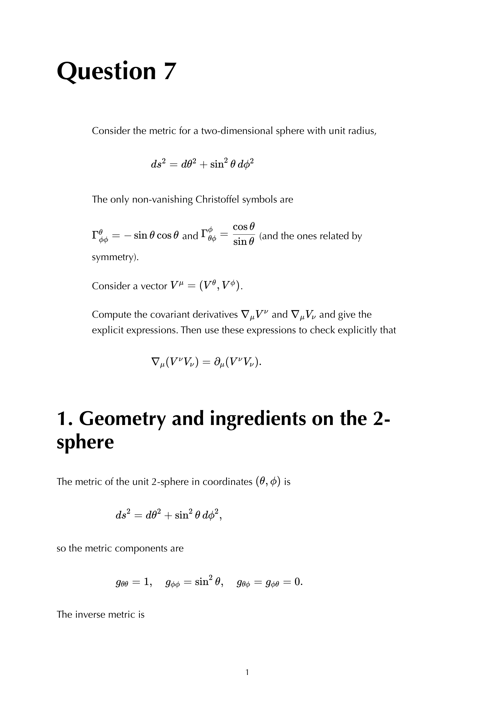
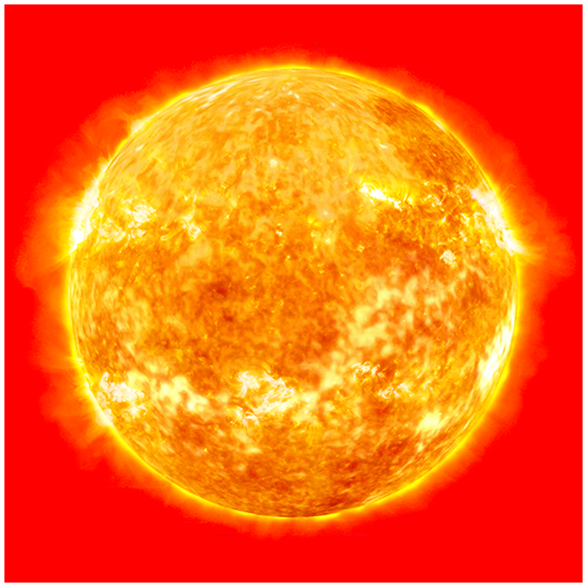

# Parallel transport and holonomy

---

### General Relativity Mathematical & Oral Defense Panel

*Question 7 Oral Exam Model Solution: Parallel transport of a vector along a latitude circle $\theta = \theta_0$ on $S^2$, covariant derivative equation $\nabla_{\dot{\gamma}} V^\mu = 0$, and derivation of the holonomy angle $\Delta\phi = 2\pi(1 - \cos\theta_0)$.*

*Cambridge Lecture Diagram: Holonomy on curved manifolds: non-commutativity of covariant derivatives and the Riemann curvature tensor definition.*

<!-- sources:wiki-arxiv -->
## Wikipedia and arXiv sources

*Visualisation of parallel transport on a sphere along a piecewise smooth curve. Initial vector is labelled as V, its parallel transport is labelled as P_\gamma(V)* ([Commons file page](https://commons.wikimedia.org/wiki/File:Holonomy-vis-with-label.png), User84446654, CC BY-SA 4.0, as used on the Wikipedia article [Holonomy](https://en.wikipedia.org/wiki/Holonomy))

- **Holonomy**. "In differential geometry, the holonomy of a connection on a smooth manifold is the extent to which parallel transport around closed loops fails to preserve the geometrical data being transported. Holonomy is a general geometrical consequence of the curvature of the connection. For flat connections, the associated holonomy is a type of monodromy and is an inherently global notion." ([Wikipedia](https://en.wikipedia.org/wiki/Holonomy))

> Definitions quoted from Wikipedia (CC BY-SA 4.0). Figures credited in their captions.
<!-- /sources:wiki-arxiv -->

