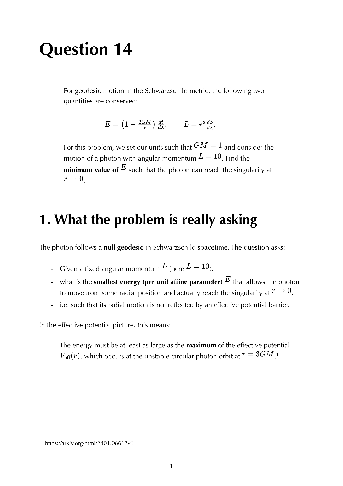


# Perihelion precession of Mercury

---

### General Relativity Mathematical & Oral Defense Panel

*Question 14 Oral Exam Model Solution: Relativistic Binet equation for planetary orbits $\frac{d^2 u}{d\phi^2} + u = \frac{GM}{L^2} + 3GM u^2$, perturbative derivation of the perihelion advance $\Delta\phi = \frac{6\pi GM}{c^2 a(1-e^2)}$, and verification of Mercury 43 arcsec/century.*


  <h4 class="backlinks-title">Linked References (1)</h4>
  <ul class="backlinks-list">
    <li class="backlink-item-wrap"><a href="../../04_Atlas/General_Relativity_MOC.html" class="backlink-item">General_Relativity_MOC</a></li>
  </ul>

<!-- sources:wiki-arxiv -->
## Wikipedia and arXiv sources

- **Tests of general relativity**. "Tests of general relativity serve to establish observational evidence for the theory of general relativity. The first three tests, proposed by Albert Einstein in 1915, concerned the "anomalous" precession of the perihelion of Mercury, the bending of light in gravitational fields, and the gravitational redshift." ([Wikipedia](https://en.wikipedia.org/wiki/Tests_of_general_relativity))
- **Lecture Notes on General Relativity**. "These notes represent approximately one semester's worth of lectures on introductory general relativity for beginning graduate students in physics. Topics include manifolds, Riemannian geometry, Einstein's equations, and three applications: gravitational radiation, black holes, and cosmology." ([arXiv:gr-qc/9712019](https://arxiv.org/abs/gr-qc/9712019))

> Definitions quoted from Wikipedia (CC BY-SA 4.0) and the arXiv abstract. Figures credited in their captions.
<!-- /sources:wiki-arxiv -->

