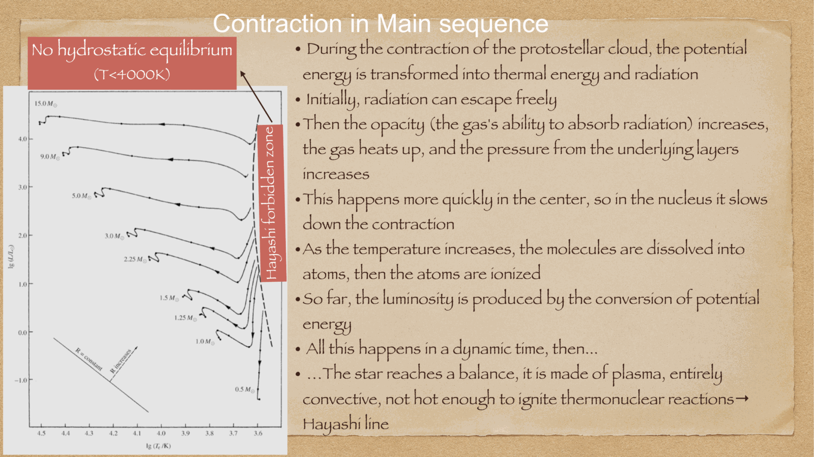
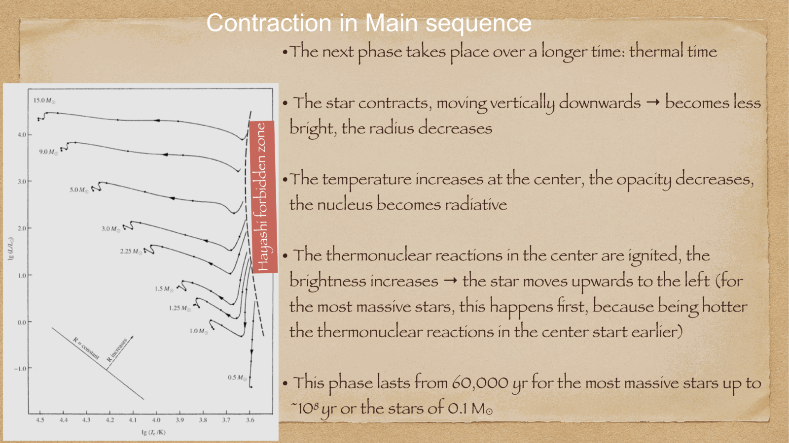
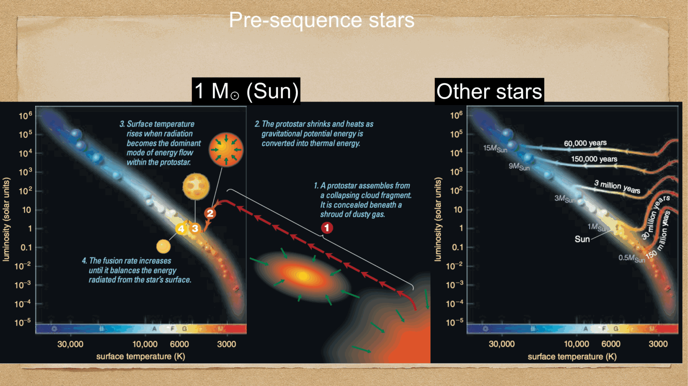
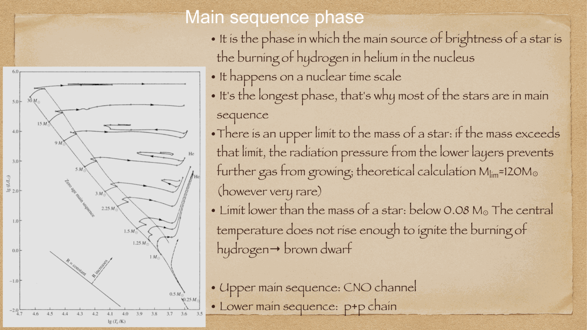

after a dense protostellar core fragments out of a molecular cloud, it undergoes pre-main sequence (PMS) contraction until central temperatures and pressures reach conditions sufficient for stable hydrogen fusion.

---

## the phases of pre-main sequence evolution

### 1. isothermal free-fall collapse
the core collapses rapidly on the dynamical timescale $t_{\text{ff}} \approx 10^5$ yr. dust efficiently radiates away compressional heat in the far-infrared ($T \approx 10-20$ K).

### 2. hydrostatic protostar and the Hayashi track
once the core becomes optically thick, trapped radiation heats the gas, establishing hydrostatic equilibrium. the object is now a **protostar**, embedded in an infalling circumstellar envelope and rotating accretion disk (observed in sub-mm by ALMA).

Chushiro Hayashi (1961) showed that a fully convective star has a nearly constant effective temperature:
$$T_{\text{eff}} \approx 3000 - 4500 \text{ K}$$
the protostar contracts along a nearly vertical path downward in the HR diagram called the **Hayashi track**:
- radius $R$ decreases substantially.
- $T_{\text{eff}} \approx \text{constant}$.
- luminosity $L = 4\pi R^2 \sigma T_{\text{eff}}^4$ plunges by orders of magnitude.
- energy transport is **100% convective**.

### 3. the Henyey track
for stars with $M \gtrsim 0.5 M_\odot$, central temperature eventually rises sufficiently that core opacity drops (Kramer's opacity $\kappa \propto \rho T^{-7/2}$). convection ceases in the interior, and a **radiative core** develops.

the star turns horizontally to the left on the HR diagram along the **Henyey track**:
- luminosity $L \approx \text{constant}$.
- effective temperature $T_{\text{eff}}$ increases steadily as the surface heats up.
- radius continues to contract.

*(very low mass stars, $M < 0.5 M_\odot$, remain fully convective and follow the Hayashi track all the way down to the main sequence without a Henyey phase).*

### 4. arrival at the Zero-Age Main Sequence (ZAMS)
when the central core reaches $T_c \approx 10^7$ K and $\rho_c \sim 100$ g/cm$^3$, thermonuclear fusion of hydrogen via the pp-chain (or CNO cycle) ignites. nuclear energy generation perfectly matches the surface luminosity loss ($L_{\text{nuc}} = L$). 

gravitational contraction ceases, the star achieves complete thermal and hydrostatic equilibrium, and settles onto the **Zero-Age Main Sequence (ZAMS)**.

---

## worked example

the time to reach the main sequence is the Kelvin-Helmholtz time, and it depends strongly on mass:

- $15\,M_\odot$: about $10^5$ yr
- $1\,M_\odot$: about 30 to 50 Myr
- $0.1\,M_\odot$: several hundred Myr

other numbers: deuterium burns at $10^6$ K, hydrogen needs $M > 0.075\,M_\odot$, and deuterium needs $M > 13$ Jupiter masses.

## where it goes wrong

- a pre-main-sequence star shines by contraction, not by fusion.
- a T Tauri star sits above the main sequence because it is larger, not because it is hotter.
- on the Hayashi track the star is fully convective and its temperature stays near 4000 K while the luminosity falls.
- massive stars are still accreting when they reach the main sequence, so they have no visible pre-main-sequence phase.

<!-- sources:wiki-arxiv -->
## Wikipedia and arXiv sources

*LH 95 stellar nursery in the Large Magellanic Cloud* ([Commons file page](https://commons.wikimedia.org/wiki/File:LH_95.jpg), NASA, ESA, and the Hubble Heritage Team (STScI/AURA)-ESA/Hubble Collaboration, Public domain, as used on the Wikipedia article [Pre-main-sequence star](https://en.wikipedia.org/wiki/Pre-main-sequence_star))

- **Pre-main-sequence star**. "A pre-main-sequence star (also known as a PMS star and PMS object) is a star in the stage when it has not yet reached the main sequence. Earlier in its life, the object is a protostar that grows by acquiring mass from its surrounding envelope of interstellar dust and gas. After the protostar blows away this envelope, it is optically visible, and appears on the stellar birthline in the Hertzsprung-Russell diagram." ([Wikipedia](https://en.wikipedia.org/wiki/Pre-main-sequence_star))

> Definitions quoted from Wikipedia (CC BY-SA 4.0). Figures credited in their captions.
<!-- /sources:wiki-arxiv -->

## see also

- [[Fundamentals_Astrophysics_Cosmology_MOC]]
- [[Jeans theory and protostellar formation]]
- [[HR diagram]]
- [[Stellar scaling relations]]
- [[Stellar evolution timescales]]

## Linked References

- [[Jeans theory and protostellar formation]]
- [[Stellar evolution timescales]]
- [[Fundamentals_Astrophysics_Cosmology_MOC]]

