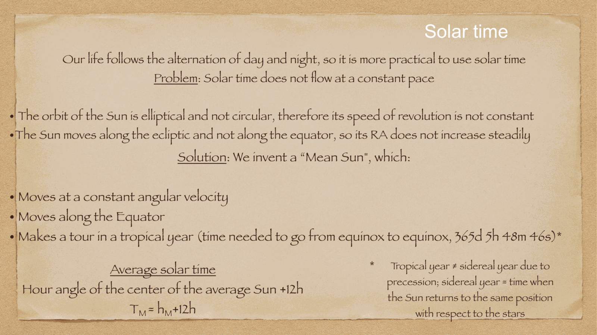
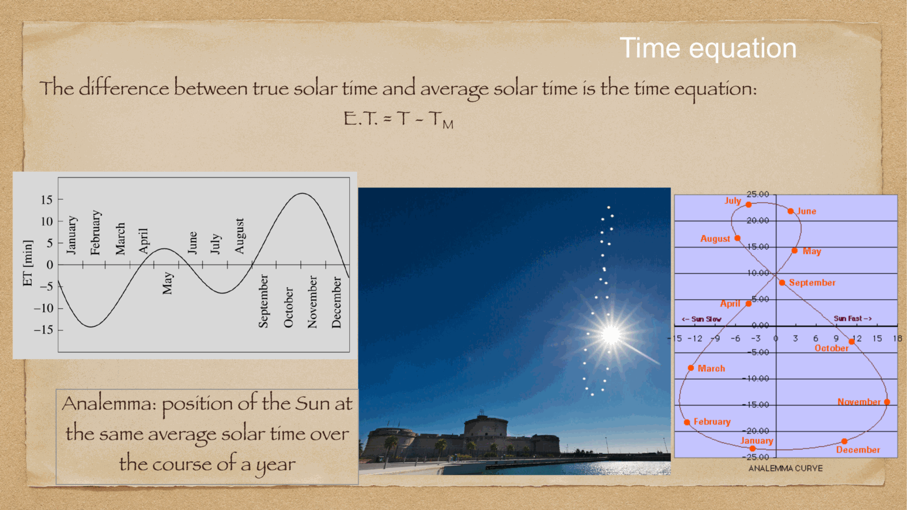
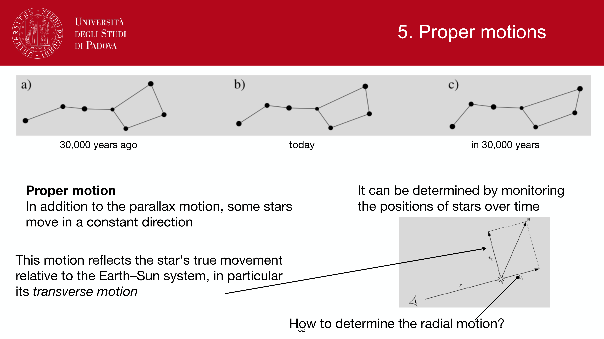
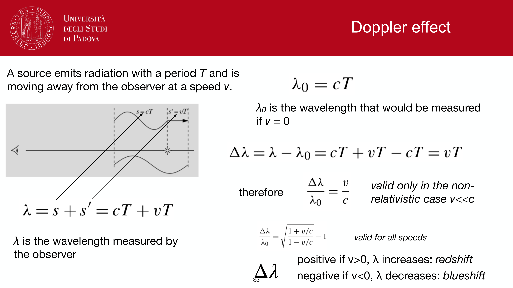

in addition to the periodic reflex motions of parallax and aberration caused by Earth's orbit, stars have intrinsic physical motion through three-dimensional space relative to the solar system: their **space velocity** $\vec{v}$.

the projection of this 3D space velocity onto the plane of the sky is observed as an angular drift called **proper motion** (moto proprio).

---

## definitions and the velocity triangle

the space velocity vector $\vec{v}$ of a star relative to the Sun is decomposed into two orthogonal components:
1. **radial velocity** $v_r$: along the line of sight.
2. **tangential velocity** $v_t$: perpendicular to the line of sight, in the plane of the sky.

$$v = \sqrt{v_r^2 + v_t^2}$$

### 1. radial velocity $v_r$
measured directly in physical units (km/s) from the Doppler shift of spectral absorption/emission lines:
$$z = \frac{\lambda_{\text{obs}} - \lambda_0}{\lambda_0} \approx \frac{v_r}{c} \implies v_r = c \left(\frac{\Delta\lambda}{\lambda_0}\right)$$
- $v_r > 0$ (redshift): star is receding from the Sun.
- $v_r < 0$ (blueshift): star is approaching the Sun.

### 2. proper motion $\mu$ and tangential velocity $v_t$
**proper motion** $\mu$ is the annual angular displacement of the star on the celestial sphere, usually measured in arcseconds per year ($''/\text{yr}$) or milliarcseconds per year (mas/yr).

it is resolved into equatorial components:
$$\mu = \sqrt{\mu_\alpha^2 \cos^2\delta + \mu_\delta^2}$$
where $\mu_\alpha = d\alpha/dt$ and $\mu_\delta = d\delta/dt$.

the physical **tangential velocity** $v_t$ depends on both the proper motion $\mu$ and the distance $d$:
$$v_t = d \cdot \mu$$

converting units ($d$ in pc, $\mu$ in $''/\text{yr}$, $v_t$ in km/s):
$$v_t = \left(d \times 3.0857 \times 10^{13}\text{ km}\right) \left(\mu \times \frac{\pi}{180 \times 3600}\text{ rad}\right) \left(\frac{1}{3.1557 \times 10^7\text{ s}}\right)$$
$$\boxed{\, v_t = 4.7404 \, d(\text{pc}) \, \mu(''/\text{yr}) \approx 4.74 \, \frac{\mu(''/\text{yr})}{p(''/\text{yr})} \text{ km/s} \,}$$

---

## records and physical significance

- **Barnard's Star**: fastest known proper motion of any star, discovered by E. E. Barnard in 1916.
  $$\mu = 10.36'' / \text{year}, \quad p = 0.547'' \implies d = 1.83 \text{ pc}$$
  $$v_t = 4.74 \times 1.83 \times 10.36 \approx 89.8 \text{ km/s}, \quad v_r = -110.8 \text{ km/s}$$
  $$v = \sqrt{89.8^2 + (-110.8)^2} \approx 142.6 \text{ km/s}$$
- **kinematics of Galactic populations**:
  - **Population I stars (thin disk)**: small random velocities ($\sigma_v \sim 10-20$ km/s), circular orbits in the disk plane.
  - **Population II stars (halo & globular clusters)**: high proper motions and large velocity dispersions ($\sigma_v \sim 100-200$ km/s), plunge through the disk on highly eccentric orbits. high-proper-motion star searches historically discovered the halo population and halo subdwarfs.

---

## worked example

Barnard's star has $\mu = 10.4''$/yr and $p = 0.547''$, so $d = 1.83$ pc. the tangential velocity is

$$v_t = 4.74\,\mu\,d = 4.74 \times 10.4 \times 1.83 = 90\ \text{km/s}$$

with the radial velocity $v_r = -110$ km/s the space velocity is $v = \sqrt{90^2 + 110^2} = 142$ km/s.

## where it goes wrong

- the factor 4.74 is one AU per year in km/s. it only works with $\mu$ in arcsec/yr and $d$ in pc.
- the proper motion in right ascension must be multiplied by $\cos\delta$ to be an angle on the sky.
- proper motion is a straight drift, parallax is a yearly loop. a short time baseline can confuse the two.

<!-- sources:wiki-arxiv -->
## Wikipedia and arXiv sources

*Vectors showing relation between an object's proper motion and its velocity* ([Commons file page](https://commons.wikimedia.org/wiki/File:Proper_motion.svg), Original: Brews ohare Vectorisation: CheChe, CC BY-SA 3.0, as used on the Wikipedia article [Proper motion](https://en.wikipedia.org/wiki/Proper_motion))

- **Proper motion**. "Proper motion is the angular speed of an astronomical object, such as a star, as it moves across the sky. It is an astrometric measure, giving an object's change in angular position over time relative to the center of mass of the Solar System. This parameter is measured relative to the distant stars or a stable reference such as the International Celestial Reference Frame (ICRF)." ([Wikipedia](https://en.wikipedia.org/wiki/Proper_motion))

> Definitions quoted from Wikipedia (CC BY-SA 4.0). Figures credited in their captions.
<!-- /sources:wiki-arxiv -->

## see also

- [[Fundamentals_Astrophysics_Cosmology_MOC]]
- [[Annual stellar parallax]]
- [[Stellar kinematics measurements]]
- [[Milky Way structure]]
- [[Stellar populations I II III]]
- [[Aberration of light]]

---

## observational astrophysics course slides (Prof. Paolo Cassata)

*Proper motion mu (arcsec/yr) and tangential velocity v_t = 4.74 mu d.*

*Radial velocity v_r from Doppler shift and total space velocity v = sqrt(v_r^2 + v_t^2).*

## Linked References

- [[Aberration of light]]
- [[Annual stellar parallax]]
- [[Fundamentals_Astrophysics_Cosmology_MOC]]
- [[Observational_Astrophysics_MOC]]

