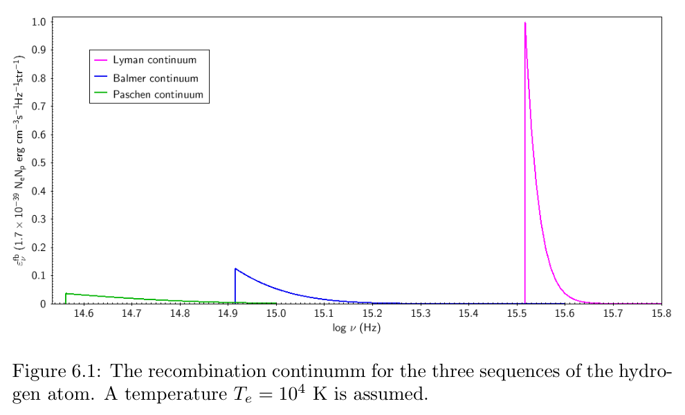

in photoionised gas, **recombination of free electrons onto ions** produces continuum photons in addition to the cascade-line photons. the continuum is what carries away the kinetic energy of the captured electron + the binding energy of the final atomic level.

## the process

$$X^+ + e^-(KE) \to X^*(n) + h\nu$$

where:
- $X^+$ is the recombining ion.
- $e^-$ has kinetic energy $E_e = (1/2)m_e v^2$.
- $X^*(n)$ is the final atom in level $n$ with binding energy $\chi_n$ relative to ionisation.
- the photon carries $h\nu = \chi_n + E_e$.

so the photon energy is $\ge \chi_n$, the binding energy of the final level. recombinations to the ground produce **above the ionisation edge** continuum. to $n=2$ produce **above the Balmer edge** continuum. etc.

## the spectrum

the emissivity at frequency $\nu$ is the convolution of the velocity distribution of the captured electrons with the recombination cross section $\sigma(v, n)$. for hydrogenic ions with Maxwellian electrons at $T_e$:
$$j_\nu = \frac{n_e n_p\,h^4 \nu^3}{2 (m_e c)^3}\,\frac{1}{(k_BT_e)^{3/2}}\sum_n \left[\frac{2 \chi_n}{n^3}\right]\,e^{-(h\nu-\chi_n)/k_BT_e}\,\Theta(h\nu - \chi_n)$$

(simplified.) key features:
- **edges** at $h\nu = \chi_n$: above each edge, recombination to $n$ contributes.
- **exponential decline** $e^{-h\nu/k_BT_e}$ above each edge: from the Maxwellian falling off.
- **discontinuities at edges**: recombination to lower $n$ kicks in only for $h\nu > \chi_n$.

so the continuum has steps at the Lyman, Balmer, Paschen, ... edges.

## the Balmer continuum

specifically, the continuum from recombination to $n = 2$:
- **edge** at $\lambda = 3646$ Å ($\chi_2 = 3.4$ eV).
- **emission** below $3646$ Å (i.e., at higher $\nu$).
- **discontinuity** in the SED at this wavelength.

dominant nebular continuum source in the **near-UV** ($3000$ to $3646$ Å). together with the Balmer line series convergence near the edge, it produces the famous **"Balmer jump"** seen in HII region and PN spectra.

## the integrated continuum luminosity

integrating $j_\nu$ over $\nu$ above the Lyman edge:
$$L_{\rm rec\,cont}^{\rm Ly} = n_e n_p\,\alpha_A^{\rm cont}\,k_BT_e \cdot V$$

a rough fraction of the total recombination energy goes into continuum vs lines. in HII regions it's $\sim 30$ to $50\%$ of the recombination radiation.

## the contrast with free-free

| feature | recombination continuum | free-free (Bremsstrahlung) |
|---|---|---|
| origin | bound-free transition | free-free deflection |
| edges | yes (at $\chi_n$) | no edges, smooth |
| spectrum | $e^{-h\nu/k_BT_e}$ above edges, $1/\nu^3$ steepening | $\propto e^{-h\nu/k_BT_e}$, smooth |
| dominant in | nebulae below Balmer edge | hot plasma in mm/cm/X-ray |

both contribute simultaneously. their sum is the smooth nebular continuum.

<!-- spec-figures -->
## Figures

*Figure 6.1 of Ciroi's notes: The recombination continuum for the three sequences of the hydrogen atom. A temperature $T_e = 10^4$ K is assumed.* (Ciroi's notes, p. 82)
<!-- /spec-figures -->

<!-- sources:wiki-arxiv -->
## Wikipedia and arXiv sources

- **Carrier generation and recombination**. "In solid-state physics of semiconductors, carrier generation and carrier recombination are processes by which mobile charge carriers (electrons and electron holes) are created and eliminated. Carrier generation and recombination processes are fundamental to the operation of many optoelectronic semiconductor devices, such as photodiodes, light-emitting diodes and laser diodes." ([Wikipedia](https://en.wikipedia.org/wiki/Carrier_generation_and_recombination))

> Definitions quoted from Wikipedia (CC BY-SA 4.0). Figures credited in their captions.
<!-- /sources:wiki-arxiv -->

## see also

- [[Free-free continuum]]
- [[Balmer continuum]]
- [[Bremsstrahlung]]
- [[Two-photon emission]]
- [[Recombination rate]]
- [[Optically thin recombination lines]]
- [[Hydrogen spectral series]]
- [[Continuum opacity sources]]
- [[H II region spectroscopy]]

## Linked References

- [[Balmer continuum]]
- [[Continuum opacity sources]]
- [[Free-free continuum]]
- [[Galactic novae spectroscopy]]
- [[Optically thin recombination lines]]
- [[Planetary nebula spectroscopy]]
- [[Recombination line emissivity]]
- [[Recombination rate]]
- [[Two-photon emission]]
- [[Astronomical_Spectroscopy_MOC]]

