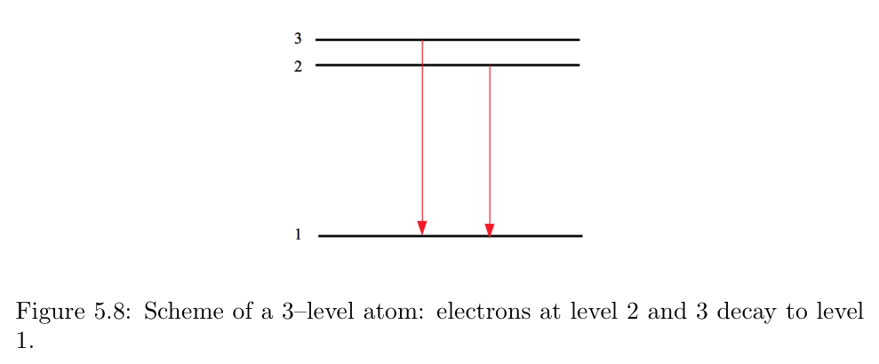
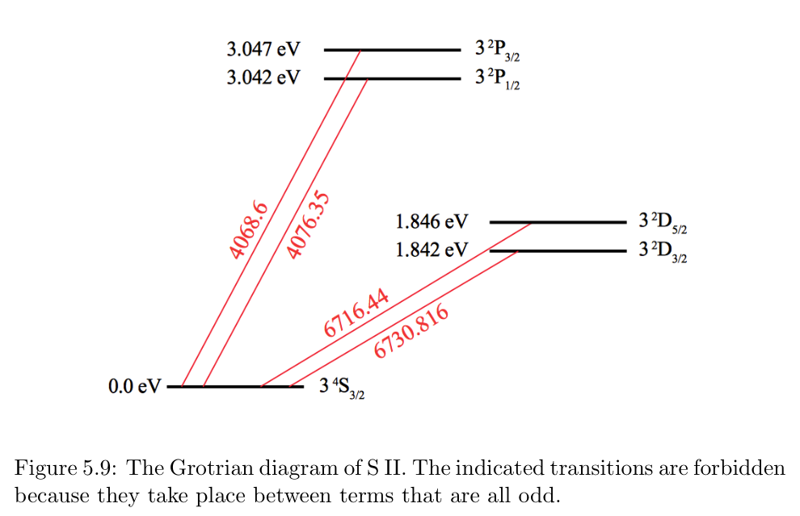
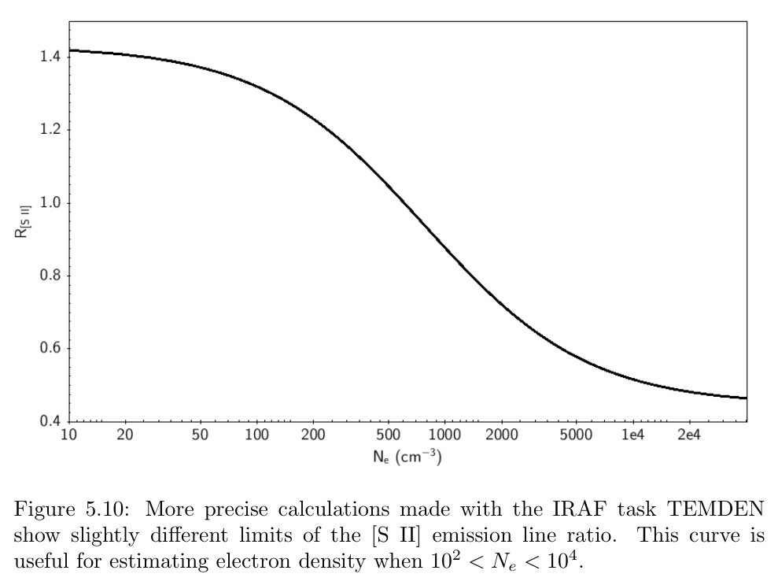

$[SII]$ forbidden lines are the **workhorse density diagnostic** in photoionised nebulae, sensitive to electron density in the range $n_e \sim 10^2$ to $10^4$ cm$^{-3}$ where most HII regions sit.

## the doublet

singly ionised sulphur S$^+$ has $3p^3$ valence configuration. terms (see [[Equivalent vs nonequivalent electrons]]):
- ground $^4S_{3/2}$.
- $^2D_{5/2}$ and $^2D_{3/2}$, fine-structure split.
- $^2P_{1/2, 3/2}$.

the $[SII]$ doublet:
- **$\lambda 6716.4$ Å**: $^2D_{5/2} \to ^4S_{3/2}$, $A = 2.6 \times 10^{-4}$ s$^{-1}$.
- **$\lambda 6730.8$ Å**: $^2D_{3/2} \to ^4S_{3/2}$, $A = 8.8 \times 10^{-4}$ s$^{-1}$.

the two lines come from **different upper levels** ($J = 5/2$ and $J = 3/2$), with very similar excitation energies ($\sim 1.84$ eV) but different $A$ values.

## why it's a density diagnostic

the two lines have:
- very similar excitation energies $\to$ Boltzmann factor cancels in their ratio (eliminates $T_e$ sensitivity).
- different $A$ values $\to$ different critical densities:
  - $\lambda 6716$: $n_c \approx 10^3$ cm$^{-3}$.
  - $\lambda 6731$: $n_c \approx 10^4$ cm$^{-3}$.

so each line saturates at a different density. the ratio $F(\lambda 6716)/F(\lambda 6731)$ varies over the density range $10^2 \le n_e \le 10^5$ cm$^{-3}$:

| $n_e$ (cm$^{-3}$) | $F(6716)/F(6731)$ |
|---|---|
| $10$ | $\sim 1.50$ |
| $10^2$ | $\sim 1.45$ |
| $10^3$ | $\sim 1.05$ |
| $10^4$ | $\sim 0.55$ |
| $10^5$ | $\sim 0.45$ |

at low $n_e$, both lines in the **low-density regime**: emissivities $\propto n_e \cdot$ (statistical weight)$\cdot$ (excitation rate). ratio is the upper-level statistical-weight ratio.

at high $n_e$, both in the **high-density regime**: emissivities $\propto n \cdot A$. ratio is set by the $A$ values.

between, the ratio drops smoothly from $\sim 1.5$ to $\sim 0.45$. this is the diagnostic curve.

## how to use it

1. measure the integrated flux of both lines.
2. compute the ratio $R = F(\lambda 6716)/F(\lambda 6731)$.
3. read $n_e$ off a tabulated diagnostic curve (Osterbrock & Ferland 2006, table 5.1).
4. for $1.5 > R > 1$: low-density regime, $n_e$ poorly constrained ($< 100$ cm$^{-3}$).
5. for $0.5 < R < 1.5$: density well-constrained.
6. for $R < 0.5$: high-density limit, $n_e > 10^4$ cm$^{-3}$.

## practical issues

- **resolution**: at $R \lesssim 5000$, the doublet is unresolved. need at least $R = 3000$ to separate them at $T_e \sim 10^4$ K thermal Doppler width.
- **sky lines**: the wavelength range often has sky line residuals. careful sky subtraction needed.
- **integration**: for spatially resolved studies, the integrated $[SII]$ flux measures $\int n_e n_S\,dV$, weighted by emissivity.

## comparison with other density diagnostics

| line pair | density range (cm$^{-3}$) |
|---|---|
| $[SII]\,\lambda 6716/6731$ | $10^2$ to $10^4$ |
| $[OII]\,\lambda 3729/3726$ | $10^2$ to $10^4$ (similar physics, in UV) |
| $[CII]\,\lambda 158\,\mu$m / $[OIII]\,\lambda 88\,\mu$m | $10^2$ to $10^4$ (FIR) |
| $[NeIV]\,\lambda 1602/1486$ | $10^4$ to $10^6$ |
| $[ArIV]\,\lambda 4711/4740$ | $10^3$ to $10^5$ |

so $[SII]$ is the most-used because the wavelengths are accessible and the lines are bright in HII regions.

<!-- spec-figures -->
## Figures

*Figure 5.8 of Ciroi's notes: Scheme of a 3-level atom: electrons at level 2 and 3 decay to level 1.* (Ciroi's notes, p. 73)

*Figure 5.9 of Ciroi's notes: The Grotrian diagram of S II. The indicated transitions are forbidden because they take place between terms that are all odd. The spontaneous transition probabilities of the lines indicated in figure are: $A_{4068} = 0.192$ s$^{-1}$, $A_{4076} = 7.72 \cdot 10^{-2}$ s$^{-1}$, $A_{6716} = 2.02 \cdot 10^{-4}$ s$^{-1}$, and $A_{6731} = 6.84 \cdot 10^{-4}$ s$^{-1}$.* (Ciroi's notes, p. 74)

*Figure 5.10 of Ciroi's notes: More precise calculations made with the IRAF task TEMDEN show slightly different limits of the [S II] emission line ratio. This curve is useful for estimating electron density when $10^2 < N_e < 10^4$ cm$^{-3}$.* (Ciroi's notes, p. 77)
<!-- /spec-figures -->

<!-- sources:wiki-arxiv -->
## Wikipedia and arXiv sources

- **Forbidden mechanism**. "In spectroscopy, a forbidden mechanism (forbidden transition or forbidden line) is a spectral line associated with absorption or emission of photons by atomic nuclei, atoms, or molecules which undergo a transition that is not allowed by a particular selection rule but is allowed if the approximation associated with that rule is not made." ([Wikipedia](https://en.wikipedia.org/wiki/Forbidden_mechanism))

> Definitions quoted from Wikipedia (CC BY-SA 4.0). Figures credited in their captions.
<!-- /sources:wiki-arxiv -->

## see also

- [[Forbidden lines]]
- [[Critical density]]
- [[Two-level atom]]
- [[OIII forbidden lines]]
- [[Forbidden line diagnostics]]
- [[Spectroscopic ne diagnostics]]
- [[Equivalent vs nonequivalent electrons]]
- [[Selection rules]]
- [[BPT diagram]]

## Linked References

- [[Collisional excitation rate]]
- [[Critical density]]
- [[Forbidden line diagnostics]]
- [[Forbidden lines]]
- [[Forbidden vs permitted vs semiforbidden transitions]]
- [[Selection rules]]
- [[Spectroscopic Te diagnostics]]
- [[Spectroscopic ne diagnostics]]
- [[Supernova remnant spectroscopy]]
- [[Two-level atom]]
- [[Astronomical_Spectroscopy_MOC]]

