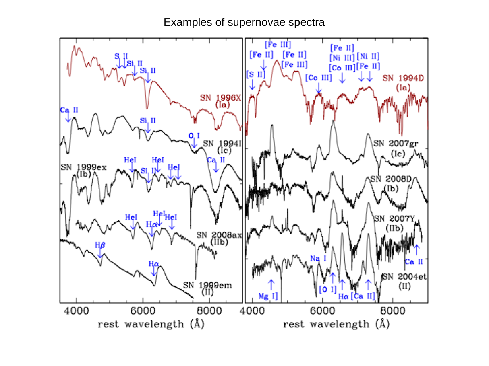

**supernova spectra** classify SNe into thermonuclear (Type Ia) vs core-collapse (Types Ib, Ic, II) based on the **presence or absence** of hydrogen and helium in the spectrum. the ejecta evolve dramatically over weeks to months, with each phase producing distinctive spectral features.

## the classification scheme

### Type Ia
- **no hydrogen** (no Balmer lines).
- **strong Si II $\lambda 6355$ Å** absorption near max light. signature of partial nuclear burning to intermediate-mass elements.
- **broad lines** $\sim 10^4$ km/s.
- progenitor: thermonuclear explosion of a $\sim 1.4\,M_\odot$ C/O white dwarf.
- standard candle for cosmology ([[Type Ia supernovae as standard candles]]).

### Type Ib
- **no hydrogen**, **with helium** (He I $\lambda 5876, 6678, 7065$).
- progenitor: massive star that lost its H envelope (Wolf-Rayet WN type) before core collapse.

### Type Ic
- **no hydrogen, no helium**.
- progenitor: even more stripped (WC), only C/O remaining.
- some Type Ic-BL (broad-lined) connected to long gamma-ray bursts.

### Type II
- **hydrogen present** (broad Balmer P-Cygni profiles).
- progenitor: red supergiant retaining most of its H envelope.
- subdivided by light curve: Type IIP (plateau, classical), IIL (linear), IIb (transitions to Type Ib appearance), IIn (narrow lines from CSM interaction).

## spectral evolution

over weeks to months post-max:

### **photospheric phase** (day 0 to $\sim 30$)
optically thick photosphere recedes through the ejecta. spectrum shows:
- broad **P Cygni profiles**: blueshifted absorption + redshifted emission.
- velocity from absorption-line minimum: thousands of km/s.
- progenitor's composition revealed in absorption lines (Si II for Ia, He I for Ib, H for II).

### **nebular phase** (day $\sim 100+$)
ejecta optically thin. spectrum dominated by **forbidden line emission** from the inner ejecta:
- **$[OI]\,\lambda 6300$**: oxygen-rich, traces core-collapse nucleosynthesis.
- **$[CaII]\,\lambda 7291, 7324$**: calcium emission.
- **$[FeII]$, $[FeIII]$**: iron from $^{56}$Ni $\to ^{56}$Co $\to ^{56}$Fe decay chain.
- **$[NiII]$**: in Type Ia, traces unmixed iron-peak material.

profile widths give ejecta velocity ($\sim 10^4$ km/s for Type Ia, $\sim 10^3$ to $10^4$ for core-collapse).

## examples in `intro_spec.pdf`

the user has plot:
- **SN 1996X (Ia)**: clear Si II, no H, no He.
- **SN 1994I (Ic)**: O I, Ca II, no H, no He.
- **SN 1999ex (Ib)**: He I prominent, no H.
- **SN 2008ax (IIb)**: H$\alpha$ + He I, transitioning.
- **SN 1999em (II)**: H$\alpha$ Balmer dominant.
- **SN 2007gr (Ic)** in nebular: $[OI], [CaII], [FeII]$.
- **SN 2007Y (IIb)**, **SN 2004et (II)** in nebular: clear nebular forbidden lines.

## the role of $^{56}$Ni decay

a critical link to spectroscopy: SNe Ia (and most core-collapse) are powered late-time by **radioactive decay**:
$$^{56}{\rm Ni} \xrightarrow{6.1\,{\rm d}} ^{56}{\rm Co} \xrightarrow{77.3\,{\rm d}} ^{56}{\rm Fe}$$

energy from gamma-rays + positrons heats the ejecta, driving the late-time emission. nebular Fe + Co lines directly trace the produced $^{56}$Ni mass: $\sim 0.6\,M_\odot$ for typical Ia, $\sim 0.05\,M_\odot$ for core-collapse.

<!-- spec-figures -->
## Figures

*Supernova spectra, Ciroi's slides* (Ciroi's slides, slide 32)
<!-- /spec-figures -->

<!-- sources:wiki-arxiv -->
## Wikipedia and arXiv sources

*Hubble Space Telescope-Image of Supernova 1994D (SN1994D) in galaxy NGC 4526 (SN 1994D is the bright spot on the lower left)* ([Commons file page](https://commons.wikimedia.org/wiki/File:SN1994D.jpg), NASA/ESA, The Hubble Key Project Team and The High-Z Supernova Search Team, Public domain, as used on the Wikipedia article [Supernova](https://en.wikipedia.org/wiki/Supernova))

- **Supernova**. "A supernova (pl.: supernovae) is a powerful and luminous explosion of a star. A supernova occurs during the last evolutionary stages of a massive star, or when a white dwarf is triggered into runaway nuclear fusion. The original object, called the progenitor, either collapses to a neutron star or black hole, or is completely destroyed to form a diffuse nebula." ([Wikipedia](https://en.wikipedia.org/wiki/Supernova))

> Definitions quoted from Wikipedia (CC BY-SA 4.0). Figures credited in their captions.
<!-- /sources:wiki-arxiv -->

## see also

- [[Type Ia supernovae as standard candles]]
- [[Cepheids and supernovae]]
- [[Emission line stars]]
- [[Forbidden lines]]
- [[Hydrogen spectral series]]
- [[Helium energy levels]]
- [[Galactic novae spectroscopy]]
- [[Supernova remnant spectroscopy]]
- [[Stellar populations I II III]]

## Linked References

- [[Emission line stars]]
- [[Galactic novae spectroscopy]]
- [[Supernova remnant spectroscopy]]
- [[Astronomical_Spectroscopy_MOC]]

