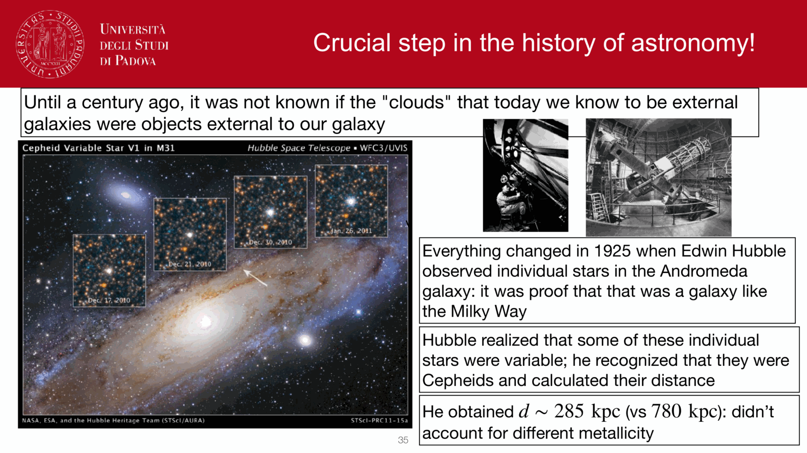
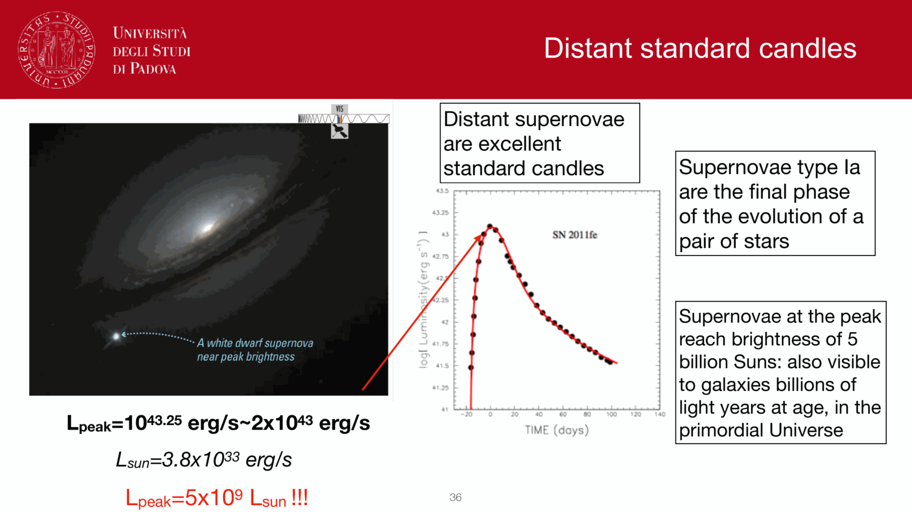

at the **tip of the red giant branch** (TRGB), low-mass stars ignite helium in a thermal flash. the luminosity at this point is nearly independent of mass and metallicity, making it a sharp standard-candle feature in the I-band luminosity function.

## the physics

stars with $M \lesssim 2.3\,M_\odot$ ascend the RGB while burning hydrogen in a shell around an inert helium core. as they evolve up the RGB, the He core grows by shell burning until it reaches a critical mass $\sim 0.46\,M_\odot$, at which point degenerate helium ignites in a runaway thermonuclear flash (the **helium flash**).

since the core mass at flash is universal (set by neutrino cooling and degeneracy pressure), the luminosity at the tip is also universal:
$$M_I^{\rm TRGB} \approx -4.0$$

with a weak metallicity dependence:
$$M_I^{\rm TRGB} = -4.05 + 0.22[Fe/H]$$
(approximate, calibrations vary).

## the observational signature

a CMD of an old population (resolved galaxy halo) shows:
- the RGB rising in $V$ as stars get redder.
- a sharp **edge** at the top: stars stop accumulating at the tip because they evolve quickly through the helium flash.

statistically, the I-band luminosity function shows a sharp discontinuity (the "tip"), and edge-detection algorithms (Sobel filter, Bayesian) locate it to $\sim 0.05$ mag precision.

## advantages over Cepheids

- works in **old populations**: globular clusters, halos, ellipticals, spheroidal dwarfs. anywhere there are old red giants.
- **less metallicity-sensitive**: $\sim 0.05$ mag/dex vs $\sim 0.2$ for Cepheids.
- **insensitive to crowding** at moderate distances (large stars, sparse field).
- **does not require multi-epoch photometry**: a single-epoch deep image gives the answer.
- competes with Cepheids in the same galaxies, providing a critical cross-check.

## disadvantages

- requires **resolving** individual giants. limit: $\sim 30$ Mpc with HST, $\sim 100$ Mpc with JWST in deep fields.
- needs a **clean halo field** away from disk dust.
- the tip detection itself has subtle systematics (smoothing kernel, slope of the LF beneath the tip, metal-rich populations adding scatter).

## the modern $H_0$ player

the Carnegie-Chicago Hubble Program (Freedman et al.) advocates TRGB as the primary local distance scale, calibrated against parallax-known Galactic globular clusters. their $H_0$ measurement:
$$H_0 \approx 69.8 \pm 1.7\,\text{km/s/Mpc}$$
intermediate between the Cepheid-anchored ($73.0$) and Planck-anchored ($67.4$) values. the disagreement among the three is at the heart of the modern $H_0$ tension.

JWST is now resolving TRGB stars in galaxies hosting SN Ia, providing the cleanest Cepheid-independent local ladder.

## worked example

the tip sits at $M_I \approx -4.05$, almost independent of age and metallicity for old metal-poor populations, because the helium flash happens at a fixed core mass of $0.47\,M_\odot$.

in a galaxy where the luminosity function of red giants jumps at $I = 25.8$:

$$\mu = 25.8 + 4.05 = 29.85, \qquad d = 9.3\ \text{Mpc}$$

## where it goes wrong

- the edge must be found on a clean luminosity function. AGB stars above the tip and crowding blur it.
- the calibration depends on colour in the near infrared, much less in the I band.
- the method needs old stars, so it works best in the halos of galaxies, where dust is low.

<!-- sources:wiki-arxiv -->
## Wikipedia and arXiv sources

*The evolutionary track of a solar mass, solar metallicity, star from main sequence to post-AGB* ([Commons file page](https://commons.wikimedia.org/wiki/File:Evolutionary_track_1m.svg), Lithopsian, CC BY-SA 4.0, as used on the Wikipedia article [Tip of the red-giant branch](https://en.wikipedia.org/wiki/Tip_of_the_red-giant_branch))

- **Tip of the red-giant branch**. "Tip of the red-giant branch (TRGB) is a primary distance indicator used in astronomy. It uses the luminosity of the brightest red-giant-branch stars in a galaxy as a standard candle to gauge the distance to that galaxy. It has been used in conjunction with observations from the Hubble Space Telescope to determine the relative motions of the Local Cluster of galaxies within the Local Supercluster." ([Wikipedia](https://en.wikipedia.org/wiki/Tip_of_the_red-giant_branch))
- **The Hubble Constant**. "Considerable progress has been made in determining the Hubble constant over the past two decades." ([arXiv:1004.1856](https://arxiv.org/abs/1004.1856))

> Definitions quoted from Wikipedia (CC BY-SA 4.0) and the arXiv abstract. Figures credited in their captions.
<!-- /sources:wiki-arxiv -->

## see also

- [[Cepheid period-luminosity relation]]
- [[Variable stars as standard candles]]
- [[Type Ia supernovae as standard candles]]
- [[Distance ladder derivations]]
- [[Color-magnitude diagrams of clusters]]
- [[HR diagram]]
- [[Hubble flow distances]]

---

## observational astrophysics course slides (Prof. Paolo Cassata)

*Tip of the Red Giant Branch (TRGB) distance indicator.*

*Core helium flash in low-mass degenerate cores fixing tip luminosity M_I ~ -4.0 mag.*

## Linked References

- [[Cepheid period-luminosity relation]]
- [[Distance ladder derivations]]
- [[Red giant branch RGB]]
- [[Resolved vs unresolved stellar populations]]
- [[Supernova Hubble diagram]]
- [[Surface brightness fluctuations]]
- [[Variable stars as standard candles]]
- [[Observational_Astrophysics_MOC]]

