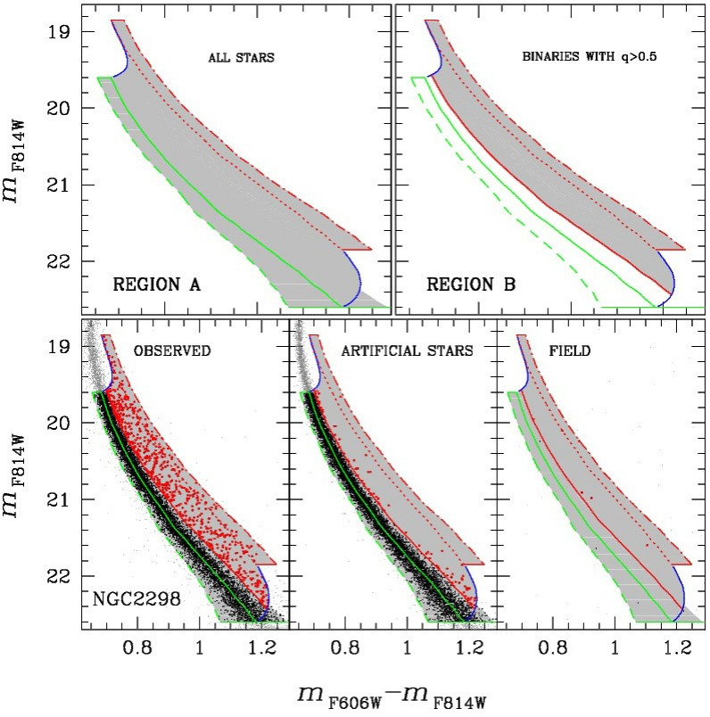

# wdcs turn to blue and cia

deep CMDs of nearby globular clusters and old open clusters reveal something unexpected at the very faint end of the [[White dwarf cooling theory]]: instead of continuing to redden as luminosity drops, the white dwarf cooling sequence (WDCS) bends back **toward the blue**, forming a hook (the so-called blue turn) at $M_{F606W} \sim 15\text{-}16$.  this feature is real, predicted by atmosphere models, and a sensitive age diagnostic.

## physical origin

the explanation lies in the high-density physics of cool, hydrogen-rich WD atmospheres.

**high-density opacity effects.** as a WD cools below $T_{\rm eff} \sim 5000$ K its photosphere becomes very dense (because the atmosphere is so thin and gravity so strong). collisions between H, H$_2$, and He become frequent enough to perturb the electronic and rotational states of the molecules, producing opacity that does not exist in dilute gas.

**collision-induced absorption (CIA) of H$_2$.** the H$_2$ molecule has no permanent dipole moment and so does not absorb infrared photons in isolation. but during a collision (with another H$_2$, with He, or with H), the transient distortion of the molecular charge distribution produces an induced dipole that **does** couple to radiation. this gives broad, strong opacity bands across the red and infrared, particularly around $\sim 1\text{-}5\,\mu$m. the opacity scales with density squared (because two collision partners are needed) and so it switches on dramatically only when the atmosphere is cool and dense.

## consequence for the CMD

the photosphere becomes nearly opaque in the infrared while remaining relatively transparent in the optical and near-UV. the spectral energy distribution shifts: the star can no longer radiate efficiently at long wavelengths, so the emergent flux pushes toward bluer colours even as $T_{\rm eff}$ continues to drop. the result is that, in $(F606W{-}F814W)$ or any optical-IR colour, the cooling sequence reaches a reddest point and then walks back toward the blue. in a CMD this looks like a hook at the faint end, often referred to as the **blue hook of the WDCS**.

## why it matters

the blue turn is set by a **specific combination of $T_{\rm eff}$, $\log g$, and atmospheric composition**, and atmosphere models (e.g. Hansen et al. 2007) reproduce it quantitatively. since cooler WDs are older, the blue turn corresponds to a definite age. clusters that show a clear hook are old enough that the oldest WDs have cooled into the CIA regime; clusters that don't reach the hook are too young or too distant. the position of the hook in absolute magnitude is therefore one of the cleanest age estimators available, with little dependence on metallicity (see [[White dwarf cooling theory]] for why WDCS ages are metallicity-insensitive in general).

it is one of the few places in stellar astrophysics where molecular physics in a strange regime (dense H$_2$ at $\rho \gtrsim 0.1$ g cm$^{-3}$) directly maps onto a measurable colour-magnitude feature used to date the Galaxy.

<!-- sources:wiki-arxiv -->
## Wikipedia and arXiv sources

*Placed pointer to Sirius B* ([Commons file page](https://commons.wikimedia.org/wiki/File:Sirius_A_and_B_Hubble_photo.editted.PNG), NASA, ESA, H. Bond (STScI), and M. Barstow (University of Leicester); modified by Bokus, Public domain, as used on the Wikipedia article [White dwarf](https://en.wikipedia.org/wiki/White_dwarf))

- **White dwarf**. "A white dwarf is a very dense type of star: in an Earth-sized volume, it packs a mass that is comparable to the Sun. A white dwarf radiates light from residual heat and eventual crystallization, not from nuclear fusion. Stars like the Sun, whose mass is not high enough to collapse into a neutron star or black hole, are expected to become white dwarf stars later in their evolution." ([Wikipedia](https://en.wikipedia.org/wiki/White_dwarf))
- **Evolutionary and pulsational properties of white dwarf stars**. "Abridged. White dwarf stars are the final evolutionary stage of the vast majority of stars, including our Sun. The study of white dwarfs has potential applications to different fields of astrophysics." ([arXiv:1007.2659](https://arxiv.org/abs/1007.2659))

> Definitions quoted from Wikipedia (CC BY-SA 4.0) and the arXiv abstract. Figures credited in their captions.
<!-- /sources:wiki-arxiv -->

## see also
- [[White dwarf cooling theory]]
- [[Age dating from the WD luminosity function]]
- [[Color-magnitude diagrams of clusters]]
- [[Continuum opacity sources]]
- [[White dwarf overview]]
- [[Stellar_Astrophysics_MOC]]

## Linked References

- [[Age dating from the WD luminosity function]]
- [[WDCS vs MSTO ages comparison]]
- [[White dwarf cooling sequence on the CMD]]
- [[White dwarf cooling theory]]
- [[White dwarf overview]]
- [[Stellar_Astrophysics_MOC]]

