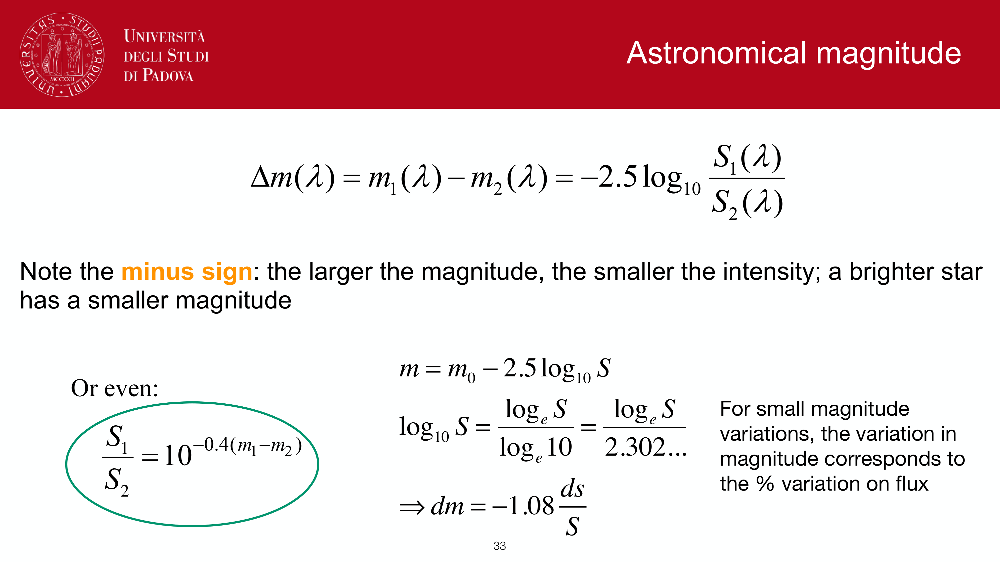
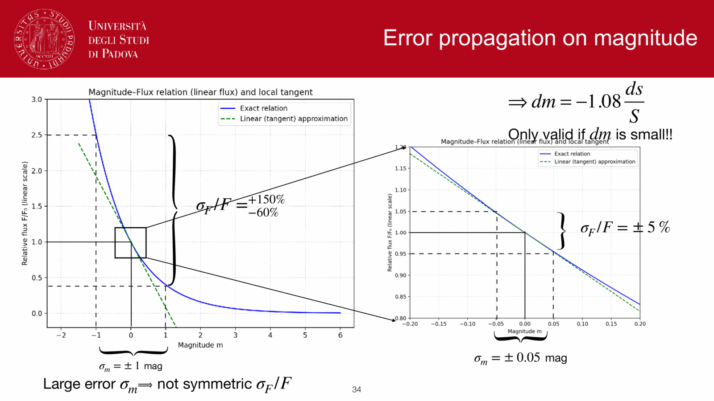
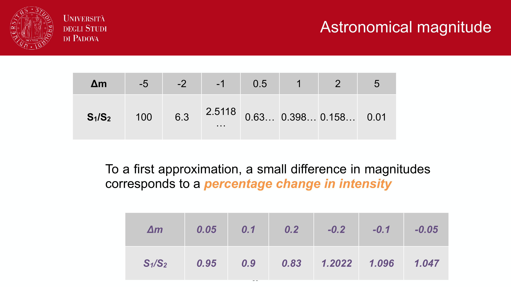
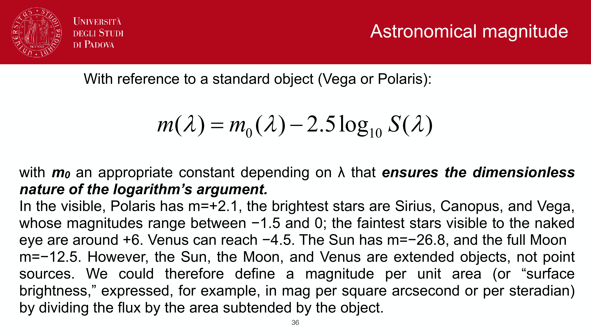

a key qualitative result that comes up repeatedly: even though massive stars are rare in number, they dominate the **integrated luminosity** at almost every wavelength shortward of their peak. answer to obs3.pdf in spoken form.

## the Stefan-Boltzmann scaling

for a star approximated as a blackbody:
$$L = 4\pi R^2 \sigma_{SB}\, T^4$$

so the power scales as the **fourth power of $T$** and as the **square of $R$**.

## the main-sequence M-L relation

stellar structure equations on the main sequence give roughly
$$L \propto M^{3.5}$$
($\sim 4$ for $M > M_\odot$, $\sim 2.3$ for $M < M_\odot$). over the relevant mass range $0.1$ to $100\,M_\odot$, $L$ varies by **eight orders of magnitude**.

physically: more massive stars have hotter cores, more efficient nuclear burning (CNO cycle dominates above $\sim 1.3\,M_\odot$), higher $T$ at the surface (steeper temperature gradient), and slightly larger $R$.

## the IMF weighting

the [[Initial mass function]] $\xi(M) \propto M^{-2.35}$ (Salpeter) means most stars are low-mass. but the **bolometric light** from a stellar population is
$$L_{\rm tot} = \int \xi(M)\, L(M)\, dM \propto \int M^{-2.35} M^{3.5}\, dM = \int M^{1.15}\, dM$$
which is **dominated by the high-mass end** of the integration range.

quantitatively, for a Salpeter SSP just after a burst:
- by **number**: $\sim 99\%$ of stars are $< 1\,M_\odot$.
- by **mass**: $\sim 60\%$ of total mass is $< 1\,M_\odot$ (with truncation at $0.1\,M_\odot$).
- by **bolometric light**: $\sim 70\%$ comes from $M > 5\,M_\odot$ at age $\sim 10$ Myr.
- by **UV light**: $\sim 99\%$ comes from $M > 10\,M_\odot$.

after the high-mass stars die ($\tau_{MS} \propto M^{-2.5}$), the dominant contributor shifts to red giants of slightly lower mass.

## the wavelength dependence

at any wavelength $\lambda$ shortward of the peak of a star's blackbody spectrum, that star contributes proportionally more than its bolometric share. so:
- **UV** ($\sim 100$ to $300$ nm): dominated by O and early-B stars ($T > 20\,000$ K).
- **optical** ($400$ to $700$ nm): contributions from F, G, K, and earlier types.
- **NIR** (J, H, K): K and M giants, also red supergiants.

this is why **UV emission traces young (massive) stars** and is a clean SFR tracer for $\tau \sim 100$ Myr. while **NIR traces old stellar populations** (the integrated mass).

## consequence for galaxy spectra

the SED of a galaxy at any moment is the **superposition** of contributions from all the stars currently alive, weighted by the IMF and the SFH. for a galaxy with continuous star formation:
- UV is dominated by stars formed in the last $\sim 100$ Myr.
- optical bolometric is mixed.
- NIR ($\lambda > 1\,\mu$m) traces the integral of past star formation, i.e. the stellar mass.

this is the spectral basis for population-synthesis SED fitting (see [[Stellar population synthesis]] and `obs5.pdf`/`obs7.pdf`).

## worked example

with $L \propto M^{3.5}$, one star of $10\,M_\odot$ shines like $10^{3.5} \approx 3200$ Suns. the Salpeter mass function gives $10^{-2.35} = 0.0045$ such stars for each solar-mass star, per unit mass interval. the light per mass interval is then $0.0045 \times 3200 \approx 14$ times larger at $10\,M_\odot$ than at $1\,M_\odot$.

so the light of a young population comes from the few massive stars, while the mass is in the many small ones.

## where it goes wrong

- this holds only while the massive stars are alive. a $10\,M_\odot$ star lasts $10\ \text{Gyr} \times 10^{-2.5} \approx 30$ Myr.
- ultraviolet light measures recent star formation, not stellar mass.
- the mass-to-light ratio of a population rises steadily as it ages, by a factor of ten or more in the optical.

<!-- sources:wiki-arxiv -->
## Wikipedia and arXiv sources

- **Mass–luminosity relation**. "In astrophysics, the mass–luminosity relation is an empirical and theoretical relationship between a star's mass and its luminosity The relationship is represented by the equation: L L ⊙ = ( M M ⊙ ) a ${\frac {L}{L_{\odot }}}=\left({\frac {M}{M_{\odot }}}\right)^{a}$ where L☉ and M☉ are the luminosity and mass of the Sun and 1 < a < 6. The value a = 3.5 is commonly used for main-sequence stars." ([Wikipedia](https://en.wikipedia.org/wiki/Mass%E2%80%93luminosity_relation))

> Definitions quoted from Wikipedia (CC BY-SA 4.0). Figures credited in their captions.
<!-- /sources:wiki-arxiv -->

## see also

- [[Planck law Wien Stefan-Boltzmann]]
- [[Stellar scaling relations]]
- [[Mass-luminosity relation]]
- [[Initial mass function]]
- [[Stellar populations I II III]]
- [[UV SFR tracer]]
- [[IR SFR tracer]]
- [[Stellar population synthesis]]
- [[Stellar mass estimation in unresolved populations]]

---

## observational astrophysics course slides (Prof. Paolo Cassata)

*Obs3 exam question: Why do hot massive stars dominate bolometric and UV light?*

*Mass-Luminosity relation L proportional to M^3.5 on the Main Sequence.*

*Blackbody peak shifts deep into UV for O/B stars (T_eff > 20000 K).*

*Time evolution: rapid death of massive stars leads to drastic UV drop in stellar populations.*

## Linked References

- [[Mass-luminosity relation]]
- [[Planck law Wien Stefan-Boltzmann]]
- [[Observational_Astrophysics_MOC]]

