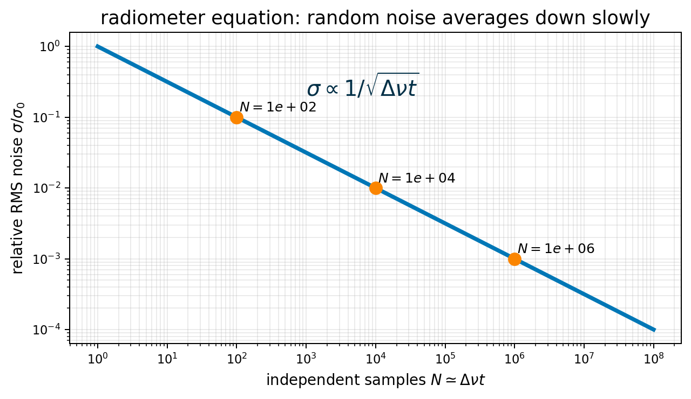

# ALMA exposure time calculator and sensitivity

BookAI uses the ALMA Exposure Time Calculator as a concrete example of how sensitivity estimates become observing-time estimates.

## what the ETC does

ALMA ETC estimates either:

- RMS sensitivity for a chosen integration time, or
- integration time needed for a desired signal-to-noise ratio.

it includes atmosphere, instrumental performance, array configuration, bandwidth, and weighting.

## core equation

ideal interferometric RMS:

$$\sigma\simeq\frac{\mathrm{SEFD}}{\sqrt{N_{\rm ant}(N_{\rm ant}-1)\Delta\nu t}}$$

with

$$\mathrm{SEFD}=\frac{2k_BT_{\rm sys}}{A_{\rm eff}}$$

## BookAI worked example

continuum observation in Band 6:

- $\nu=230\,\mathrm{GHz}$
- $\Delta\nu=8\times10^9\,\mathrm{Hz}$
- $N_{\rm ant}=43$
- $t=3600\,\mathrm{s}$
- $\mathrm{SEFD}\sim1000\,\mathrm{Jy}$

antenna-pair factor:

$$N(N-1)=43\times42=1806$$

denominator:

$$\sqrt{1806\times8\times10^9\times3600}\simeq7.2\times10^8$$

ideal RMS:

$$\sigma\simeq\frac{1000}{7.2\times10^8}\,\mathrm{Jy}\simeq1.4\,\mu\mathrm{Jy}$$

realistic corrections:

- correlator efficiency
- atmospheric decorrelation
- weighting losses
- calibration imperfections

so a practical RMS might become:

$$\sigma\sim5-10\,\mu\mathrm{Jy\,beam^{-1}}$$

## interpretation

- increasing integration time by 4 lowers noise by 2
- increasing bandwidth helps continuum sensitivity
- atmospheric conditions matter strongly at high frequency
- weighting can trade sensitivity for resolution/sidelobe control

## connection to observing proposals

when writing an ALMA proposal, the ETC is the bridge from science requirement to telescope time. if the source has flux $0.1\,\mathrm{mJy}$ and RMS is $10\,\mu\mathrm{Jy}$, detection is $\sim10\sigma$.

## exam sentence

the ALMA ETC is the interferometric radiometer equation with real-world corrections. it converts system temperature, effective area, bandwidth, time, and number of antennas into image-plane RMS.

## scientific figure

reading cue: the exposure-time calculator is a practical wrapper around this scaling, with real-world corrections for antennas, weather, bandwidth, efficiency, and weighting.

source: local plot generated from the radiometer-equation scaling.

<!-- sources:wiki-arxiv -->
## Wikipedia and arXiv sources

*Lead figure of the Wikipedia article Atacama Large Millimeter Array* ([Commons file page](https://commons.wikimedia.org/wiki/File:ALMA_Antennas_on_Chajnantor.jpg), Iztok Bončina/ESO, CC BY 4.0, as used on the Wikipedia article [Atacama Large Millimeter Array](https://en.wikipedia.org/wiki/Atacama_Large_Millimeter_Array))

- **Atacama Large Millimeter Array**. "The Atacama Large Millimeter/submillimeter Array (ALMA) is an astronomical interferometer of 66 radio telescopes in the Atacama Desert of northern Chile, which observe electromagnetic radiation at millimeter and submillimeter wavelengths. The array has been constructed on the 5,000 m (16,000 ft) elevation Chajnantor plateau – near the Llano de Chajnantor Observatory and the Atacama Pathfinder Experiment." ([Wikipedia](https://en.wikipedia.org/wiki/Atacama_Large_Millimeter_Array))

> Definitions quoted from Wikipedia (CC BY-SA 4.0). Figures credited in their captions.
<!-- /sources:wiki-arxiv -->

## see also

- [[Radiometer equation and SEFD]]
- [[Antenna effective area and gain]]
- [[Radio interferometer architecture]]
- [[Steps in radio interferometric observations]]

## Linked References

- [[Radiometer equation and SEFD]]
- [[Astronomical_Interferometry_MOC]]

