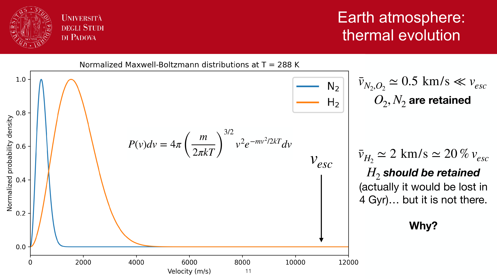
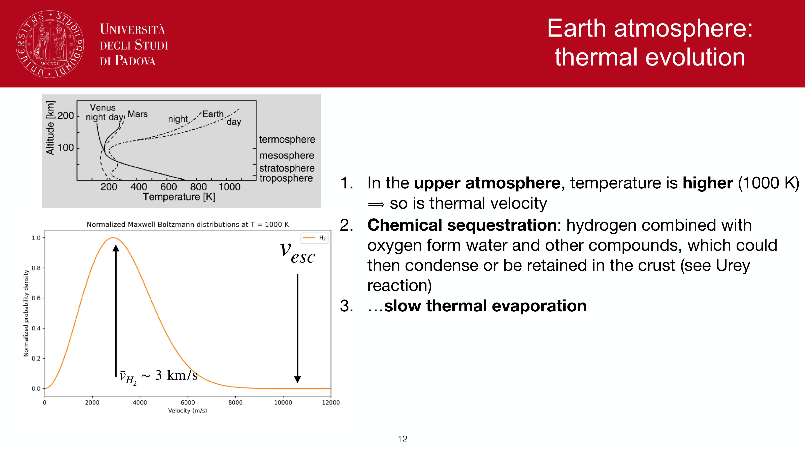

the Earth's atmosphere is a vertical stack of layers with very different physical properties. each one matters differently for astronomy.

## the layers from the ground up

| layer | altitude | $T$ profile | mass fraction | astronomical role |
|---|---|---|---|---|
| **troposphere** | 0 to 10-15 km | decreases with height | $\sim 80\%$ | most of the seeing, most of the weather, most of the H$_2$O |
| **stratosphere** | 12 to 50 km | increases (ozone heating) | $\sim 19\%$ | ozone layer cuts off UV ($\lambda < 300$ nm) |
| **mesosphere** | 50 to 85 km | decreases | tiny | Na layer at $\sim 90$ km used by laser guide stars |
| **thermosphere** | 85 to 600 km | rises sharply (UV-EUV from Sun) | tiny | aurorae, ionosphere |
| **exosphere** | $> 600$ km | very thin | negligible | escape regime |

## scale height and pressure profile

in hydrostatic equilibrium with an isothermal atmosphere, pressure decreases exponentially:
$$P(z) = P_0 \exp(-z/H), \quad H = \frac{k_BT}{\mu g}$$

with mean molecular mass $\mu \approx 29$ amu and $T \approx 250$ K (rough average):
$$H \approx 8\,\text{km}$$

so for every $\sim 8$ km of altitude, the air pressure (and roughly the column density) drops by $1/e$. doubles the importance of going up:
- sea level (0 m): $P = 1013$ hPa, $X = 1.0$ at zenith.
- Mauna Kea (4200 m): $P \approx 615$ hPa, $X \approx 0.6$ at zenith.
- airborne (12 km): $P \approx 200$ hPa.
- balloon (35 km): $P \approx 5$ hPa.
- space ($> 600$ km): $P \approx 0$.

## the ionosphere

the upper atmosphere ($> 60$ km) contains free electrons produced by solar UV and X-ray ionisation. it reflects radio waves with $\lambda > 30$ m, which is why long-wavelength radio astronomy from the ground requires careful frequency choice (e.g. LOFAR low band at $\sim 30$ MHz works only when the F-layer plasma frequency is below the observing frequency).

the ionosphere also introduces phase delays that distort wide-field radio interferometry, especially at low frequencies. ionospheric calibration is a major part of LOFAR/SKA-Low data reduction.

## why high mountain tops

an observatory at $4200$ m sits above $\sim 40\%$ of the atmosphere by mass and **most of the troposphere's water vapour and turbulence**. the simultaneous gains:
- transparency improves (less H$_2$O in the NIR + sub-mm).
- extinction drops (less Rayleigh + Mie path).
- seeing improves (less turbulent air column).
- sky brightness drops (less airglow scatter).
- thermal sky drops (cooler ambient).

practical pre-2020 list: Mauna Kea ($4200$ m), Cerro Paranal ($2600$ m), Cerro Pachón ($2700$ m), La Palma ($2400$ m), San Pedro Mártir ($2800$ m), Cerro Tololo ($2200$ m). future ELTs: Cerro Armazones ($3000$ m), Maunakea-South.

## worked example

the pressure falls as $P = P_0\,e^{-h/H}$ with a scale height

$$H = \frac{k_BT}{\mu m_Hg} \approx 7.5\ \text{km}$$

for $T = 250$ K and $\mu = 29$. at Paranal (2635 m) the pressure is $e^{-0.35} = 71\%$ of sea level, at Mauna Kea (4200 m) it is $58\%$. water vapour has a scale height of only 2 km, so at 4200 m only $e^{-2.1} = 12\%$ of it is still above the telescope. this is why infrared and sub-mm telescopes go high.

## where it goes wrong

- turbulence is not only near the ground. the jet stream at 10 to 12 km is a strong layer.
- the ozone that blocks the ultraviolet is in the stratosphere, above every mountain.
- the sodium layer used for laser guide stars is at 90 km, and the ionosphere that affects radio waves is higher still.

<!-- sources:wiki-arxiv -->
## Wikipedia and arXiv sources

*Lead figure of the Wikipedia article Atmosphere of Earth* ([Commons file page](https://commons.wikimedia.org/wiki/File:Top_of_Atmosphere.jpg), NASA Earth Observatory, Public domain, as used on the Wikipedia article [Atmosphere of Earth](https://en.wikipedia.org/wiki/Atmosphere_of_Earth))

- **Atmosphere of Earth**. "The atmosphere of Earth consists of a multi-layered gas mixture (commonly referred to as air) surrounding the Earth's planetary surface, which is retained by gravity. Like the atmospheres of other planets, Earth's atmosphere also contains variable quantities of suspended aerosols and particulates that create weather features such as clouds and hazes." ([Wikipedia](https://en.wikipedia.org/wiki/Atmosphere_of_Earth))

> Definitions quoted from Wikipedia (CC BY-SA 4.0). Figures credited in their captions.
<!-- /sources:wiki-arxiv -->

## see also

- [[Earth atmosphere for observations]]
- [[Atmospheric transparency windows]]
- [[Atmospheric extinction]]
- [[Atmospheric seeing]]
- [[Sky brightness]]
- [[Adaptive optics overview]]

---

## observational astrophysics course slides (Prof. Paolo Cassata)

*Atmospheric layers: Troposphere, Stratosphere, Mesosphere, Thermosphere.*

*Temperature inversion layers and turbulence generation at boundary interfaces.*

## Linked References

- [[Atmospheric seeing]]
- [[Atmospheric transparency windows]]
- [[Sky brightness]]
- [[Observational_Astrophysics_MOC]]
