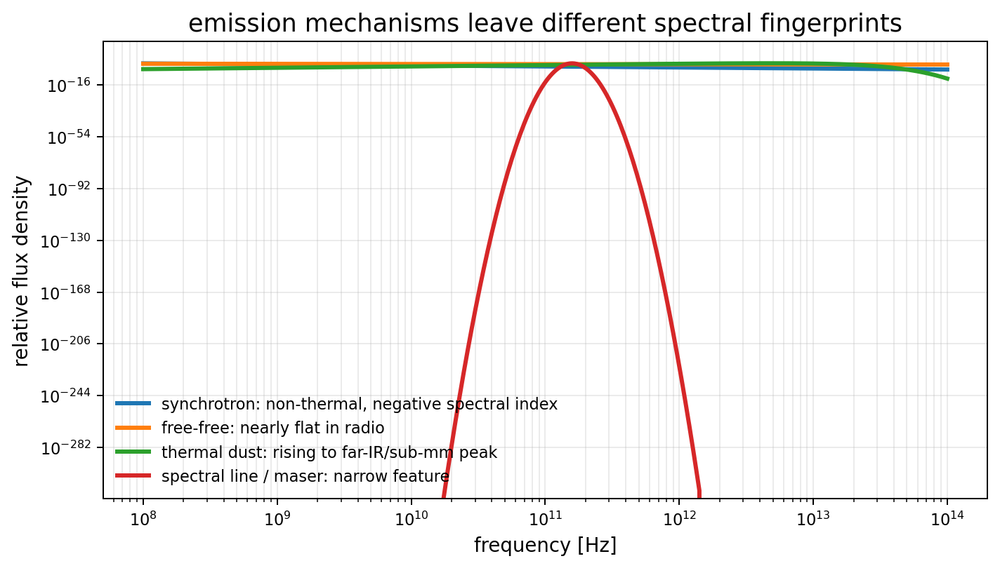

# Radiation mechanisms in astronomy and interferometers

BookAI ends by connecting interferometric images back to physical emission mechanisms. an interferometer gives structure; radiation physics says what produced the structure.

## thermal blackbody radiation

matter in thermodynamic equilibrium emits Planck radiation:

$$B_\nu(T)=\frac{2h\nu^3}{c^2}\frac{1}{e^{h\nu/kT}-1}$$

radio limit:

$$B_\nu\simeq\frac{2kT\nu^2}{c^2}$$

examples:

- stellar photospheres
- dust in star-forming regions
- protoplanetary disks
- planets

interferometry resolves the emitting region and gives brightness temperature.

## free-free emission

free-free emission, or bremsstrahlung, comes from electrons accelerated by ions in ionized gas.

examples:

- HII regions
- planetary nebulae
- hot intracluster gas

in radio it often has a relatively weak frequency dependence.

## synchrotron radiation

relativistic electrons spiral in magnetic fields. typical spectrum:

$$S_\nu\propto\nu^{-\alpha}$$

properties:

- non-thermal
- broad spectrum
- often strongly polarized
- high brightness temperature

examples:

- supernova remnants
- AGN jets
- pulsar wind nebulae

interferometric polarization maps reveal magnetic-field structure.

## line emission

atomic and molecular transitions produce spectral lines. interferometers map:

- where the gas is
- how fast it moves
- rotation curves
- outflows
- turbulence
- chemistry

ALMA is especially powerful for molecular lines in disks and star-forming regions.

## maser emission

masers are stimulated line emission. they are compact, bright, and can have extremely high brightness temperatures.

examples:

- water masers
- OH masers
- SiO masers

VLBI can measure maser proper motions and geometric distances.

## scattering and reprocessing

radiation can be absorbed, scattered, and re-emitted by dust or plasma. interferometry constrains the geometry of scattering and reprocessing regions.

## what interferometers add

| physical question | interferometric answer |
|---|---|
| where is the emission? | high angular resolution image |
| is it thermal? | brightness temperature |
| how is gas moving? | spectral-line cube |
| are magnetic fields involved? | polarization map |
| is faint structure near bright light? | high dynamic range imaging |

## exam sentence

radiation mechanisms explain what emitted the light; interferometry explains where it was emitted and under what physical conditions.

## scientific figure

reading cue: before asking what structure the interferometer resolves, ask what physical emission made the photons. thermal dust, free-free, synchrotron, lines, and masers have different spectral fingerprints.

source: local schematic plot generated from standard qualitative spectral scalings.

<!-- sources:wiki-arxiv -->
## Wikipedia and arXiv sources

*Emission spectrum of a metal halide lamp* ([Commons file page](https://commons.wikimedia.org/wiki/File:MHL.png), Philips Lighting, CC BY-SA 2.5 nl, as used on the Wikipedia article [Emission spectrum](https://en.wikipedia.org/wiki/Emission_spectrum))

- **Emission spectrum**. "The emission spectrum of a chemical element or chemical compound is the spectrum of frequencies of electromagnetic radiation emitted due to electrons making a transition from a high energy state to a lower energy state. The photon energy of the emitted photons is equal to the energy difference between the two states." ([Wikipedia](https://en.wikipedia.org/wiki/Emission_spectrum))

> Definitions quoted from Wikipedia (CC BY-SA 4.0). Figures credited in their captions.
<!-- /sources:wiki-arxiv -->

## see also

- [[Radio astronomy basics]]
- [[Polarization in interferometry]]
- [[Young stellar object disks]]
- [[AGN and supermassive black holes]]
- [[Cosmological masers]]

## Linked References

- [[Figure bank - interferometry]]
- [[Polarization in interferometry]]
- [[Astronomical_Interferometry_MOC]]

